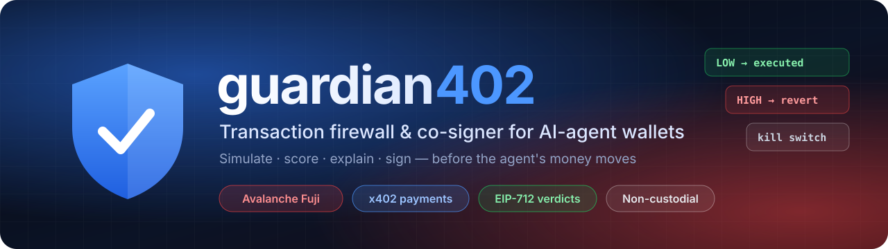
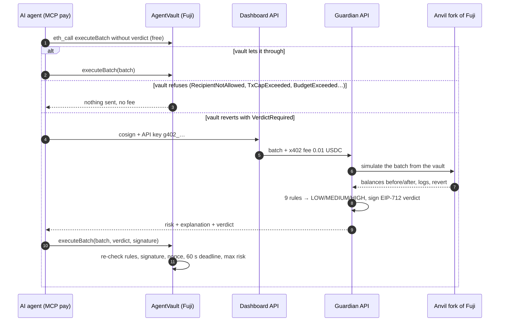
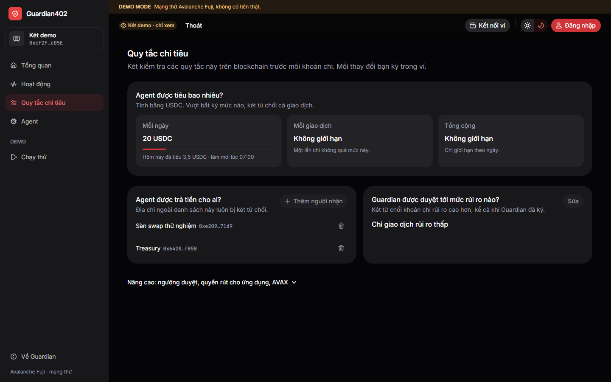

<p align="center">
  
</p>

# Guardian402

**A transaction firewall and co-signer for AI-agent wallets on Avalanche.**

Funds sit in the owner's smart-contract vault (`AgentVault`). The agent can only spend within the rules the vault enforces on-chain. When a payment needs approval, the Guardian simulates it on a fork of Fuji, scores the risk with deterministic rules, and signs an EIP-712 verdict bound to that exact batch. Each check is paid in USDC over x402.

[Live demo](https://miho-hackathon.080895.xyz) · [Evidence on Fuji](#5-evidence-on-fuji) · [Architecture](#4-architecture) · [API](docs/API.md) · [Spec](docs/SPEC.md) · [Threat model](docs/THREAT_MODEL.md) · [Tiếng Việt](README.md)

[](https://testnet.snowtrace.io/address/0xAd6BC023d60f871488394dEceE9EC2E85E553549)


[](LICENSE)

Built for Team1 Vietnam UniHack 2026, suggested topics #12, #14 and #17. Avalanche Fuji testnet only, no token.

---

## 0. Facts for reviewers

Figures below are measured at the current commit; every line has a transaction or a command to check it (sections [5](#5-evidence-on-fuji) and [10](#10-reproduce)).

```yaml
project: Guardian402
category: AI-agent payments security (transaction firewall + co-signer)
hackathon: Team1 Vietnam UniHack 2026
topics: ["#12 agent treasury with guardrails", "#14 transaction guardian", "#17 x402 on Fuji"]
network: Avalanche Fuji C-Chain, chainId 43113, testnet only
live_demo: https://miho-hackathon.080895.xyz
source: https://github.com/surinatheworld/guardian402
contracts_verified_on_snowtrace:
  VaultFactory: "0xAd6BC023d60f871488394dEceE9EC2E85E553549"
  AgentVault_demo: "0xcf2F9AD1e2665112092696F49C4BBc42b81be05E"
usdc_circle: "0x5425890298aed601595a70AB815c96711a31Bc65"
erc8004:
  identity_registry: "0x8004A818BFB912233c491871b3d84c89A494BD9e"
  reputation_registry: "0x8004B663056A597Dffe9eCcC1965A193B7388713"
  agent_id: 295
enforcement: on-chain; AgentVault.executeBatch reverts on any policy violation
risk_engine: 9 deterministic rules; same input gives the same LOW/MEDIUM/HIGH
llm_role: explanation text only (Vietnamese + English); cannot change risk or sign; off with LLM_PROVIDER=none
custody: non-custodial; the owner withdraws at any time; the Guardian key signs verdicts only
revenue: x402 per request in USDC (check 0.005, wallet check 0.005, cosign 0.01); no token
tests: { forge: 197 passed, typescript: 386 passed, fork_integration: 18 }
contract_coverage: AgentVault.sol and VaultFactory.sol 100% lines, statements, branches, functions
eval: 40 synthetic labelled cases; precision 100%, recall 100%, false positive rate 0%, p50 354 ms
mocked_parts: [MockOracle, MockRouter + mWAVAX, scripted attack feed, 3/3 lookalike threshold] # DEMO MODE, section 8
```

### Judging criteria and evidence

| Criterion                     | Main evidence                                                                                                                                                                                                                                                                                                                    | Where to check                                                                                                                                                                                                                                   |
| :---------------------------- | :------------------------------------------------------------------------------------------------------------------------------------------------------------------------------------------------------------------------------------------------------------------------------------------------------------------------------- | :----------------------------------------------------------------------------------------------------------------------------------------------------------------------------------------------------------------------------------------------- |
| Technical Implementation (25) | The vault enforces the rules on-chain; 197 Foundry tests (unit, fuzz, invariant); 100% line and branch coverage of `AgentVault` and `VaultFactory`. Pipeline: simulate, rules, explain, sign; 386 TypeScript tests. Verdicts signed in TypeScript are cross-checked by the contract. CI runs build, typecheck, lint and tests.   | [`AgentVault.sol`](contracts/src/AgentVault.sol), [`contracts/test/`](contracts/test), [`pipeline.ts`](apps/guardian/src/pipeline.ts), [`VerdictCrossCheck.t.sol`](contracts/test/VerdictCrossCheck.t.sol), [`ci.yml`](.github/workflows/ci.yml) |
| Avalanche Integration (25)    | 6 contracts verified on Fuji. x402 fees settle in Circle's USDC on the C-Chain (EIP-3009). Identity and reputation on the official ERC-8004 registries. Simulation on an Anvil fork of Fuji. Routescan lookup for unknown contracts. Core wallet support.                                                                        | [Section 5](#5-evidence-on-fuji), [`x402.ts`](apps/guardian/src/x402.ts), [`erc8004.fuji.json`](packages/shared/src/addresses/erc8004.fuji.json), [`explorer.ts`](apps/guardian/src/explorer.ts)                                                 |
| Creativity & Innovation (15)  | Two independent layers: on-chain rules still block when the agent skips the Guardian; the verdict is bound to the batch hash, a nonce and a 60-second deadline. Risk-based fees: the vault checks itself for free first, and the Guardian is paid only when the vault asks for approval. The LLM never decides where money goes. | [Section 3](#3-solution-two-layers-of-protection), [`agent-tools.ts`](apps/guardian-mcp/src/agent-tools.ts#L213)                                                                                                                                 |
| Impact & Use Case (15)        | Operators of AI agents hand money to an agent without handing over full control. The MCP tool `pay` works with any MCP-capable agent. The wallet check page serves any wallet before it signs.                                                                                                                                   | [Section 6](#6-try-it), [`packages/mcp-agent/`](packages/mcp-agent), [`/kiem-tra-vi`](https://miho-hackathon.080895.xyz/kiem-tra-vi)                                                                                                             |
| UI/UX & Demo (10)             | Vietnamese dashboard: create a vault in one transaction, simulate scenarios, see each blocked or executed transaction with its explanation, kill switch.                                                                                                                                                                         | [Public deployment](https://miho-hackathon.080895.xyz), screenshots in [section 6](#6-try-it)                                                                                                                                                    |

### Suggested topics covered

| Topic                              | Core requirement                           | How Guardian402 meets it                                                                                                                                                |
| :--------------------------------- | :----------------------------------------- | :---------------------------------------------------------------------------------------------------------------------------------------------------------------------- |
| #12 Agent treasury with guardrails | An agent manages funds within owner limits | `AgentVault`: recipient and app allowlists, daily, per-transaction and total-budget caps, kill switch, maximum risk. `VaultFactory` creates a vault in one transaction. |
| #14 Transaction Guardian           | Check a transaction before signing         | `POST /v1/wallet/check` and the `/kiem-tra-vi` page: simulate from any wallet's address, 7 rules, explanations in Vietnamese and English.                               |
| #17 x402 on Fuji                   | A pay-per-call service over x402           | `check`, `cosign` and `wallet/check` charge USDC on Fuji over x402 2.28.0; a self-hosted facilitator is included; the Guardian is also a paid MCP server.               |

## 1. The problem

Giving an AI agent a wallet key gives it unrestricted spending power. The agent can:

- misread an instruction, or be prompt-injected into sending a malicious transaction;
- send funds to a scam address or a lookalike of a real one;
- grant an unlimited `approve` or call an unvetted router;
- spend more than the owner intended.

Rules that live in the agent's software or on a server can be bypassed by whoever holds the agent key. Rules only bind when the agent cannot get around them, so Guardian402 puts them in the smart contract that holds the funds.

Guardian402 is not an AI agent. It is infrastructure between an agent's decision and the right to spend.

## 2. The three required questions

| Question                        | Answer                                                                                                                                                                                                                                                                                                                                                                                                                                                                                                   |
| :------------------------------ | :------------------------------------------------------------------------------------------------------------------------------------------------------------------------------------------------------------------------------------------------------------------------------------------------------------------------------------------------------------------------------------------------------------------------------------------------------------------------------------------------------- |
| Why on-chain?                   | The vault is the one place the agent cannot bypass: every call goes through `executeBatch`, and a rule violation reverts with the funds left in place. The vault verifies the verdict signature at execution time, so no server has to be trusted. The owner keeps the right to withdraw and to lock the vault.                                                                                                                                                                                          |
| Why Avalanche?                  | Circle's USDC on the C-Chain supports EIP-3009, which x402's `exact` scheme needs: the agent only signs and the facilitator submits. C-Chain fees and block times are low enough to charge fractions of a cent per call and to land the agent's transaction within the verdict's 60-second window. Anvil forks of the C-Chain let the Guardian simulate on near-current Fuji state. The official ERC-8004 registries are live on Fuji.                                                                   |
| Where does the money come from? | Per-call fees in USDC over x402: 0.005 USDC for `check` and `wallet/check`, 0.01 USDC for `cosign`, charged only on a successful response. A payment the vault refuses on its own, or a small one below the approval threshold, never calls the Guardian and costs nothing. No token, no token sale, no yield.                                                                                                                                                                                           |
| Legal limits in Vietnam         | Crypto assets are not legal tender in Vietnam, so the product runs only on Fuji with valueless test tokens. It holds no user funds, raises no capital and gives no investment advice. On-chain data is limited to hashes, payments and state; dashboard accounts (email, hashed password) stay in the dashboard server's database. A mainnet launch for Vietnamese users would need review against the Law on Digital Technology Industry (2025) and the pilot programme under Resolution 05/2025/NQ-CP. |

## 3. Solution: two layers of protection

| Layer                        | Runs where                        | What it does                                                                                             | When a compromised agent skips the Guardian                                 |
| :--------------------------- | :-------------------------------- | :------------------------------------------------------------------------------------------------------- | :-------------------------------------------------------------------------- |
| 1. On-chain rules            | `AgentVault` on Fuji              | Checks every agent call: recipient, app, caps, verdict, kill switch. One violation reverts the batch.    | Still blocks                                                                |
| 2. Simulation and risk score | Guardian API + Anvil fork of Fuji | Simulates the batch, scores it with 9 rules, explains it, signs an EIP-712 verdict for that exact batch. | The vault requires a verdict, so calls that need approval are still blocked |

### Layer 1: `AgentVault`

Every agent call goes through [`executeBatch`](contracts/src/AgentVault.sol#L248), up to 8 calls per batch. Checks, in order:

1. The vault is not paused; the caller is the agent the owner set.
2. Each call passes [`_checkCall`](contracts/src/AgentVault.sol#L566): a token call must be an exactly encoded `transfer` or `approve`; the recipient must be allowlisted; the contract and function called must be allowed; an `approve` may not exceed the maximum (`ApprovalTooLarge`).
3. With a verdict: matching batch hash, matching `verdictNonce`, not expired, signed by the Guardian, risk not above `maxAgentRisk` ([`_verifyVerdict`](contracts/src/AgentVault.sol#L610)). The nonce increments before any external call.
4. Run the batch, then revoke whatever approval it did not use ([`_revokeApprovals`](contracts/src/AgentVault.sol#L651)).
5. Measure the actual balance decrease of each token and of AVAX; enforce the daily cap (per UTC day), the per-transaction cap (`maxPerTx`) and the total budget (`budget`) ([`_recordOutflow`](contracts/src/AgentVault.sol#L680)).
6. Require a verdict (`VerdictRequired`) when an outflow exceeds `verdictThreshold`, when the batch approves, or when the batch calls a contract and lowers a balance.

Owner rights: withdraw at any time, even while paused; change the agent or the Guardian; edit rules; reset the budget; run calls directly with `ownerExecute`. `renounceOwnership` is disabled. [`VaultFactory`](contracts/src/VaultFactory.sol#L21) creates a vault in one transaction and keeps no rights over it.

### Layer 2: Guardian API

[`Pipeline.run`](apps/guardian/src/pipeline.ts#L113): validate input → read the vault's rules → simulate on the fork → run the rules → explain → sign the verdict (`cosign` only) → store → respond.

| Rule                        | Detects                                                                                                               | Level                                                                     |
| :-------------------------- | :-------------------------------------------------------------------------------------------------------------------- | :------------------------------------------------------------------------ |
| `SIMULATION_FAILED`         | The batch reverts in simulation                                                                                       | HIGH                                                                      |
| `POLICY_PRECHECK`           | The vault would refuse: recipient not allowed, cap or budget exceeded, vault paused                                   | HIGH                                                                      |
| `UNLIMITED_APPROVAL`        | Unlimited `approve`, above the maximum, or to a non-allowlisted spender; `setApprovalForAll`                          | HIGH                                                                      |
| `UNKNOWN_CONTRACT`          | A contract outside the known-contracts registry                                                                       | MEDIUM; HIGH when it receives funds, is unverified or is under 7 days old |
| `ADDRESS_POISONING`         | Lookalike address: same first 4 and last 4 characters as a trusted address, or at most 4 characters different from it | HIGH                                                                      |
| `DRAIN_PATTERN`             | One batch moves 50% or more of a balance, unless all of it goes to allowlisted recipients                             | HIGH                                                                      |
| `ABNORMAL_SLIPPAGE`         | A swap returns less than the reference price                                                                          | MEDIUM from 2%, HIGH from 10%                                             |
| `RECIPIENT_NOT_ALLOWLISTED` | Funds or swap output go to an address outside the allowlist                                                           | HIGH                                                                      |
| `UNPROTECTED_SWAP`          | `minOut` more than 3% below the simulated output                                                                      | MEDIUM                                                                    |

Thresholds live in [`config/rules.json`](apps/guardian/config/rules.json). A check of an arbitrary wallet runs 7 rules, without the two that read a vault policy (`POLICY_PRECHECK`, `RECIPIENT_NOT_ALLOWLISTED`). The Routescan lookup for unknown contracts is enabled with `EXPLORER_LOOKUP=true`.

**Role of the LLM.** By default the Guardian uses fixed templates. When enabled (Anthropic, Gemini or an OpenAI-compatible API), the LLM only writes the explanation from the simulation result. Text that contradicts the risk level, is malformed, or takes longer than 1.5 s is replaced by the template ([`llm.ts`](apps/guardian/src/explain/llm.ts#L49)). The explainer module imports no signer and no wallet.

## 4. Architecture

Flow of the MCP tool `pay` ([`agent-tools.ts`](apps/guardian-mcp/src/agent-tools.ts#L213)); the dashboard's "try it on the web" button runs the same flow.



| Component       | Path                                        | Role                                                                                                         |
| :-------------- | :------------------------------------------ | :----------------------------------------------------------------------------------------------------------- |
| Contracts       | [`contracts/`](contracts)                   | `AgentVault`, `VaultFactory`, DEMO mocks; Solidity 0.8.28, OpenZeppelin 5.7.0, EVM `cancun`                  |
| Shared          | [`packages/shared/`](packages/shared)       | ABIs, addresses, EIP-712 types, zod schemas, RPC with fallback                                               |
| Guardian API    | [`apps/guardian/`](apps/guardian)           | x402 paywall, simulator, rules, explainer, verdict signer, SQLite store                                      |
| MCP servers     | [`apps/guardian-mcp/`](apps/guardian-mcp)   | Agent-side MCP (`get_rules`, `check_payment`, `pay`, `get_transaction`); the Guardian as a paid MCP server   |
| MCP npm package | [`packages/mcp-agent/`](packages/mcp-agent) | Bundled `guardian402-mcp` build of the agent-side MCP server                                                 |
| Dashboard       | [`apps/dashboard/`](apps/dashboard)         | Next.js 16, Vietnamese UI: accounts (email or SIWE), vault creation, rules, activity, agents, agent REST API |
| Demo agent      | [`apps/agent/`](apps/agent)                 | Scenarios S0–S6, local control API                                                                           |
| Eval            | [`eval/`](eval)                             | 40 labelled cases, runner, report                                                                            |
| Scripts         | [`scripts/`](scripts)                       | Fork, deploy, seed, ERC-8004, run the whole stack                                                            |

## 5. Evidence on Fuji

Every transaction below ran on the real Avalanche Fuji network and can be checked on Snowtrace.

### 5.1 Verified contracts

| Contract                                  | Address                                                                                                                         |
| :---------------------------------------- | :------------------------------------------------------------------------------------------------------------------------------ |
| VaultFactory                              | [`0xAd6BC023d60f871488394dEceE9EC2E85E553549`](https://testnet.snowtrace.io/address/0xAd6BC023d60f871488394dEceE9EC2E85E553549) |
| AgentVault (demo vault, S0–S6)            | [`0xcf2F9AD1e2665112092696F49C4BBc42b81be05E`](https://testnet.snowtrace.io/address/0xcf2F9AD1e2665112092696F49C4BBc42b81be05E) |
| MockRouter (DEMO)                         | [`0xe20967C615e442991D468ed7f797edcAeA1771d9`](https://testnet.snowtrace.io/address/0xe20967C615e442991D468ed7f797edcAeA1771d9) |
| MockOracle (DEMO)                         | [`0xeebAac693aA19308bA859b3D668e3794310e66AE`](https://testnet.snowtrace.io/address/0xeebAac693aA19308bA859b3D668e3794310e66AE) |
| mWAVAX (DEMO)                             | [`0xC2439b70B85CF5fBD5A7dA935567e476bFc97ba5`](https://testnet.snowtrace.io/address/0xC2439b70B85CF5fBD5A7dA935567e476bFc97ba5) |
| CancunSmoke (Fuji EVM check)              | [`0x0D363882aA2DdA271323F91a1a268Cd707D3C426`](https://testnet.snowtrace.io/address/0x0D363882aA2DdA271323F91a1a268Cd707D3C426) |
| USDC (Circle's, not deployed by the team) | [`0x5425890298aed601595a70AB815c96711a31Bc65`](https://testnet.snowtrace.io/address/0x5425890298aed601595a70AB815c96711a31Bc65) |

The Guardian holds an ERC-8004 identity as agent **#295** on the official IdentityRegistry [`0x8004A818…4BD9e`](https://testnet.snowtrace.io/address/0x8004A818BFB912233c491871b3d84c89A494BD9e) ([registration transaction](https://testnet.snowtrace.io/tx/0x6d22083e006da209338f289b5389f1486902233f859bcfe00b179512b8658001)). A vault owner reviews a check and writes "right" or "false alarm" to the official ReputationRegistry; the About Guardian page counts only feedback from wallets that own a vault created through `VaultFactory`, and the Guardian's own key cannot rate itself. Previous demo vault (older code, left as is): [`0x6A8C…Cf3c`](https://testnet.snowtrace.io/address/0x6A8CCC880238DF1f4309d1B04EDFBD6017A4Cf3c).

### 5.2 Main flow with a MetaMask wallet (2026-11-13)

Vault [`0xff0d…9C2d`](https://testnet.snowtrace.io/address/0xff0db552A0Ffe0464273DAe402dd19efB7Bc9C2d), created on the Get Started page: pay only the Treasury, at most 2 USDC per transaction, 5 USDC in total. The agent calls the MCP server's `pay`.

| Step                               | Actor           | Result                                                                                                                                                                                                                         |
| :--------------------------------- | :-------------- | :----------------------------------------------------------------------------------------------------------------------------------------------------------------------------------------------------------------------------- |
| Deposit 10 USDC into the vault     | Owner, MetaMask | [tx](https://testnet.snowtrace.io/tx/0xe14a3197b03ce8dcc7855bf37aa24feb2163389c6108f2751e8d7a89dd187bf3)                                                                                                                       |
| Pay 1 USDC to the Treasury         | Agent           | low risk, [executed](https://testnet.snowtrace.io/tx/0xa7db521a54613d8a92fccbb7b331ec28bf48e2d7c0aac1bfcb2fa84920e8ed97)                                                                                                       |
| Pay 2.5 USDC                       | Agent           | blocked: over the per-transaction cap, nothing sent                                                                                                                                                                            |
| Pay 2 USDC, then 2 USDC            | Agent           | [executed](https://testnet.snowtrace.io/tx/0x42170a0049edecfd3c7228b25aaae7e835b6627b7587d367f502904dff8c9607), [executed](https://testnet.snowtrace.io/tx/0xf7103a3222f7e599ece9413f50de34cce170c1a979d5d95d3debd1d857e91edd) |
| Pay 0.5 USDC after spending 5 USDC | Agent           | blocked: total budget used up                                                                                                                                                                                                  |
| Reset the budget                   | Owner, MetaMask | budget back to 5 USDC                                                                                                                                                                                                          |
| Pay 1 USDC after the reset         | Agent           | [executed](https://testnet.snowtrace.io/tx/0xd5e2f1963f288ac01983708ff5d181ee9aaa57cf2db1b57f3cb5b58638b166d6)                                                                                                                 |
| Withdraw 2 USDC to the wallet      | Owner, MetaMask | succeeded                                                                                                                                                                                                                      |

### 5.3 Risk-based fees (2026-11-15)

`pnpm happy-path:fuji` with `HAPPY_PATH_UNIT=0.2`. Vault [`0x0BBc…A1bE`](https://testnet.snowtrace.io/address/0x0BBcE9a627A205C7C620a556261Fe23d7290A1bE), created through VaultFactory ([tx](https://testnet.snowtrace.io/tx/0x70d022f02d593f860c0c3408f4effb2ed7d1cf47134bc93b5612cb2fce059924), [1.2 USDC deposit](https://testnet.snowtrace.io/tx/0x37289c1d379b54b2c6c801a8b7cad38e74261e0ce61dc0fb267d85e180fc299f)): pay only the Treasury, at most 0.4 USDC per transaction, 0.7 USDC in total, payments up to 0.1 USDC without the Guardian.

| Amount   | Vault self-check (free) | Guardian                                                                                                                 | Result                                                                                                     |
| :------- | :---------------------- | :----------------------------------------------------------------------------------------------------------------------- | :--------------------------------------------------------------------------------------------------------- |
| 0.1 USDC | lets it through         | not called, no fee                                                                                                       | [paid](https://testnet.snowtrace.io/tx/0x7b4488a4cd85b770e5f849795b504b8ba36783cefa67a1bd0fb09eb04839b5f8) |
| 0.2 USDC | approval required       | LOW, [0.01 USDC fee](https://testnet.snowtrace.io/tx/0xe5b22ee55c47646680c00b093a68a9091da6b1dbf2e9f66b471bc46e614548d1) | [paid](https://testnet.snowtrace.io/tx/0x6690c25d240b54e10936a06af331c40e04de58c54f20b77132dfd3a9be9d3915) |
| 0.5 USDC | `TxCapExceeded`         | not called, no fee                                                                                                       | nothing sent                                                                                               |
| 0.4 USDC | approval required       | LOW, [0.01 USDC fee](https://testnet.snowtrace.io/tx/0x628715afc7c31c8eda72ae2eb72111351e918b235bac418475c6243250412ff4) | [paid](https://testnet.snowtrace.io/tx/0x23701067d01e4cfcfea76a0ab7d41a9ed0b0e39a6b41d769d9986de467c5924f) |
| 0.1 USDC | `BudgetExceeded`        | not called, no fee                                                                                                       | nothing sent                                                                                               |

### 5.4 Attack scenarios S0–S6

| ID  | Scenario                                                       | Guardian | Vault                                                                                                                                                                                                                                          |
| :-- | :------------------------------------------------------------- | :------- | :--------------------------------------------------------------------------------------------------------------------------------------------------------------------------------------------------------------------------------------------- |
| S0  | Transfer 1.5 USDC to the Treasury                              | LOW      | [executed](https://testnet.snowtrace.io/tx/0x02b10072b18e80301ccd5fdfa8e0193d74fac595c83a1dbdeec677dea0444eb1)                                                                                                                                 |
| S1  | Swap 2 USDC for mWAVAX with `minOut`                           | LOW      | [executed](https://testnet.snowtrace.io/tx/0x643d89ad6e6e526bdc2bc5f2d9a0084263c68564235104d4a0c418b94a090e00)                                                                                                                                 |
| S2  | Prompt-injected agent drains the vault to the attacker         | HIGH 100 | [`RecipientNotAllowed`](https://testnet.snowtrace.io/tx/0x18f9908fedaf48e0e7ca4eea3e1b5020470d333869412ac90ff0cf6a25e132ae)                                                                                                                    |
| S3  | Unlimited approval to a lookalike of the swap router           | HIGH 100 | [`RecipientNotAllowed`](https://testnet.snowtrace.io/tx/0xb0a0846cf4297693f3e6508d50b631e7fff1e51542c620435a9c640c8ac00fce)                                                                                                                    |
| S4  | Swap through a pool priced 30% off, `minOut = 0`               | HIGH 85  | [`RiskTooHigh`](https://testnet.snowtrace.io/tx/0x1220fd094ecbbc621c6640f15c9570092f34cfd330b329271432473d8f3869f5)                                                                                                                            |
| S5  | Reuse an old approval for another batch, then after it expires | LOW      | [`InvalidVerdict`](https://testnet.snowtrace.io/tx/0x9924ab795e1974f6232321d1fee49c6046213d494790f72da4f86d74eb5ab056), [`VerdictExpired`](https://testnet.snowtrace.io/tx/0x885d3cb381d11d9d55b98c7bd96b7f174abddc9d406c283c582c7496d620a51f) |
| S6  | The agent spends after the owner triggered the kill switch     | HIGH 60  | [`Paused`](https://testnet.snowtrace.io/tx/0xe61ec50818bdbe9d5844e2546a7d2ff3902ef71ff09d083e8100482b19b61161)                                                                                                                                 |

- S2, S3: the compromised agent sends straight to the vault without the Guardian; layer 1 still refuses.
- S4: passes every static rule of the vault; only layer 2's simulation reveals the mispriced pool.
- Every Guardian call has a real x402 payment transaction, for example [the fee for S0](https://testnet.snowtrace.io/tx/0xadf11f6a7b76b4a10b830d8cd978b0fe50bc0e6734ce72aee852204e8b2e4741).

### 5.5 Automated tests

| Suite                                             | Result                                                                                 | Command                                                                 |
| :------------------------------------------------ | :------------------------------------------------------------------------------------- | :---------------------------------------------------------------------- |
| Contracts: unit, fuzz, invariant                  | 197/197                                                                                | `cd contracts && forge test`                                            |
| Coverage of `AgentVault.sol`, `VaultFactory.sol`  | 100% lines, statements, branches, functions                                            | `forge coverage --report summary --no-match-coverage "(test\|script)/"` |
| TypeScript, 7 packages                            | 386/386                                                                                | `pnpm test`                                                             |
| Guardian on a Fuji fork                           | 18 tests                                                                               | `pnpm --filter @guardian402/guardian test:fork`                         |
| Verdict signed in TypeScript, checked in Solidity | pass                                                                                   | `pnpm test:crosscheck`                                                  |
| Eval, 40 labelled cases written by the team       | precision 100%, recall 100%, false positives 0%, p50 354 ms ([report](eval/report.md)) | `pnpm eval`                                                             |

The eval uses synthetic cases written by the team, not real user transactions; the result does not mean the Guardian catches every real attack.

## 6. Try it

**No wallet needed.** Open [miho-hackathon.080895.xyz](https://miho-hackathon.080895.xyz), click **Xem két demo** (view demo vault) on the sign-in page, then open **Chạy thử** (try it) to have the Guardian score a scenario. It is free and sends nothing on-chain. The dashboard UI is in Vietnamese.

**No vault needed.** The [**Kiểm tra ví**](https://miho-hackathon.080895.xyz/kiem-tra-vi) (wallet check) page checks a transaction from any wallet before it signs: an approval, a transfer, or the raw data a website sends to the wallet. Wallets and apps call `POST /v1/wallet/check` (0.005 USDC over x402).

**Vault owner, one-time setup:**

1. Sign in with a wallet (Sign-In with Ethereum: sign a message, free) or with email. [Core](https://core.app) and MetaMask are supported on Avalanche Fuji.
2. Create a vault on the Get Started page: choose the agent wallet, recipients and limits, then sign one `VaultFactory.createVault` transaction. One more button deposits USDC.
3. Connect the agent: get an API key (`g402_…`) and the MCP configuration. The **Thử ngay trên web** (try it on the web) button shows one valid payment and one blocked payment.
4. Monitor from Overview and Activity. Resetting the budget, editing rules, withdrawing and the kill switch are transactions the owner signs.

**The agent** needs the API URL (`https://<dashboard>/api/agent/v1`), the API key and the agent wallet's private key. The private key stays on the machine running the agent. The API key cannot withdraw funds or change rules.

| MCP tool          | Purpose                                                                                                                | Fee                                                                                |
| :---------------- | :--------------------------------------------------------------------------------------------------------------------- | :--------------------------------------------------------------------------------- |
| `get_rules`       | Read the vault's rules and remaining limits, phrased as guidance for the agent                                         | free                                                                               |
| `check_payment`   | Check a payment without sending it                                                                                     | 0.005 USDC                                                                         |
| `pay`             | The vault checks itself first; a payment it lets through goes straight out, otherwise Guardian approval then execution | 0.01 USDC when approval is needed; 0 when the vault blocks or the payment is small |
| `get_transaction` | Look up the outcome of a transaction                                                                                   | free                                                                               |

MCP configuration, Agent REST API and Guardian API: [docs/API.md](docs/API.md).

|           Activity: what the Guardian scored and what the vault decided           | Spending rules: caps, recipients, risk level  |
| :-------------------------------------------------------------------------------: | :-------------------------------------------: |
|  |  |

## 7. Scope: supported and not supported

| Supported                                                                             | Not supported, and why                                                                                                                                      |
| :------------------------------------------------------------------------------------ | :---------------------------------------------------------------------------------------------------------------------------------------------------------- |
| ERC-20 and AVAX transfers to allowlisted recipients                                   | Arbitrary contract calldata: V1 understands token transfers and swaps through known routers only                                                            |
| Swaps through an allowed router, slippage checked against an oracle                   | Arguments inside a call to an allowed contract (for example a swap's recipient): the vault does not read them; the Guardian's rules and the caps cover this |
| Daily cap per UTC day, per-transaction cap, total budget                              | A rolling 24-hour window: around 00:00 UTC up to twice the daily cap can be spent; the per-transaction cap and total budget still hold                      |
| Checking any wallet's transaction before it signs (advice, not a block)               | Enforced blocking inside the user's wallet: needs integration with wallet vendors                                                                           |
| Small payments below the approval threshold run without the Guardian, within the caps | A leaked agent key: an attacker can still make small payments to allowlisted recipients, within the caps                                                    |
| The owner keeps full control                                                          | A leaked owner key: whoever holds it can change rules and use `ownerExecute`, by design                                                                     |
| Simulation right before the verdict is signed                                         | Chain state changing between simulation and inclusion: set `minOut` on-chain                                                                                |
| Blocking swaps beyond the slippage threshold                                          | Market losses: a valid swap within the threshold can still lose value                                                                                       |
| Blocking malicious transactions after an agent is injected                            | Defending against prompt injection at the prompt level                                                                                                      |
| Assets held in the vault                                                              | Assets outside `AgentVault`                                                                                                                                 |

Operational notes: the Guardian's Fuji fork is refreshed every few minutes, so a payment right after a deposit may take a few extra seconds. The public deployment scores scenarios S0–S6 but does not send them on-chain; running them for real requires a local setup ([section 9](#9-running-locally)). Full threat model: [docs/THREAT_MODEL.md](docs/THREAT_MODEL.md).

## 8. Simulated components (DEMO MODE)

Each part below sits behind a configuration flag, shows a `DEMO MODE` banner in the dashboard, and is declared at the start of the pitch.

| Part                         | Stands in for                                                    | Flag or location                                                              |
| :--------------------------- | :--------------------------------------------------------------- | :---------------------------------------------------------------------------- |
| MockOracle                   | A real price oracle; fixed price of 25 USDC per mWAVAX           | [`contracts/src/mocks/`](contracts/src/mocks)                                 |
| MockRouter and mWAVAX        | A real DEX; two pools, pool 1 priced 30% off                     | [`contracts/src/mocks/`](contracts/src/mocks)                                 |
| "Prompt injection" feed      | A real LLM agent; read from a fixed fixture so the demo repeats  | [`apps/agent/fixtures/feed.json`](apps/agent/fixtures/feed.json), `DEMO_MODE` |
| 3/3 lookalike threshold      | The production 4/4 threshold                                     | `DEMO_MODE`, [`rules.json`](apps/guardian/config/rules.json)                  |
| Self-hosted x402 facilitator | A public facilitator, when it rate-limits or for an offline demo | `FACILITATOR_URL`, `pnpm facilitator`                                         |

## 9. Running locally

**Requirements:** Node.js ≥ 22.13, pnpm 10 (`corepack enable pnpm`), Foundry 1.8.5, Git. If Windows blocks `anvil.exe`, Docker Desktop is needed (the fork runs in the `ghcr.io/foundry-rs/foundry:v1.8.5` image). On Windows, run commands from Git Bash and clone into a short path (for example `C:\code`) or enable `git config --global core.longpaths true`.

```bash
git clone --recurse-submodules https://github.com/surinatheworld/guardian402
cd guardian402
pnpm install
```

```bash
./run-local.sh
```

Runs everything on a fork of Fuji, with no test tokens needed: the first run creates `.env.local` with fresh testnet keys and seeds sample data. Starts the fork (8545), the x402 facilitator (4022), the Guardian API (4402), the agent API (4403) and the dashboard (http://localhost:3000); logs in `.run-local/logs/`. Stop with `Ctrl+C` or `./run-local.sh stop`.

```bash
./run-local.sh fuji
```

Runs on the real Fuji network: vault, x402 fees and transactions are all on Fuji; the fork is used only for the Guardian's simulation. Needs testnet keys funded with AVAX and test USDC ([faucet.circle.com](https://faucet.circle.com), [Core faucet](https://core.app/tools/testnet-faucet)).

```bash
./run-local.sh scenario all
```

Runs the seven scenarios S0–S6 (a single one: `scenario S2`). Full command list: [CLAUDE.md](CLAUDE.md#commands).

## 10. Reproduce

| To check                      | Command                                                              | Expected result                                      |
| :---------------------------- | :------------------------------------------------------------------- | :--------------------------------------------------- |
| Contracts                     | `cd contracts && forge test`                                         | `197 tests passed, 0 failed`                         |
| TypeScript                    | `pnpm test && pnpm typecheck && pnpm lint`                           | 386 tests pass, no type errors, no lint errors       |
| Verdict TypeScript ↔ Solidity | `pnpm test:crosscheck`                                               | `VerdictCrossCheck` passes                           |
| Eval                          | `pnpm fork`, then `pnpm eval`                                        | fingerprint `75b364aac5a8179c` in `eval/report.md`   |
| Scenarios S0–S6               | `./run-local.sh`, then `./run-local.sh scenario all`                 | every scenario matches the table in 5.4, exit code 0 |
| Main flow on Fuji             | Guardian (`NETWORK=fuji`) and dashboard, then `pnpm happy-path:fuji` | the 5 payments of 5.3, exit code 0                   |

## 11. Documentation

| Document                                     | Contents                                                    |
| :------------------------------------------- | :---------------------------------------------------------- |
| [docs/SPEC.md](docs/SPEC.md)                 | Technical specification and change log                      |
| [docs/API.md](docs/API.md)                   | Public endpoints, Guardian API, Agent REST API, MCP servers |
| [docs/THREAT_MODEL.md](docs/THREAT_MODEL.md) | Threat model and security reviews                           |
| [docs/DEMO_RUNBOOK.md](docs/DEMO_RUNBOOK.md) | Pitch runbook                                               |
| [docs/PROGRESS.md](docs/PROGRESS.md)         | Per-phase log and test results (Vietnamese)                 |
| [eval/report.md](eval/report.md)             | Eval report (Vietnamese)                                    |

License: [MIT](LICENSE).
