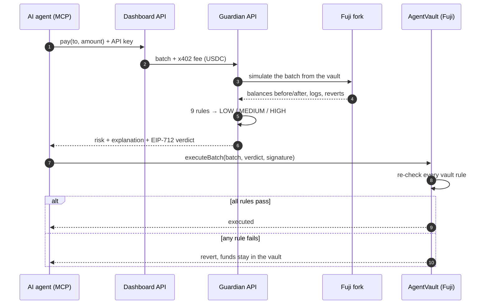
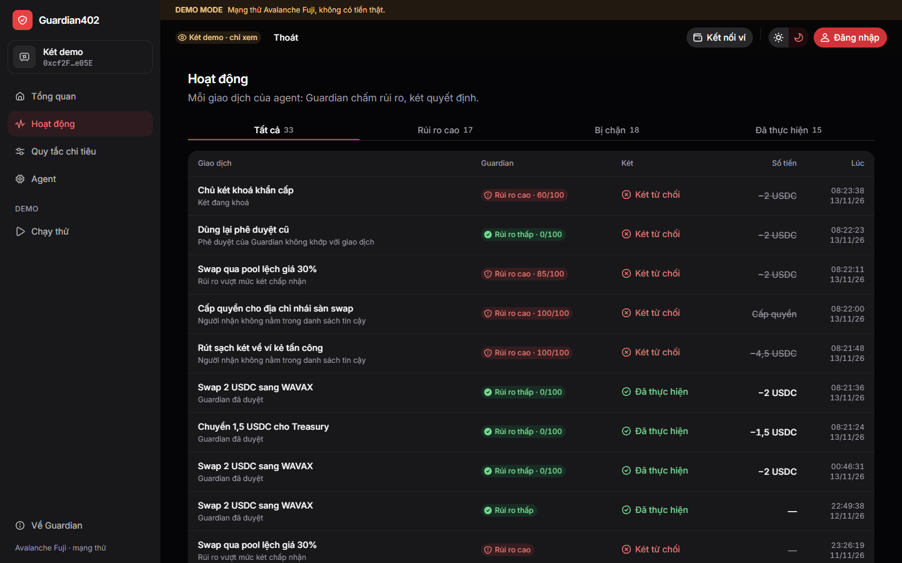

<p align="center">
  
</p>

<h1 align="center">Guardian402</h1>

<p align="center">
  <b>Let AI agents spend money, within the limits you set.</b><br />
  Funds stay in your own vault (a smart contract) on Avalanche. The agent can only spend within the vault's rules, and risky payments must first be simulated, scored and co-signed by the Guardian.
</p>

<p align="center">
  <a href="https://testnet.snowtrace.io/address/0xAd6BC023d60f871488394dEceE9EC2E85E553549"></a>
  
  
  
  
  <a href="LICENSE"></a>
</p>

<p align="center">
  
  
  
  
</p>

<p align="center">
  <a href="https://miho-hackathon.080895.xyz"><b>Live demo</b></a> ·
  <a href="#2-two-layers-of-protection">How it works</a> ·
  <a href="#3-evidence-on-fuji">Evidence</a> ·
  <a href="#8-running-locally">Setup</a> ·
  <a href="docs/API.md">API</a> ·
  <a href="docs/THREAT_MODEL.md">Security</a> ·
  <a href="README.md">Tiếng Việt</a>
</p>

> Guardian402 is a transaction firewall and co-signer for AI-agent wallets on Avalanche: on-chain spending rules, simulation before execution, and signed risk verdicts, paid per request over x402. Built for Team1 Vietnam UniHack 2026. Runs on Avalanche Fuji testnet only.

<p align="center">
  
</p>

## At a glance

1. **The problem.** Handing a wallet key to an AI agent grants it unrestricted spending power. A single misread instruction or prompt injection is enough to lose funds.
2. **Two layers of protection.** The `AgentVault` contract enforces spending rules on-chain, even when the agent bypasses the Guardian. The Guardian simulates each transaction beforehand, scores its risk with nine deterministic rules, and signs an approval bound to that exact transaction.
3. **Minimal trust.** The LLM only writes explanations and can be disabled entirely. The Guardian holds no funds and cannot move them. The vault owner can withdraw at any time.
4. **Pay-per-call revenue.** 0.005 USDC per check and 0.01 USDC per check with co-signature, paid over x402. No token.
5. **Proven on Fuji.** The main flow with a real MetaMask wallet and seven attack scenarios (S0–S6) ran end to end, each step linked on Snowtrace.

**Contents:** [1. The problem](#1-the-problem) · [2. Two layers of protection](#2-two-layers-of-protection) · [3. Evidence on Fuji](#3-evidence-on-fuji) · [4. Business model and why Avalanche](#4-business-model-and-why-avalanche) · [5. Try it](#5-try-it) · [6. Limitations](#6-limitations) · [7. Simulated components (DEMO MODE)](#7-simulated-components-demo-mode) · [8. Running locally](#8-running-locally) · [9. Documentation](#9-documentation)

---

## 1. The problem

Suppose you give an AI agent 50 USDC to pay for services, settle with partners or swap tokens. If the agent holds the wallet's private key directly, nothing prevents it from:

- misinterpreting an instruction, or falling victim to **prompt injection** and sending a malicious transaction;
- sending funds to a scam address, or to a lookalike of a legitimate address;
- granting an unlimited `approve` or calling an unverified router;
- spending more than you intended.

Spending rules only matter if the agent cannot get around them. Rules that live in the agent's software or on a server can be skipped by anyone holding the agent's key. Guardian402 therefore enforces its rules in a smart contract.

> [!IMPORTANT]
> Guardian402 is not an AI agent. It is infrastructure that sits between an agent's decisions and its access to funds: the agent can act, but it never gains full control over the owner's assets.

## 2. Two layers of protection



### Layer 1: on-chain rules (`AgentVault.sol`)

Every agent action goes through `executeBatch`. If any rule fails, the call reverts and the funds stay in the vault. This layer still holds when a compromised agent bypasses the Guardian and calls the vault directly.

- **Designated agent only:** only the agent appointed by the owner can call `executeBatch`.
- **Recipients and applications:** payments go only to allowlisted addresses; only approved contracts and functions can be called.
- **Per-token limits:** a daily cap (measured on the vault's actual balance decrease, reset at 00:00 UTC), a per-transaction cap (`maxPerTx`) and a total budget (`budget`; once exhausted, the owner must call `resetBudget`). Native AVAX has its own limits.
- **Restricted `approve`:** allowances can only go to allowlisted addresses, are capped (`ApprovalTooLarge`), and any allowance a batch leaves unused is revoked as soon as the batch completes.
- **Verdict required** for transfers above a threshold, for every `approve`, and for every outflow in a batch that calls a contract.
- **Replay protection:** a monotonically increasing `verdictNonce`, a 60-second validity window based on block time, and a maximum risk level set by the owner.
- **Kill switch:** revokes the agent's spending rights immediately.

Owner powers: withdraw at any time (even while the vault is paused), change the agent, change the Guardian, and edit the rules. The owner also has `ownerExecute` to run calls outside the rules, since it is their own vault. `renounceOwnership` is disabled so a vault can never become ownerless. `VaultFactory` lets each owner create a vault in a single transaction and retains no rights over the vaults it creates.

### Layer 2: simulation and risk scoring (Guardian API)

1. **Simulate** the batch on an Anvil fork of Fuji, recording balances before and after, logs and reverts.
2. **Score** the risk with nine deterministic rules: the same input always yields the same LOW, MEDIUM or HIGH result.
3. **Explain** in Vietnamese and English where the money goes and why a transaction was blocked. Templates are used by default; when an LLM is enabled (Anthropic, Gemini or any OpenAI-compatible API), it writes the explanation from the simulation result. The LLM never decides whether funds move and cannot change the risk level; the explainer module imports no signer and no wallet.
4. **Sign an EIP-712 verdict** bound to the exact batch, the vault's nonce and a 60-second expiry. The vault verifies the signature itself, so execution requires no trust in any server.

| Rule                        | Detects                                                                    | Level                         |
| :-------------------------- | :------------------------------------------------------------------------- | :---------------------------- |
| `SIMULATION_FAILED`         | The transaction reverts in simulation                                      | HIGH                          |
| `POLICY_PRECHECK`           | The vault would reject it: wrong recipient, cap exceeded, vault paused…    | HIGH                          |
| `UNLIMITED_APPROVAL`        | Unlimited token allowance                                                  | HIGH                          |
| `UNKNOWN_CONTRACT`          | Call to a contract outside the known list                                  | MEDIUM, HIGH when value moves |
| `ADDRESS_POISONING`         | Lookalike address: same first 4 and last 4 characters as a trusted address | HIGH                          |
| `DRAIN_PATTERN`             | A single outflow of 50% or more of the balance                             | HIGH                          |
| `ABNORMAL_SLIPPAGE`         | Swap returns less than the reference price                                 | MEDIUM ≥ 2%, HIGH ≥ 10%       |
| `RECIPIENT_NOT_ALLOWLISTED` | Funds sent to an address outside the recipient allowlist                   | HIGH                          |
| `UNPROTECTED_SWAP`          | `minOut` more than 3% below the simulated output                           | MEDIUM                        |

> [!NOTE]
> Not every transaction must go through the Guardian. The precise claim: Guardian402 enforces spending rules on-chain and requires risk-based approval for transactions that meet the configured conditions.

## 3. Evidence on Fuji

All results below ran on **live Avalanche Fuji** on 13 November 2026 and can be verified on Snowtrace.

### Main flow with a real MetaMask wallet

Vault [`0xff0d…9C2d`](https://testnet.snowtrace.io/address/0xff0db552A0Ffe0464273DAe402dd19efB7Bc9C2d), created from the Get Started page with these rules: pay only the Treasury, at most 2 USDC per transaction, 5 USDC in total. The agent calls the MCP server's `pay` tool.

| Step                                   | Actor           | Result                                                                                                                                                                                                                           |
| :------------------------------------- | :-------------- | :------------------------------------------------------------------------------------------------------------------------------------------------------------------------------------------------------------------------------- |
| Deposit 10 USDC into the vault         | Owner, MetaMask | ✓ [tx](https://testnet.snowtrace.io/tx/0xe14a3197b03ce8dcc7855bf37aa24feb2163389c6108f2751e8d7a89dd187bf3)                                                                                                                       |
| Pay 1 USDC to the Treasury             | Agent           | ✓ low risk, [executed](https://testnet.snowtrace.io/tx/0xa7db521a54613d8a92fccbb7b331ec28bf48e2d7c0aac1bfcb2fa84920e8ed97)                                                                                                       |
| Pay 2.5 USDC                           | Agent           | ✓ blocked: per-transaction cap exceeded; nothing sent                                                                                                                                                                            |
| Pay 2 USDC, then 2 USDC                | Agent           | ✓ [executed](https://testnet.snowtrace.io/tx/0x42170a0049edecfd3c7228b25aaae7e835b6627b7587d367f502904dff8c9607), [executed](https://testnet.snowtrace.io/tx/0xf7103a3222f7e599ece9413f50de34cce170c1a979d5d95d3debd1d857e91edd) |
| Pay 0.5 USDC after spending the full 5 | Agent           | ✓ blocked: total budget exhausted, awaiting owner reset                                                                                                                                                                          |
| Reset the budget                       | Owner, MetaMask | ✓ budget restored to 5 USDC                                                                                                                                                                                                      |
| Pay 1 USDC after the reset             | Agent           | ✓ [executed](https://testnet.snowtrace.io/tx/0xd5e2f1963f288ac01983708ff5d181ee9aaa57cf2db1b57f3cb5b58638b166d6)                                                                                                                 |
| Withdraw 2 USDC to the wallet          | Owner, MetaMask | ✓                                                                                                                                                                                                                                |

### Attack scenarios S0–S6

| ID     | Scenario                                                       | Guardian | Vault                                                                                                                                                                                                                                          |
| :----- | :------------------------------------------------------------- | :------- | :--------------------------------------------------------------------------------------------------------------------------------------------------------------------------------------------------------------------------------------------- |
| **S0** | Transfer 1.5 USDC to the Treasury                              | LOW      | [Executed](https://testnet.snowtrace.io/tx/0x02b10072b18e80301ccd5fdfa8e0193d74fac595c83a1dbdeec677dea0444eb1)                                                                                                                                 |
| **S1** | Swap 2 USDC for mWAVAX with `minOut`                           | LOW      | [Executed](https://testnet.snowtrace.io/tx/0x643d89ad6e6e526bdc2bc5f2d9a0084263c68564235104d4a0c418b94a090e00)                                                                                                                                 |
| **S2** | Prompt-injected agent drains the vault to an attacker wallet   | HIGH 100 | [`RecipientNotAllowed`](https://testnet.snowtrace.io/tx/0x18f9908fedaf48e0e7ca4eea3e1b5020470d333869412ac90ff0cf6a25e132ae)                                                                                                                    |
| **S3** | Unlimited approval to a lookalike of the swap router           | HIGH 100 | [`RecipientNotAllowed`](https://testnet.snowtrace.io/tx/0xb0a0846cf4297693f3e6508d50b631e7fff1e51542c620435a9c640c8ac00fce)                                                                                                                    |
| **S4** | Swap through a pool mispriced by 30%, `minOut = 0`             | HIGH 85  | [`RiskTooHigh`](https://testnet.snowtrace.io/tx/0x1220fd094ecbbc621c6640f15c9570092f34cfd330b329271432473d8f3869f5)                                                                                                                            |
| **S5** | Reuse an old approval for a different batch, then after expiry | LOW      | [`InvalidVerdict`](https://testnet.snowtrace.io/tx/0x9924ab795e1974f6232321d1fee49c6046213d494790f72da4f86d74eb5ab056), [`VerdictExpired`](https://testnet.snowtrace.io/tx/0x885d3cb381d11d9d55b98c7bd96b7f174abddc9d406c283c582c7496d620a51f) |
| **S6** | Agent spends after the owner has triggered the kill switch     | HIGH 60  | [`Paused`](https://testnet.snowtrace.io/tx/0xe61ec50818bdbe9d5844e2546a7d2ff3902ef71ff09d083e8100482b19b61161)                                                                                                                                 |

- **S2, S3:** the compromised agent bypasses the Guardian and calls the vault directly; layer 1 still rejects the transaction.
- **S4:** passes every static rule; only the layer-2 simulation reveals the mispriced pool.
- Every Guardian call is paid with a real x402 settlement, for example [the S0 fee](https://testnet.snowtrace.io/tx/0xadf11f6a7b76b4a10b830d8cd978b0fe50bc0e6734ce72aee852204e8b2e4741).

### Automated testing

| Suite                                           | Result                                                                     |
| :---------------------------------------------- | :------------------------------------------------------------------------- |
| Contracts (`forge test`: unit, fuzz, invariant) | 197/197                                                                    |
| TypeScript (`pnpm test`, 6 packages)            | 369/369                                                                    |
| Guardian on a Fuji fork (`test:fork`)           | 18/18                                                                      |
| Eval, 40 labelled cases (`pnpm eval`)           | 100% precision, 100% recall, 0% false positives ([report](eval/report.md)) |

### Contracts on Fuji

Avalanche Fuji C-Chain (`chainId 43113`), verified on Snowtrace:

| Contract                           | Address                                                                                                                         |
| :--------------------------------- | :------------------------------------------------------------------------------------------------------------------------------ |
| **VaultFactory**                   | [`0xAd6BC023d60f871488394dEceE9EC2E85E553549`](https://testnet.snowtrace.io/address/0xAd6BC023d60f871488394dEceE9EC2E85E553549) |
| **AgentVault** (demo vault, S0–S6) | [`0xcf2F9AD1e2665112092696F49C4BBc42b81be05E`](https://testnet.snowtrace.io/address/0xcf2F9AD1e2665112092696F49C4BBc42b81be05E) |
| **MockRouter (DEMO)**              | [`0xe20967C615e442991D468ed7f797edcAeA1771d9`](https://testnet.snowtrace.io/address/0xe20967C615e442991D468ed7f797edcAeA1771d9) |
| **MockOracle (DEMO)**              | [`0xeebAac693aA19308bA859b3D668e3794310e66AE`](https://testnet.snowtrace.io/address/0xeebAac693aA19308bA859b3D668e3794310e66AE) |
| **mWAVAX (DEMO)**                  | [`0xC2439b70B85CF5fBD5A7dA935567e476bFc97ba5`](https://testnet.snowtrace.io/address/0xC2439b70B85CF5fBD5A7dA935567e476bFc97ba5) |
| **USDC (Circle)**                  | [`0x5425890298aed601595a70AB815c96711a31Bc65`](https://testnet.snowtrace.io/address/0x5425890298aed601595a70AB815c96711a31Bc65) |

Previous demo vault (older code, left as is): [`0x6A8C…Cf3c`](https://testnet.snowtrace.io/address/0x6A8CCC880238DF1f4309d1B04EDFBD6017A4Cf3c). The Guardian holds an ERC-8004 identity as agent **#295** on the IdentityRegistry [`0x8004A818…4BD9e`](https://testnet.snowtrace.io/address/0x8004A818BFB912233c491871b3d84c89A494BD9e).

## 4. Business model and why Avalanche

**Revenue.** The Guardian charges per call in USDC over x402: **0.005 USDC** per check (`check`) and **0.01 USDC** per check with co-signature (`cosign`). The agent pays from its own wallet to the Guardian operator's fee address, and is charged only for successful responses. There is no token, no token sale and no yield. During the hackathon, every payment uses test USDC on Fuji.

**Why Avalanche.**

- Circle's USDC on the C-Chain supports EIP-3009 (`transferWithAuthorization`), which is exactly what x402's `exact` scheme requires: the agent only signs, the facilitator submits the transaction, and no account or card is needed.
- C-Chain settlement is fast and inexpensive, which makes fees of a fraction of a cent per call viable and lets the agent's transaction land within the verdict's 60-second window.
- Anvil forks of the C-Chain are fast, so the Guardian simulates against near-current Fuji state (p50 of 354 ms in the [eval](eval/report.md)).
- The Guardian has an on-chain identity on the official ERC-8004 IdentityRegistry on Fuji, and a public score on the official ReputationRegistry: an owner reviews a check and writes "right" or "false alarm" on chain; the Guardian's own key cannot rate itself.
- The Guardian looks unknown contracts up on Avalanche's explorer (Routescan, behind testnet.snowtrace.io): unverified or younger than 7 days is high risk (`EXPLORER_LOOKUP`).

## 5. Try it

### No wallet needed

Open **https://miho-hackathon.080895.xyz**, click **Xem két demo** (view demo vault) on the sign-in page, then open **Chạy thử** (Try it) to have the Guardian score any scenario. Simulation is free and sends nothing on-chain. The dashboard UI is in Vietnamese.

|           Activity: what the Guardian scored and what the vault decided           | Spending rules: caps, recipients, risk level  |
| :-------------------------------------------------------------------------------: | :-------------------------------------------: |
|  |  |

### Vault owner: one-time setup

1. **Sign in** with a wallet (Sign-In with Ethereum: sign a message, free of charge) or with email. If you have no wallet, install [Core](https://core.app) or MetaMask and select the Avalanche Fuji network.
2. **Create a vault** on the Get Started page (`/bat-dau`): choose the agent wallet (or generate one in the browser), set recipients and limits, then sign **a single** `VaultFactory.createVault` transaction. One more button deposits USDC into the vault.
3. **Connect the agent:** receive an API key and an MCP configuration. The **Try it on the web** button shows the agent making one valid payment and one blocked payment.
4. **Monitor** from **Overview** and **Activity**. When needed, reset the budget, edit rules, withdraw funds or trigger the kill switch; each action is a transaction you sign.

### Agent: one API key and one MCP server

The agent needs the **API URL** (`https://<dashboard>/api/agent/v1`), an **API key** (`g402_…`) and the **agent wallet's private key**. The private key stays on the machine running the agent; the dashboard never receives it. The API key cannot withdraw funds or change rules.

| MCP tool          | Purpose                                                                                                                                                                              | Fee                                                                                   |
| :---------------- | :----------------------------------------------------------------------------------------------------------------------------------------------------------------------------------- | :------------------------------------------------------------------------------------ |
| `get_rules`       | Read the rules and remaining limits, phrased as guidance for the agent                                                                                                               | free                                                                                  |
| `check_payment`   | Pre-check a payment without sending it                                                                                                                                               | 0.005 USDC                                                                            |
| `pay`             | A free dry run on the vault first; a payment the vault lets through without approval goes straight out, otherwise Guardian approval then vault execution; nothing is sent if blocked | 0.01 USDC when the Guardian approves; 0 for a payment the vault blocks or a small one |
| `get_transaction` | Look up the outcome of a transaction                                                                                                                                                 | free                                                                                  |

MCP configuration, the Agent REST API, the Guardian API and public endpoints: [docs/API.md](docs/API.md).

## 6. Limitations

| Out of scope                                   | Reason                                                                                                                                              |
| :--------------------------------------------- | :-------------------------------------------------------------------------------------------------------------------------------------------------- |
| **Arbitrary Web3 contracts**                   | V1 supports ERC-20 transfers and swaps through known routers; it does not yet analyse arbitrary calldata.                                           |
| **Parameters of allowed applications**         | The vault does not inspect the arguments of approved contracts (for example, a swap's recipient); this relies on the Guardian's rules and the caps. |
| **Leaked agent key, below-threshold payments** | Small transfers (below the verdict threshold) to allowlisted recipients, within the caps, can execute without the Guardian.                         |
| **Leaked owner key**                           | Whoever controls the owner role can change rules and use `ownerExecute`, by design.                                                                 |
| **Check-time vs. execution-time drift**        | Prices and chain state may change between simulation and inclusion in a block; `minOut` must be set on-chain.                                       |
| **Market losses**                              | A valid swap within the slippage tolerance can still lose value.                                                                                    |
| **Prompt-level injection**                     | Guardian402 blocks malicious transactions after an agent has been injected; it does not defend against attacks at the prompt level.                 |
| **Assets outside AgentVault**                  | Only assets held in the vault are protected.                                                                                                        |
| **Around 00:00 UTC**                           | For a few minutes around UTC midnight, up to twice the daily cap can be spent; the per-transaction cap and total budget still apply.                |

Operational note: the Guardian's Fuji fork is refreshed every few minutes, so a payment made right after a deposit may take a few extra seconds. The public deployment offers **Try it** only; running scenarios S0–S6 for real requires running the project locally.

**Regulatory context (Vietnam).** Crypto assets are not legal tender in Vietnam, so Guardian402 runs only on Fuji testnet with valueless test tokens. It holds no user funds, issues no token, raises no capital and gives no investment advice. On-chain data is limited to hashes, payments and state; dashboard accounts (email and hashed password) live only in the dashboard server's database. A mainnet launch for Vietnamese users would require review against the Law on Digital Technology Industry (2025) and the pilot programme under Resolution 05/2025/NQ-CP.

Full threat model: [docs/THREAT_MODEL.md](docs/THREAT_MODEL.md).

## 7. Simulated components (DEMO MODE)

The following components are disclosed during the pitch and flagged by a `DEMO MODE` banner in the dashboard:

- **MockOracle:** fixed price of 25 USDC per mWAVAX.
- **MockRouter and mWAVAX:** a test router with two pools (pool 1 mispriced by 30%) and a test token.
- **Attack scenarios:** the "prompt injection" instructions are read from a fixed fixture (`apps/agent/fixtures/feed.json`) so the demo is reproducible and independent of any LLM.
- **Lookalike addresses:** DEMO MODE uses a threshold of 3 leading and 3 trailing characters (4/4 in production).
- **Self-hosted x402 facilitator:** used when the public facilitator rate-limits requests or for offline demos.

## 8. Running locally

**Requirements:** Node.js ≥ 22.13 and pnpm 10 (`corepack enable pnpm`), Foundry 1.8.5, Git. If Windows blocks `anvil.exe`, Docker Desktop is required: the fork then runs in the `ghcr.io/foundry-rs/foundry:v1.8.5` image. On Windows, run commands from Git Bash and clone into a short path (for example `C:\code`) or enable `git config --global core.longpaths true`.

```bash
git clone --recurse-submodules https://github.com/surinatheworld/guardian402
cd guardian402
pnpm install
```

```bash
./run-local.sh
```

Runs the entire stack on a **Fuji fork**, with no test tokens required: on first run it creates `.env.local` with fresh testnet keys and seeds sample data. It starts the fork (8545), the x402 facilitator (4022), the Guardian API (4402), the agent API (4403) and the dashboard (http://localhost:3000); logs are written to `.run-local/logs/`. Stop with `Ctrl+C` or `./run-local.sh stop`.

```bash
./run-local.sh fuji
```

Runs against **live Fuji**: the vault, x402 fees and transactions are all on Fuji; the fork is used only for Guardian simulation. Requires a `.env.local` with testnet keys funded with test AVAX and USDC ([faucet.circle.com](https://faucet.circle.com), [Core faucet](https://core.app/tools/testnet-faucet)).

```bash
./run-local.sh scenario all
```

Runs the seven scenarios S0–S6 (a single one: `scenario S2`).

**Testing:** `cd contracts && forge test`, then `pnpm test`, `pnpm typecheck` and `pnpm lint` from the repository root. Additionally: `pnpm --filter @guardian402/guardian test:fork` (requires `pnpm fork`), `pnpm eval` (writes `eval/report.md`) and `pnpm happy-path:fuji` (the full main flow on Fuji). Complete command list: [CLAUDE.md](CLAUDE.md#commands).

| Directory            | Contents                                                                             |
| :------------------- | :----------------------------------------------------------------------------------- |
| `contracts/`         | `AgentVault.sol`, `VaultFactory.sol`, DEMO mocks, Foundry tests and scripts          |
| `packages/shared/`   | ABIs, addresses, EIP-712 types, shared schemas                                       |
| `apps/guardian/`     | Guardian API: x402 paywall, simulator, rule engine, explainer, verdict signer        |
| `apps/guardian-mcp/` | Agent-side MCP server (`pnpm mcp:agent`) and the Guardian as a paid MCP server       |
| `apps/agent/`        | Demo agent, scenarios S0–S6, local control API                                       |
| `apps/dashboard/`    | Next.js dashboard (Vietnamese UI): accounts, vault creation, rules, activity, agents |
| `eval/`              | 40 labelled cases, runner and report                                                 |
| `scripts/`           | Fork, deploy, seed, full-stack launcher                                              |

## 9. Documentation

- [docs/SPEC.md](docs/SPEC.md): technical specification and change log
- [docs/API.md](docs/API.md): public endpoints, Guardian API, Agent REST API, MCP server
- [docs/PRODUCT_FLOWS.md](docs/PRODUCT_FLOWS.md): product flows
- [docs/THREAT_MODEL.md](docs/THREAT_MODEL.md): threat model and review history
- [docs/DEMO_RUNBOOK.md](docs/DEMO_RUNBOOK.md): pitch runbook

License: [MIT](LICENSE).
