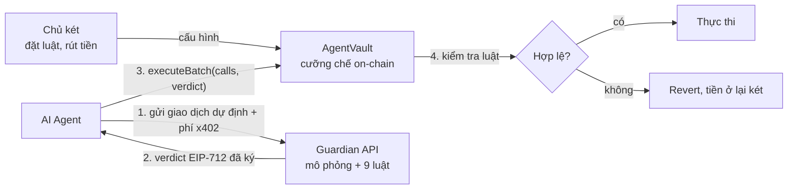

# Guardian402 — Tường lửa giao dịch cho ví của AI Agent

> Guardian402 giúp chủ sở hữu kiểm soát cách AI Agent tiêu tiền on-chain: tiền nằm trong một smart contract có luật chi tiêu, và mỗi giao dịch được mô phỏng, chấm rủi ro rồi mới được ký duyệt.
>
> _Guardian402 is an on-chain transaction firewall for autonomous AI agents: enforceable spending policies, transaction simulation, and cryptographically signed risk verdicts._

Mạng: Avalanche Fuji testnet (chain id 43113). Dự thi Team1 Vietnam UniHack 2026.

**Mục lục**

1. [Tác dụng](#1-tác-dụng)
2. [Hướng dẫn sử dụng sản phẩm](#2-hướng-dẫn-sử-dụng-sản-phẩm)
3. [Cơ chế hoạt động](#3-cơ-chế-hoạt-động)
4. [Kịch bản demo S0–S6](#4-kịch-bản-demo-s0s6)
5. [Phạm vi và giới hạn](#5-phạm-vi-và-giới-hạn)
6. [Phần giả lập (DEMO MODE)](#6-phần-giả-lập-demo-mode)
7. [Hợp đồng trên Avalanche Fuji](#7-hợp-đồng-trên-avalanche-fuji)
8. [Cài đặt và kiểm thử cho lập trình viên](#8-cài-đặt-và-kiểm-thử-cho-lập-trình-viên)
9. [Tiêu chí nghiệm thu](#9-tiêu-chí-nghiệm-thu)
10. [Tài liệu và giấy phép](#10-tài-liệu-và-giấy-phép)

---

## 1. Tác dụng

### Vấn đề

Bạn cấp cho một AI Agent 500 USDC để tự thanh toán dịch vụ, trả đối tác hoặc swap token. Agent có thể:

- hiểu sai lệnh, hoặc bị **prompt injection** và gửi giao dịch độc hại;
- chuyển tiền đến địa chỉ lừa đảo, hoặc địa chỉ nhái gần giống địa chỉ thật;
- gọi router hay contract chưa được kiểm chứng;
- cấp quyền `approve` không giới hạn;
- tiêu quá hạn mức bạn đặt ra.

Nếu agent giữ thẳng private key của ví, không có gì chặn được các việc trên.

### Guardian402 làm gì

- **Giữ tiền trong két (`AgentVault`)** thay vì trong ví của agent. Két chỉ chạy lệnh của agent khi lệnh qua được luật: người nhận được phép, ứng dụng được phép, hạn mức mỗi ngày, công tắc khoá khẩn cấp.
- **Kiểm tra trước khi chạy.** Guardian mô phỏng giao dịch trên bản sao của Fuji, chấm rủi ro bằng 9 luật xác định, và ký một phê duyệt (verdict) gắn với đúng giao dịch đó.
- **Giải thích bằng lời.** Mỗi lần kiểm tra có lời giải thích tiếng Việt và tiếng Anh về việc tiền đi đâu và vì sao bị gắn cờ.
- **Không giữ hộ tiền.** Chủ két rút tiền bất cứ lúc nào, kể cả khi đã khoá agent. Guardian chỉ ký verdict, không chuyển được tiền.

> [!IMPORTANT]
> Guardian402 không phải là một AI Agent. Đây là hạ tầng bảo mật đứng giữa quyết định của agent và quyền dùng tiền: agent có thể được cấp quyền hành động, nhưng không bao giờ được toàn quyền trên tài sản của chủ sở hữu.

### Ba trường hợp sử dụng

| Trường hợp                     | Mục tiêu                                                                       | Kịch bản demo  |
| :----------------------------- | :----------------------------------------------------------------------------- | :------------- |
| **Agent thanh toán**           | Agent tự trả USDC cho các bên đã được duyệt, trong hạn mức.                    | S0, S2         |
| **Bảo vệ giao dịch DeFi**      | Agent swap qua router; Guardian kiểm tra kết quả mô phỏng, trượt giá, approve. | S1, S4         |
| **Khoanh vùng agent bị chiếm** | Agent lộ key, bị prompt injection hoặc cố vượt quyền; két chặn mọi vi phạm.    | S2, S3, S5, S6 |

---

## 2. Hướng dẫn sử dụng sản phẩm

### 2.1 Chạy sản phẩm trên máy

Cần Node.js ≥ 22.13, pnpm 10, Foundry 1.8.5 và Git (chi tiết ở [mục 8](#8-cài-đặt-và-kiểm-thử-cho-lập-trình-viên)).

```bash
git clone --recurse-submodules https://github.com/surinatheworld/guardian402
cd guardian402
pnpm install
./run-local.sh
```

`./run-local.sh` dựng toàn bộ sản phẩm trên một bản sao (fork) của Fuji và mở dashboard tại `http://localhost:3000`. Trên Windows, chạy lệnh này từ Git Bash. Bấm `Ctrl+C` hoặc chạy `./run-local.sh stop` để dừng.

Lần chạy đầu, script tạo `.env.local` với key testnet mới. Không cần ví hay tiền thật.

### 2.2 Xem thử không cần ví

Mở trang **Chạy thử** (`/chay-thu`), chọn một kịch bản S0–S6 hoặc tự soạn giao dịch, rồi chọn một trong hai chế độ:

- **Chạy thử**: Guardian mô phỏng và chấm rủi ro, miễn phí, không gửi giao dịch nào.
- **Chạy thật**: agent demo trả phí x402 và gửi giao dịch vào két; bạn thấy két chấp nhận hay từ chối.

Khi dashboard được mở qua URL công khai, "Chạy thật" giới hạn 6 lần mỗi người và 24 lần cho mọi khách trong 10 phút.

### 2.3 Dùng với vai trò chủ két

1. **Đăng nhập** ở trang Tài khoản (`/tai-khoan`), bằng email và mật khẩu hoặc bằng ví (Sign-In with Ethereum). Sau đó liên kết két của bạn; két chỉ liên kết được khi ví của bạn là `owner()` của nó trên chain.
2. **Đặt quy tắc chi tiêu** ở trang Quy tắc chi tiêu (`/quy-tac`): hạn mức mỗi ngày, người nhận tin cậy, ứng dụng được dùng, mức rủi ro tối đa agent được phép. Mỗi thay đổi là một giao dịch bạn ký bằng ví của mình.
3. **Quản lý agent** ở trang Agent (`/agent`): agent nào được tiêu tiền từ két, cấp và thu hồi khoá API, tạm ngưng hoặc gỡ quyền.
4. **Theo dõi** ở trang Tổng quan (`/`) và Hoạt động (`/hoat-dong`): số dư, hạn mức đã dùng hôm nay, giao dịch nào bị chặn và vì sao. Mỗi giao dịch hiện thành ba trạm: Agent đề xuất → Guardian kiểm tra → Két quyết định, kèm link Snowtrace.
5. **Khoá khẩn cấp** bằng nút ở thanh trên cùng: agent mất quyền ngay lập tức, bạn vẫn rút được tiền.

| Trang            | Đường dẫn    | Trả lời câu hỏi                           |
| :--------------- | :----------- | :---------------------------------------- |
| Tổng quan        | `/`          | Tiền của tôi có ổn không?                 |
| Hoạt động        | `/hoat-dong` | Agent đã làm gì, cái gì bị chặn, vì sao?  |
| Chạy thử         | `/chay-thu`  | Guardian xử lý giao dịch này ra sao?      |
| Quy tắc chi tiêu | `/quy-tac`   | Agent được tiêu bao nhiêu, cho ai, ở đâu? |
| Agent            | `/agent`     | Agent nào đang có quyền?                  |

### 2.4 Kết nối agent của bạn

Agent gọi Guardian trước khi gửi giao dịch, rồi gửi lệnh kèm verdict vào két. Có ba cách gọi:

| Cách gọi       | Dùng khi                                  | Điểm vào                                                             |
| :------------- | :---------------------------------------- | :------------------------------------------------------------------- |
| Guardian API   | Agent tự trả phí x402 bằng ví của nó      | `POST /v1/check` (0,005 USDC), `POST /v1/cosign` (0,01 USDC)         |
| Agent REST API | Agent dùng khoá API do chủ két cấp        | `/api/agent/v1/{me,check,cosign}` với `Authorization: Bearer g402_…` |
| MCP server     | Agent chạy trong một framework hỗ trợ MCP | `pnpm mcp`: tool `check_transaction` và `cosign_transaction`         |

`check` trả về mức rủi ro và lời giải thích. `cosign` trả thêm verdict đã ký để gửi kèm `executeBatch` vào két. Tham khảo đầy đủ ở [docs/API.md](docs/API.md).

---

## 3. Cơ chế hoạt động



### Một giao dịch đi qua những bước nào

1. **Agent gửi giao dịch dự định** cho Guardian và trả phí theo từng lần gọi bằng USDC qua giao thức x402.
2. **Guardian mô phỏng** giao dịch trên một fork Anvil của Fuji và đo số dư trước, sau.
3. **Bộ luật chấm rủi ro** (LOW, MEDIUM, HIGH) từ kết quả mô phỏng. Bộ luật là mã xác định: cùng đầu vào cho cùng kết quả.
4. **LLM viết lời giải thích** từ kết quả mô phỏng. LLM không quyết định tiền có được chuyển hay không và không đổi được mức rủi ro.
5. **Guardian ký verdict EIP-712** gắn với đúng lô lệnh đó, với nonce của két và hạn dùng 60 giây.
6. **Agent gửi lô lệnh kèm verdict** vào `AgentVault`. Két tự kiểm tra lại mọi luật trên chain rồi mới chạy.

### Lớp 1 — Luật trên chain (`AgentVault.sol`)

Lớp này vẫn chặn được ngay cả khi agent bỏ qua Guardian.

- **Chỉ đúng agent** được chủ két chỉ định mới gọi được `executeBatch`.
- **Danh sách người nhận**: từ chối mọi địa chỉ nhận tiền ngoài danh sách đã duyệt.
- **Danh sách ứng dụng**: chỉ gọi được contract và hàm đã duyệt.
- **Hạn mức mỗi ngày** cho từng token, tính trên số dư thực giảm của két, đặt lại lúc 00:00 UTC.
- **Khoá khẩn cấp**: chủ két ngắt quyền agent ngay lập tức.
- **Bắt buộc có verdict** cho khoản chuyển trên ngưỡng (1 USDC trong demo), cho mọi approve, và cho mọi khoản chi của lô lệnh có gọi contract.
- **Chống dùng lại**: `verdictNonce` tăng dần và `deadline` theo thời gian block.
- **Giới hạn mức rủi ro**: két từ chối verdict có rủi ro cao hơn mức chủ két cho phép.

### Lớp 2 — Chấm rủi ro trước khi chạy (Guardian API)

| Luật                        | Phát hiện                                                              |
| :-------------------------- | :--------------------------------------------------------------------- |
| `SIMULATION_FAILED`         | Giao dịch revert khi mô phỏng                                          |
| `POLICY_PRECHECK`           | Két sẽ từ chối giao dịch này (sai người nhận, quá hạn mức, đang khoá…) |
| `UNLIMITED_APPROVAL`        | Cấp quyền tiêu token không giới hạn                                    |
| `UNKNOWN_CONTRACT`          | Gọi contract không có trong danh sách đã biết                          |
| `ADDRESS_POISONING`         | Địa chỉ nhái: trùng đầu và đuôi với một địa chỉ tin cậy                |
| `DRAIN_PATTERN`             | Rút phần lớn số dư trong một lần                                       |
| `ABNORMAL_SLIPPAGE`         | Swap nhận ít hơn nhiều so với giá tham chiếu                           |
| `RECIPIENT_NOT_ALLOWLISTED` | Tiền đến địa chỉ ngoài danh sách người nhận                            |
| `UNPROTECTED_SWAP`          | Swap không đặt mức nhận tối thiểu (`minOut` thấp hơn mô phỏng quá 3%)  |

> [!NOTE]
> Không phải mọi giao dịch của agent đều qua Guardian. Phát biểu chính xác: Guardian402 cưỡng chế luật chi tiêu trên chain và yêu cầu phê duyệt theo rủi ro cho những giao dịch thoả điều kiện đã cấu hình.

---

## 4. Kịch bản demo S0–S6

| Mã     | Kịch bản                            | Guardian | Kết quả ở két                                 |
| :----- | :---------------------------------- | :------- | :-------------------------------------------- |
| **S0** | Chuyển 1,5 USDC cho Treasury        | LOW      | Thực hiện: két −1,5 USDC, Treasury +1,5 USDC  |
| **S1** | Swap 2 USDC sang mWAVAX             | LOW      | Thực hiện                                     |
| **S2** | Rút sạch két về ví kẻ tấn công      | HIGH     | Revert `RecipientNotAllowed`                  |
| **S3** | Cấp quyền cho địa chỉ nhái sàn swap | HIGH     | Revert `RecipientNotAllowed`                  |
| **S4** | Swap qua pool lệch giá 30%          | HIGH     | Revert `RiskTooHigh`                          |
| **S5** | Dùng lại phê duyệt cũ               | LOW      | Revert `InvalidVerdict`, rồi `VerdictExpired` |
| **S6** | Agent chạy khi két đang khoá        | HIGH     | Revert `Paused`                               |

Ở S2 và S3, agent bị chiếm quyền bỏ qua Guardian và gửi thẳng vào két; két vẫn từ chối.

```bash
./run-local.sh scenario S0     # một kịch bản
./run-local.sh scenario all    # cả bảy kịch bản
```

---

## 5. Phạm vi và giới hạn

| Ngoài phạm vi bảo vệ                        | Lý do                                                                                                                             |
| :------------------------------------------ | :-------------------------------------------------------------------------------------------------------------------------------- |
| **Mọi contract Web3 tuỳ ý**                 | V1 kiểm soát các loại giao dịch được hỗ trợ (chuyển ERC-20, swap qua router đã biết), chưa phân tích calldata bất kỳ.             |
| **Tham số của ứng dụng được phép**          | Két không đọc được tham số của contract đã duyệt (ví dụ người nhận của lệnh swap); phần này dựa vào luật của Guardian và hạn mức. |
| **Tổn thất do thị trường**                  | Swap hợp lệ, trượt giá trong ngưỡng vẫn có thể lỗ theo giá thị trường.                                                            |
| **Lộ private key của chủ két**              | Người có quyền chủ két đổi được luật, theo đúng thiết kế phân quyền.                                                              |
| **Mọi biến thể prompt injection**           | Demo cho thấy giao dịch độc hại bị chặn sau khi agent bị inject; không giải quyết tấn công ở tầng prompt.                         |
| **Lỗi zero-day ngoài bộ luật**              | Mô phỏng và 9 luật bắt các mẫu tấn công đã biết, không bảo đảm bắt mọi lỗi logic của contract bên thứ ba.                         |
| **Giao dịch ngoài AgentVault**              | Chỉ tài sản nằm trong két được bảo vệ.                                                                                            |
| **Khác biệt giữa lúc kiểm tra và lúc chạy** | Giá và trạng thái chain có thể đổi giữa lúc mô phỏng và lúc giao dịch vào block; cần đặt `minOut` trên chain.                     |
| **Lộ key agent, khoản dưới ngưỡng**         | Khoản chuyển nhỏ (≤ 1 USDC) thẳng tới người nhận đã duyệt, trong hạn mức ngày, chạy được mà không cần Guardian.                   |
| **Quanh 00:00 UTC**                         | Hạn mức tính theo ngày UTC, nên trong vài phút quanh nửa đêm có thể chi tới hai lần hạn mức.                                      |

Mô hình đe doạ đầy đủ và các lần rà soát bảo mật: [docs/THREAT_MODEL.md](docs/THREAT_MODEL.md).

---

## 6. Phần giả lập (DEMO MODE)

Các phần dưới đây được công bố khi thuyết trình và hiển thị qua banner `DEMO MODE` trên dashboard:

- **MockOracle**: giá cố định 25 USDC/mWAVAX.
- **MockRouter và mWAVAX**: router thử nghiệm có hai pool (pool 1 lệch giá 30%) và token thử nghiệm.
- **Kịch bản tấn công**: lệnh "prompt injection" được đọc từ fixture cố định (`apps/agent/fixtures/feed.json`) để demo lặp lại được, không phụ thuộc vào LLM.
- **Địa chỉ nhái**: địa chỉ trùng 3 ký tự đầu và 3 ký tự cuối với router thật; DEMO MODE dùng ngưỡng 3/3.
- **x402 facilitator tự host**: dùng khi demo offline hoặc khi dịch vụ công cộng giới hạn tần suất.

Toàn bộ chạy trên testnet Fuji: không có token riêng, không bán token, không dùng tiền thật.

---

## 7. Hợp đồng trên Avalanche Fuji

Avalanche Fuji C-Chain (`chainId: 43113`), đã verify trên [testnet.snowtrace.io](https://testnet.snowtrace.io):

| Hợp đồng              | Địa chỉ                                                                                                                         |
| :-------------------- | :------------------------------------------------------------------------------------------------------------------------------ |
| **AgentVault**        | [`0x6A8CCC880238DF1f4309d1B04EDFBD6017A4Cf3c`](https://testnet.snowtrace.io/address/0x6A8CCC880238DF1f4309d1B04EDFBD6017A4Cf3c) |
| **MockRouter (DEMO)** | [`0xe20967C615e442991D468ed7f797edcAeA1771d9`](https://testnet.snowtrace.io/address/0xe20967C615e442991D468ed7f797edcAeA1771d9) |
| **MockOracle (DEMO)** | [`0xeebAac693aA19308bA859b3D668e3794310e66AE`](https://testnet.snowtrace.io/address/0xeebAac693aA19308bA859b3D668e3794310e66AE) |
| **mWAVAX (DEMO)**     | [`0xC2439b70B85CF5fBD5A7dA935567e476bFc97ba5`](https://testnet.snowtrace.io/address/0xC2439b70B85CF5fBD5A7dA935567e476bFc97ba5) |
| **USDC (Circle)**     | [`0x5425890298aed601595a70AB815c96711a31Bc65`](https://testnet.snowtrace.io/address/0x5425890298aed601595a70AB815c96711a31Bc65) |

Guardian đăng ký danh tính ERC-8004 là agent **#295** trên IdentityRegistry:
[`0x8004A818BFB912233c491871b3d84c89A494BD9e`](https://testnet.snowtrace.io/address/0x8004A818BFB912233c491871b3d84c89A494BD9e).

---

## 8. Cài đặt và kiểm thử cho lập trình viên

### Yêu cầu

- Node.js ≥ 22.13, pnpm 10 (`corepack enable pnpm`)
- Foundry 1.8.5 (`foundryup`)
- Git
- Docker, nếu máy không chạy được `anvil` (ví dụ Windows chặn `anvil.exe`): fork khi đó chạy bằng image `ghcr.io/foundry-rs/foundry:v1.8.5`

Trên Windows, clone vào đường dẫn ngắn (ví dụ `C:\code`) hoặc chạy `git config --global core.longpaths true` trước: submodule lồng trong OpenZeppelin (`lib/erc4626-tests`) có đường dẫn dài, Git báo `Filename too long` nếu thư mục gốc đã dài. Build và test không cần submodule lồng đó.

### Cài đặt và chạy test

```bash
git clone --recurse-submodules https://github.com/surinatheworld/guardian402
cd guardian402
pnpm install
cd contracts && forge test && cd ..
pnpm test
```

- `forge test`: 166 test của hợp đồng (unit, fuzz, invariant).
- `pnpm test`: test TypeScript của mọi gói (shared, guardian, guardian-mcp, agent, dashboard, eval).
- `pnpm eval`: chạy 40 ca có nhãn qua Guardian trên fork và ghi `eval/report.md` (cần `pnpm fork` đang chạy).

### `./run-local.sh` làm gì

- Kiểm tra công cụ cần có; lần đầu tạo `.env.local` với key testnet mới (không ghi đè file đã có).
- Khởi động fork Anvil của Fuji (cổng 8545). Fork đã có sẵn bộ hợp đồng Fuji; script **không deploy hợp đồng mới và không sửa file nào trong git**: nó giao két trên fork cho key trong `.env.local` (chỉ trên fork) rồi nạp dữ liệu mẫu.
- Khởi chạy x402 facilitator (4022), Guardian API (4402), Agent API (4403) và dashboard (3000); log ở `.run-local/logs/`.
- `Ctrl+C` hoặc `./run-local.sh stop` chỉ dừng các tiến trình do script mở.

### Cấu trúc repo

| Thư mục              | Nội dung                                                      |
| :------------------- | :------------------------------------------------------------ |
| `contracts/`         | `AgentVault.sol`, các mock, test và script Foundry            |
| `packages/shared/`   | ABI, địa chỉ, kiểu EIP-712, schema dùng chung                 |
| `apps/guardian/`     | Guardian API: paywall x402, mô phỏng, bộ luật, giải thích, ký |
| `apps/guardian-mcp/` | Guardian dưới dạng MCP server có trả phí                      |
| `apps/agent/`        | Agent demo, các kịch bản, API điều khiển cục bộ               |
| `apps/dashboard/`    | Dashboard Next.js (giao diện tiếng Việt)                      |
| `eval/`              | 40 ca có nhãn, bộ chạy và báo cáo                             |

---

## 9. Tiêu chí nghiệm thu

- [x] **1. Cưỡng chế on-chain**: két từ chối đúng giao dịch vi phạm luật (S2, S3, S5, S6), kể cả khi agent bỏ qua Guardian.
- [x] **2. Chuyển tiền an toàn**: S0 chuyển 1,5 USDC thành công, có receipt và biến động số dư on-chain.
- [x] **3. Rủi ro động**: S4 cho thấy bộ luật phát hiện trượt giá 30% và két từ chối vì `RiskTooHigh`.
- [x] **4. Thanh toán x402**: micropayment thật qua facilitator, có giao dịch settlement on-chain.
- [x] **5. Quyền của chủ két**: ví thường và agent không đổi được luật của két (166 test Foundry).
- [x] **6. Bằng chứng trên explorer**: mọi mã giao dịch kiểm chứng được trên Snowtrace/Routescan.
- [x] **7. Dễ dùng thử**: không cần ví vẫn trải nghiệm được sản phẩm qua trang Chạy thử.
- [x] **8. Công bố trung thực**: nêu rõ các thành phần demo, mock và giới hạn kỹ thuật của V1.

---

## 10. Tài liệu và giấy phép

- [docs/SPEC.md](docs/SPEC.md): đặc tả kỹ thuật
- [docs/API.md](docs/API.md): tham chiếu API của Guardian và dashboard
- [docs/THREAT_MODEL.md](docs/THREAT_MODEL.md): mô hình đe doạ và các lần rà soát
- [docs/DEMO_RUNBOOK.md](docs/DEMO_RUNBOOK.md): kịch bản thuyết trình
- [docs/PRODUCT_FLOWS.md](docs/PRODUCT_FLOWS.md): các luồng sản phẩm

Giấy phép: [MIT](LICENSE).
