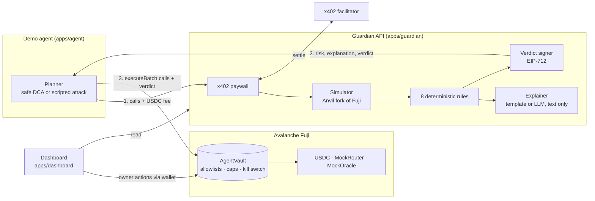

# Guardian402

A transaction firewall and co-signer for AI-agent wallets on Avalanche Fuji (testnet only).
Team1 Vietnam UniHack 2026.

An AI agent's funds sit in **AgentVault**, a contract the owner controls. Before the agent's transaction runs, the
**Guardian API** simulates it on a fork of Fuji, scores it with eight deterministic rules, explains the result in
Vietnamese and English, and signs an EIP-712 verdict bound to those exact calls. The vault runs the batch only if it
passes the on-chain policy (allowlists, daily caps, kill switch) and, when required, carries a valid low-risk
verdict. Each check is paid per request in USDC over **x402**.

> **Tóm tắt tiếng Việt.** Guardian402 là "tường lửa" cho ví của AI agent trên Avalanche Fuji (mạng thử). Tiền của
> agent nằm trong AgentVault do chủ ví kiểm soát. Trước khi agent gửi giao dịch, Guardian mô phỏng giao dịch trên
> bản fork của Fuji, chấm điểm bằng 8 luật cố định, giải thích bằng tiếng Việt, và ký một "verdict" gắn với đúng
> giao dịch đó. Vault chỉ chạy khi giao dịch qua được luật on-chain (danh sách cho phép, hạn mức ngày, nút tạm
> dừng) và, khi cần, có verdict rủi ro thấp. Mỗi lần kiểm tra trả phí bằng USDC qua x402. LLM chỉ viết lời giải
> thích, không bao giờ quyết định tiền có được chuyển hay không. Không có token, không giữ tiền của người dùng,
> chỉ chạy trên testnet.

- Spec: [docs/SPEC.md](docs/SPEC.md) · Threat model: [docs/THREAT_MODEL.md](docs/THREAT_MODEL.md) · Demo: [docs/DEMO_RUNBOOK.md](docs/DEMO_RUNBOOK.md)
- Progress and test results per phase (Vietnamese): [docs/PROGRESS.md](docs/PROGRESS.md) · Eval report: [eval/report.md](eval/report.md)
- Commands for contributors and coding agents: [CLAUDE.md](CLAUDE.md)

## Architecture



Risk comes only from the rule engine. The LLM sees structured facts and writes text; the explainer module cannot
import the signer (checked by a test).

## Quickstart

Requirements: Node ≥ 22.13, pnpm 10 (`corepack enable pnpm`), Foundry 1.8.5 (`foundryup`), Git. On Windows, Docker
Desktop if the native `anvil.exe` is blocked (see "Windows").

### A. Tests and eval, no keys needed (about 10 minutes)

```bash
git clone --recurse-submodules https://github.com/surinatheworld/guardian402
cd guardian402
pnpm install
cd contracts && forge build && forge test && cd ..
pnpm test
```

In a second terminal, start a fork of Fuji, then run the eval in the first one:

```bash
pnpm fork
```

```bash
pnpm eval
```

`pnpm eval` deploys its own vault and mocks on the fork, runs 40 labelled cases and writes `eval/report.md`.

### B. Full demo on the local fork with your own throwaway keys (about 15 minutes)

1. Make five fresh keys (testnet only, never reuse them): `cast wallet new` five times.
2. `cp .env.example .env.local` and fill in `DEPLOYER_PK`, `OWNER_PK`, `AGENT_PK`, `GUARDIAN_SIGNER_PK`, `FACILITATOR_PK`, and set `PAY_TO` to the deployer's address. Leave `NETWORK=local`.
3. Run, each long-running command in its own terminal:

```bash
pnpm fork
```

```bash
pnpm deploy:local && pnpm seed:local && pnpm known-contracts && pnpm mine-lookalike local
```

```bash
FACILITATOR_RPC_URL=http://127.0.0.1:8545 pnpm facilitator
```

```bash
FACILITATOR_URL=http://127.0.0.1:4022 DEMO_MODE=true pnpm dev:guardian
```

```bash
DEMO_MODE=true pnpm agent scenario all
```

On the fork the deploy and seed scripts fund the keys with test AVAX and mint test USDC through the impersonated
USDC masterMinter; nothing touches Fuji. `deploy:local` writes your addresses to
`packages/shared/src/addresses/local.json`.

Dashboard against the fork: put `NEXT_PUBLIC_NETWORK=local` in `apps/dashboard/.env.local`, then
`DEMO_MODE=true pnpm dev:agent` and `pnpm dev:dashboard`, and open http://localhost:3000.

### C. Fuji

The team's deployment is listed below. To run your own on Fuji, fund the deployer from the faucet and use
`pnpm deploy:fuji`, `pnpm seed:fuji`, `pnpm verify:fuji`; the 3-minute demo is in
[docs/DEMO_RUNBOOK.md](docs/DEMO_RUNBOOK.md).

## Environment

All variables are listed with comments in [.env.example](.env.example) (repo root) and in each app's
`.env.example`. Secrets go only in `.env.local` files, which git ignores. The dashboard reads only `NEXT_PUBLIC_*`
values and holds no key: the owner signs with a browser wallet.

## Commands

| Command                                                    | What it does                                             |
| ---------------------------------------------------------- | -------------------------------------------------------- |
| `pnpm test` · `pnpm typecheck` · `pnpm lint`               | TypeScript tests, types and lint in every package        |
| `cd contracts && forge test`                               | contract unit, fuzz and invariant tests                  |
| `pnpm fork`                                                | Anvil fork of Fuji on :8545 (Docker fallback on Windows) |
| `pnpm deploy:local` · `pnpm seed:local`                    | deploy and seed on the fork                              |
| `pnpm deploy:fuji` · `pnpm seed:fuji` · `pnpm verify:fuji` | the same on Fuji, then verify on Snowtrace               |
| `pnpm dev:guardian`                                        | Guardian API on :4402                                    |
| `pnpm facilitator`                                         | self-hosted x402 facilitator on :4022                    |
| `pnpm agent scenario <S1..S6\|all>`                        | run the demo scenarios                                   |
| `pnpm dev:agent`                                           | agent control API on :4403 (DEMO only)                   |
| `pnpm dev:dashboard`                                       | dashboard on :3000                                       |
| `pnpm eval`                                                | 40-case eval, writes `eval/report.md`                    |
| `pnpm erc8004:fuji`                                        | register the Guardian on ERC-8004 (bonus B1)             |
| `pnpm mcp` · `pnpm mcp:example`                            | paid MCP server (bonus B2) and an agent that pays it     |
| `pnpm bench:guardian`                                      | latency of the Guardian pipeline (free DEMO endpoint)    |

The full list, with options, is in [CLAUDE.md](CLAUDE.md).

## Fuji deployment

Verified on [testnet.snowtrace.io](https://testnet.snowtrace.io). Network: Avalanche Fuji C-Chain, chain id 43113.

| Contract          | Address                                                                                                                         |
| ----------------- | ------------------------------------------------------------------------------------------------------------------------------- |
| AgentVault        | [`0x3f6a5852788ff6a46d924C407976bB89487f7651`](https://testnet.snowtrace.io/address/0x3f6a5852788ff6a46d924C407976bB89487f7651) |
| MockRouter (DEMO) | [`0xe20967C615e442991D468ed7f797edcAeA1771d9`](https://testnet.snowtrace.io/address/0xe20967C615e442991D468ed7f797edcAeA1771d9) |
| MockOracle (DEMO) | [`0xeebAac693aA19308bA859b3D668e3794310e66AE`](https://testnet.snowtrace.io/address/0xeebAac693aA19308bA859b3D668e3794310e66AE) |
| mWAVAX (DEMO)     | [`0xC2439b70B85CF5fBD5A7dA935567e476bFc97ba5`](https://testnet.snowtrace.io/address/0xC2439b70B85CF5fBD5A7dA935567e476bFc97ba5) |
| USDC (Circle)     | [`0x5425890298aed601595a70AB815c96711a31Bc65`](https://testnet.snowtrace.io/address/0x5425890298aed601595a70AB815c96711a31Bc65) |

AgentVault was redeployed on 2026-11-08 with the P11 fix that revokes unused approvals at the end of each batch
(finding F1 in the threat model), using `pnpm redeploy-vault:fuji`. The first vault,
[`0x32cb61054E31678E6Afa6731B0DC70D330a1Ab99`](https://testnet.snowtrace.io/address/0x32cb61054E31678E6Afa6731B0DC70D330a1Ab99), was emptied and paused.

### ERC-8004 identity (bonus B1)

The Guardian is agent **#295** on the official ERC-8004 IdentityRegistry on Fuji,
[`0x8004A818BFB912233c491871b3d84c89A494BD9e`](https://testnet.snowtrace.io/address/0x8004A818BFB912233c491871b3d84c89A494BD9e), owned by the deployer
wallet. Its registration file (`registration-v1`: name, description, services, `x402Support: true`, registrations) is
stored on-chain as the agentURI, as a base64 JSON data URI. Register: [0x6d22083e…](https://testnet.snowtrace.io/tx/0x6d22083e006da209338f289b5389f1486902233f859bcfe00b179512b8658001),
agentURI: [0xf6f78bcf…](https://testnet.snowtrace.io/tx/0xf6f78bcf70ab3d62eb2eaa04d5f202e042cd5c83d1736a93cb1c029bda2471e1). Read it back:

```bash
cast call 0x8004A818BFB912233c491871b3d84c89A494BD9e "tokenURI(uint256)(string)" 295 --rpc-url https://api.avax-test.network/ext/bc/C/rpc
```

The dashboard shows it on the Tổng quan page. Set `GUARDIAN_PUBLIC_URL` and run `pnpm erc8004:fuji` again to
advertise a public Guardian endpoint instead of this repository.

## MCP server (bonus B2)

`apps/guardian-mcp` serves the Guardian's two checks as MCP tools, paid per call over x402 with `@x402/mcp`:
`check_transaction` (0.005 USDC) and `cosign_transaction` (0.01 USDC, with the signed verdict). It runs the same
pipeline as the HTTP API, in process, and charges nothing for a failed or invalid check.

```bash
FORK_PORT=8546 pnpm fork
```

```bash
NETWORK=fuji MCP_FORK_RPC_URL=http://127.0.0.1:8546 FACILITATOR_URL=http://127.0.0.1:4022 DEMO_MODE=true pnpm mcp:example
```

The example agent starts the server over stdio, is asked for 0.005 USDC, pays from `AGENT_PK` (it refuses anything
above 0.02 USDC) and prints the risk and the settlement. Run on Fuji on 2026-11-09: risk LOW, payment
[0x64a5e6bb…](https://testnet.snowtrace.io/tx/0x64a5e6bb319f77d9a55b31cb29ed8554323a6c031852bfc7766a1783ef9f68cf).
Any MCP client can start `pnpm mcp`; a client without an x402 wallet receives the payment requirement instead of a
result.

## What is mocked (DEMO MODE)

Declared at the start of the pitch, and shown as a DEMO MODE banner in the dashboard:

- **MockOracle** (fixed price, 25 USDC per mWAVAX) and **MockRouter** with two fake pools (pool 1 is deliberately 30% off) and **mWAVAX**, a mock token.
- **Scripted attacks**: the "prompt-injected" planner turns lines of `apps/agent/fixtures/feed.json` into calls; no LLM is involved, so the demo is repeatable.
- **Lookalike address**: mined to match 3+3 hex characters of the router, and the poisoning rule runs at 3/3 in DEMO mode (4/4 otherwise).
- **Self-hosted x402 facilitator**, used when the public one is unavailable.
- **`/v1/demo/check`**, a free check endpoint for the dashboard, only with `DEMO_MODE=true`.
- **Eval cases** are synthetic and written by the team.

## Hackathon rules: where they are enforced

| Rule                                                                  | Enforced in                                                                                                                                                      | Proved by                                                                                                                                                                                          |
| --------------------------------------------------------------------- | ---------------------------------------------------------------------------------------------------------------------------------------------------------------- | -------------------------------------------------------------------------------------------------------------------------------------------------------------------------------------------------- |
| The LLM never decides whether money moves                             | Risk only from `apps/guardian/src/rules`; the explainer cannot import the signer or the aggregator; a text that contradicts the risk is replaced by the template | `apps/guardian/test/explain.test.ts` ("nothing in src/explain imports the signer…", "falls back when the text contradicts the risk"); `rules.test.ts` "rules never touch the chain or the network" |
| Every agent action passes AgentVault's policy                         | `AgentVault.executeBatch`: allowlists, `maxApproval`, daily caps, pause, verdict                                                                                 | `contracts/test/AgentVault.t.sol`, `AgentVault.fuzz.t.sol`, `AgentVault.invariant.t.sol` (`invariant_DailyOutflowWithinCap`, `invariant_PausedAgentMovesNothing`, `invariant_AttackerNeverPaid`)   |
| Non-custodial: the owner can always withdraw; the Guardian only signs | `withdraw`, `withdrawNative` (work while paused); the Guardian holds no funds and no vault role                                                                  | `invariant_OwnerCanWithdrawEverything`, `test_OwnerExecute_WorksWhilePaused`, `invariant_AgentCannotChangeAdminState`                                                                              |
| No token, no real money, Fuji only                                    | No token contract; `scripts/contracts.mjs` and the Forge scripts refuse any chain id other than 43113                                                            | code guard (no automated test)                                                                                                                                                                     |
| On-chain data limited to hashes, payments and state                   | `Executed(callsHash, checkId, …)` events; the Guardian stores no IPs or personal data                                                                            | code review; `apps/guardian/src/store.ts` schema                                                                                                                                                   |
| Every mock behind an explicit flag, with a banner                     | `DEMO_MODE` gates `/v1/demo/check`, scripted scenarios and the agent control API; the dashboard banner follows the Guardian's `demoMode`                         | `apps/guardian/test/api.test.ts` (demo check), `apps/agent/src/cli.ts` refuses S2–S6 without `DEMO_MODE`                                                                                           |
| Tests on every money path                                             | Foundry unit, fuzz and invariant tests                                                                                                                           | `forge coverage`: AgentVault 100% lines, statements, branches and functions                                                                                                                        |

## Legal notes (Vietnam)

- Under current Vietnamese rules, crypto-assets are not legal tender and cannot be used as a means of payment.
  Guardian402 runs only on Avalanche Fuji testnet with test tokens that have no value.
- The product holds no user funds: each owner keeps funds in their own AgentVault and can withdraw at any time.
- There is no token and no token sale.
- Guardian402 gives no financial or investment advice. Its output is a technical risk assessment of a transaction.

## Windows

- **Recommended: WSL2.** Install Ubuntu with `wsl --install`, clone the repo inside the WSL filesystem (for example `~/code/guardian402`, not `/mnt/c/...`), and install Node, pnpm and Foundry there as on Linux.
- **Fallback: native Windows + Docker.** Windows Smart App Control can block `anvil.exe`, while `forge` and `cast` still run. Start Docker Desktop and `pnpm fork` runs Anvil from the official `ghcr.io/foundry-rs/foundry:v1.8.5` image (`ANVIL_RUNNER=docker` forces it).
- If `corepack enable pnpm` fails with `EPERM`, install the shim in a user folder: `corepack enable pnpm --install-directory "%LOCALAPPDATA%\corepack-bin"` and add that folder to your `PATH`.
- Git Bash runs the `bash` scripts (`pnpm mine-lookalike`).

## License

[MIT](LICENSE), matching the `SPDX-License-Identifier: MIT` headers of the Solidity sources. `vendor/x402-starter` is
Team1's starter, kept as a read-only reference under its own terms.
