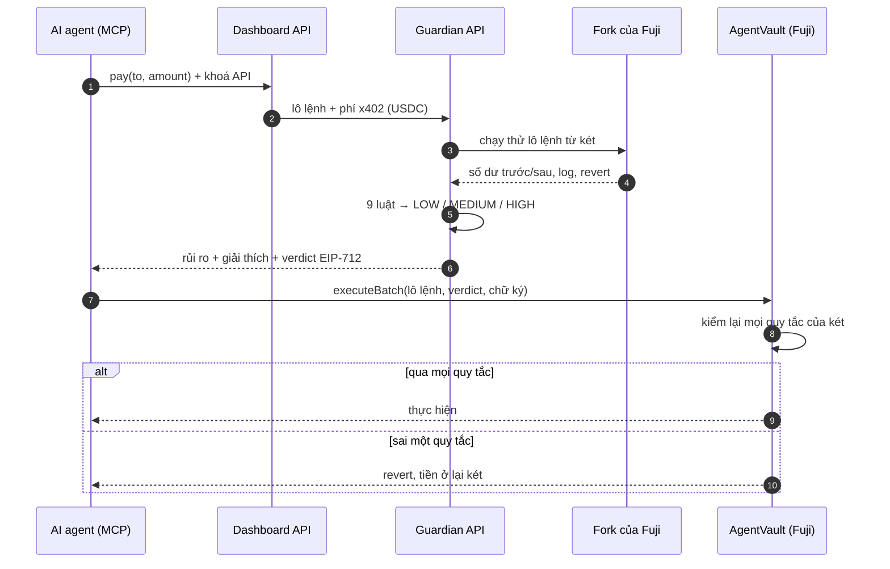

<p align="center">
  
</p>

<h1 align="center">Guardian402</h1>

<p align="center">
  <b>Cho AI agent tiêu tiền, trong giới hạn bạn đặt.</b><br />
  Tiền nằm trong két (smart contract) của bạn trên Avalanche. Agent chỉ chi được trong quy tắc của két, và khoản chi rủi ro phải được Guardian chạy thử, chấm điểm và ký duyệt trước.
</p>

<p align="center">
  <a href="https://testnet.snowtrace.io/address/0xAd6BC023d60f871488394dEceE9EC2E85E553549"></a>
  
  
  
  
  <a href="LICENSE"></a>
</p>

<p align="center">
  
  
  
  
</p>

<p align="center">
  <a href="https://miho-hackathon.080895.xyz"><b>Dùng thử</b></a> ·
  <a href="#2-hai-lớp-bảo-vệ">Cơ chế</a> ·
  <a href="#3-bằng-chứng-trên-fuji">Bằng chứng</a> ·
  <a href="#8-chạy-trên-máy">Cài đặt</a> ·
  <a href="docs/API.md">API</a> ·
  <a href="docs/THREAT_MODEL.md">Bảo mật</a> ·
  <a href="README.en.md">English</a>
</p>

> _Guardian402 is a transaction firewall and co-signer for AI-agent wallets on Avalanche: on-chain spending rules, simulation before execution, and signed risk verdicts, paid per request over x402._ Dự thi Team1 Vietnam UniHack 2026 · chỉ chạy trên Avalanche Fuji testnet.

<p align="center">
  
</p>

## Tóm tắt

1. **Vấn đề:** đưa khoá ví cho AI agent là giao toàn quyền tiêu tiền. Agent hiểu sai lệnh hay bị prompt injection một lần là mất tiền.
2. **Hai lớp bảo vệ:** két `AgentVault` cưỡng chế quy tắc chi tiêu trên blockchain, kể cả khi agent bỏ qua Guardian. Guardian chạy thử giao dịch trước, chấm rủi ro bằng 9 luật cố định và ký phê duyệt gắn với đúng giao dịch đó.
3. **Không phải tin ai:** LLM chỉ viết lời giải thích và có thể tắt hẳn. Guardian không giữ tiền và không chuyển được tiền. Chủ két rút tiền bất cứ lúc nào.
4. **Thu phí theo lần gọi:** 0,005 USDC cho một lần kiểm tra, 0,01 USDC cho kiểm tra kèm phê duyệt, trả qua x402. Không có token.
5. **Đã chạy thật trên Fuji:** luồng chính với MetaMask và bảy kịch bản tấn công S0–S6, mỗi bước có link Snowtrace.

**Mục lục:** [1. Vấn đề](#1-vấn-đề) · [2. Hai lớp bảo vệ](#2-hai-lớp-bảo-vệ) · [3. Bằng chứng trên Fuji](#3-bằng-chứng-trên-fuji) · [4. Phí và vì sao Avalanche](#4-phí-và-vì-sao-avalanche) · [5. Dùng thử](#5-dùng-thử) · [6. Giới hạn](#6-giới-hạn) · [7. Phần giả lập (DEMO MODE)](#7-phần-giả-lập-demo-mode) · [8. Chạy trên máy](#8-chạy-trên-máy) · [9. Tài liệu](#9-tài-liệu)

---

## 1. Vấn đề

Bạn cho một AI agent 50 USDC để tự trả tiền dịch vụ, trả đối tác hoặc swap token. Nếu agent giữ thẳng khoá riêng của ví, không gì chặn được việc nó:

- hiểu sai lệnh, hoặc bị **prompt injection** rồi gửi giao dịch độc hại;
- chuyển tiền tới địa chỉ lừa đảo, hay địa chỉ nhái gần giống địa chỉ thật;
- cấp quyền `approve` không giới hạn, gọi router chưa kiểm chứng;
- tiêu vượt mức bạn muốn.

Quy tắc chi tiêu chỉ có nghĩa khi agent không vượt qua được. Quy tắc nằm trong phần mềm của agent hay trên một máy chủ thì ai cầm khoá agent cũng bỏ qua được. Vì vậy Guardian402 đặt quy tắc trong smart contract.

> [!IMPORTANT]
> Guardian402 không phải là một AI agent. Đây là hạ tầng đứng giữa quyết định của agent và quyền dùng tiền: agent được hành động, nhưng không bao giờ có toàn quyền trên tài sản của chủ.

## 2. Hai lớp bảo vệ



### Lớp 1: quy tắc trên blockchain (`AgentVault.sol`)

Mọi lệnh của agent phải qua `executeBatch`. Sai một quy tắc là revert và tiền ở lại két. Lớp này vẫn chặn được khi agent bị chiếm quyền và gửi thẳng vào két, không qua Guardian.

- **Chỉ đúng agent** do chủ két chỉ định mới gọi được `executeBatch`.
- **Người nhận và ứng dụng:** chỉ trả cho địa chỉ trong danh sách; chỉ gọi contract và hàm đã duyệt.
- **Hạn mức** cho từng token: mỗi ngày (tính trên số dư thực giảm của két, làm mới lúc 00:00 UTC), mỗi giao dịch (`maxPerTx`) và tổng ngân sách (`budget`, hết thì chờ chủ két `resetBudget`). AVAX gốc có hạn mức riêng.
- **`approve` bị siết:** chỉ cấp cho địa chỉ trong danh sách, không quá mức tối đa (`ApprovalTooLarge`), và phần quyền lô lệnh không dùng hết bị thu hồi ngay khi lô lệnh chạy xong.
- **Bắt buộc có verdict** cho khoản chuyển trên ngưỡng, cho mọi `approve`, và cho mọi khoản chi của lô lệnh có gọi contract.
- **Chống dùng lại verdict:** `verdictNonce` tăng dần, hạn dùng 60 giây theo thời gian block, và mức rủi ro tối đa chủ két chấp nhận.
- **Khoá khẩn cấp:** agent mất quyền chi ngay lập tức.

Quyền của chủ két: rút tiền bất cứ lúc nào (kể cả khi két đang khoá), đổi agent, đổi Guardian, sửa quy tắc. Chủ két còn có `ownerExecute` để chạy lệnh không qua quy tắc, vì đây là két của chính họ. `renounceOwnership` bị tắt để két không bao giờ rơi vào cảnh không có chủ. `VaultFactory` cho mỗi chủ tạo két trong một giao dịch và không giữ quyền gì trên két nó tạo.

### Lớp 2: chạy thử và chấm rủi ro (Guardian API)

1. **Chạy thử** lô lệnh trên một fork Anvil của Fuji, đo số dư trước và sau, log và revert.
2. **Chấm rủi ro** bằng 9 luật xác định: cùng đầu vào cho cùng kết quả LOW, MEDIUM hoặc HIGH.
3. **Giải thích** bằng tiếng Việt và tiếng Anh: tiền đi đâu, vì sao bị chặn. Mặc định dùng mẫu câu có sẵn; bật LLM (Anthropic, Gemini hoặc API kiểu OpenAI) thì LLM viết lời giải thích từ kết quả chạy thử. LLM không quyết định tiền có được chuyển hay không và không đổi được mức rủi ro; module giải thích không import trình ký hay ví nào.
4. **Ký verdict EIP-712** gắn với đúng lô lệnh, nonce của két và hạn dùng 60 giây. Két tự kiểm chữ ký, nên lúc thực thi không phải tin máy chủ nào.

| Luật                        | Phát hiện                                                               | Mức                       |
| :-------------------------- | :---------------------------------------------------------------------- | :------------------------ |
| `SIMULATION_FAILED`         | Giao dịch revert khi chạy thử                                           | HIGH                      |
| `POLICY_PRECHECK`           | Két sẽ từ chối: sai người nhận, vượt hạn mức, két đang khoá…            | HIGH                      |
| `UNLIMITED_APPROVAL`        | Cấp quyền tiêu token không giới hạn                                     | HIGH                      |
| `UNKNOWN_CONTRACT`          | Gọi contract ngoài danh sách đã biết                                    | MEDIUM, HIGH khi kèm tiền |
| `ADDRESS_POISONING`         | Địa chỉ nhái: trùng 4 ký tự đầu và 4 ký tự cuối với một địa chỉ tin cậy | HIGH                      |
| `DRAIN_PATTERN`             | Một lần rút từ 50% số dư trở lên                                        | HIGH                      |
| `ABNORMAL_SLIPPAGE`         | Swap nhận ít hơn giá tham chiếu                                         | MEDIUM ≥ 2%, HIGH ≥ 10%   |
| `RECIPIENT_NOT_ALLOWLISTED` | Tiền tới địa chỉ ngoài danh sách người nhận                             | HIGH                      |
| `UNPROTECTED_SWAP`          | `minOut` thấp hơn kết quả chạy thử quá 3%                               | MEDIUM                    |

> [!NOTE]
> Không phải giao dịch nào cũng phải qua Guardian. Phát biểu chính xác: Guardian402 cưỡng chế quy tắc chi tiêu trên blockchain, và yêu cầu phê duyệt theo rủi ro cho những giao dịch thoả điều kiện đã cấu hình.

## 3. Bằng chứng trên Fuji

Mọi kết quả dưới đây chạy trên **Avalanche Fuji thật** ngày 13/11/2026 và kiểm được trên Snowtrace.

### Luồng chính với ví MetaMask thật

Két [`0xff0d…9C2d`](https://testnet.snowtrace.io/address/0xff0db552A0Ffe0464273DAe402dd19efB7Bc9C2d), tạo qua trang Bắt đầu với quy tắc: chỉ trả cho Treasury, tối đa 2 USDC mỗi giao dịch, tổng 5 USDC. Agent gọi công cụ `pay` của MCP server.

| Bước                               | Ai làm            | Kết quả                                                                                                                                                                                                                                  |
| :--------------------------------- | :---------------- | :--------------------------------------------------------------------------------------------------------------------------------------------------------------------------------------------------------------------------------------- |
| Nạp 10 USDC vào két                | Chủ két, MetaMask | ✓ [tx](https://testnet.snowtrace.io/tx/0xe14a3197b03ce8dcc7855bf37aa24feb2163389c6108f2751e8d7a89dd187bf3)                                                                                                                               |
| Trả 1 USDC cho Treasury            | Agent             | ✓ rủi ro thấp, [đã thực hiện](https://testnet.snowtrace.io/tx/0xa7db521a54613d8a92fccbb7b331ec28bf48e2d7c0aac1bfcb2fa84920e8ed97)                                                                                                        |
| Trả 2,5 USDC                       | Agent             | ✓ bị chặn: vượt hạn mức mỗi giao dịch; không gửi gì                                                                                                                                                                                      |
| Trả 2 USDC, rồi 2 USDC             | Agent             | ✓ [đã thực hiện](https://testnet.snowtrace.io/tx/0x42170a0049edecfd3c7228b25aaae7e835b6627b7587d367f502904dff8c9607), [đã thực hiện](https://testnet.snowtrace.io/tx/0xf7103a3222f7e599ece9413f50de34cce170c1a979d5d95d3debd1d857e91edd) |
| Trả 0,5 USDC khi đã tiêu đủ 5 USDC | Agent             | ✓ bị chặn: hết tổng ngân sách, chờ chủ két làm mới                                                                                                                                                                                       |
| Làm mới ngân sách                  | Chủ két, MetaMask | ✓ ngân sách về lại 5 USDC                                                                                                                                                                                                                |
| Trả 1 USDC sau khi làm mới         | Agent             | ✓ [đã thực hiện](https://testnet.snowtrace.io/tx/0xd5e2f1963f288ac01983708ff5d181ee9aaa57cf2db1b57f3cb5b58638b166d6)                                                                                                                     |
| Rút 2 USDC về ví                   | Chủ két, MetaMask | ✓                                                                                                                                                                                                                                        |

### Kịch bản tấn công S0–S6

| Mã     | Kịch bản                                                | Guardian | Két                                                                                                                                                                                                                                            |
| :----- | :------------------------------------------------------ | :------- | :--------------------------------------------------------------------------------------------------------------------------------------------------------------------------------------------------------------------------------------------- |
| **S0** | Chuyển 1,5 USDC cho Treasury                            | LOW      | [Thực hiện](https://testnet.snowtrace.io/tx/0x02b10072b18e80301ccd5fdfa8e0193d74fac595c83a1dbdeec677dea0444eb1)                                                                                                                                |
| **S1** | Swap 2 USDC sang mWAVAX, có `minOut`                    | LOW      | [Thực hiện](https://testnet.snowtrace.io/tx/0x643d89ad6e6e526bdc2bc5f2d9a0084263c68564235104d4a0c418b94a090e00)                                                                                                                                |
| **S2** | Agent bị chèn lệnh, rút sạch két về ví kẻ tấn công      | HIGH 100 | [`RecipientNotAllowed`](https://testnet.snowtrace.io/tx/0x18f9908fedaf48e0e7ca4eea3e1b5020470d333869412ac90ff0cf6a25e132ae)                                                                                                                    |
| **S3** | Cấp quyền không giới hạn cho địa chỉ nhái sàn swap      | HIGH 100 | [`RecipientNotAllowed`](https://testnet.snowtrace.io/tx/0xb0a0846cf4297693f3e6508d50b631e7fff1e51542c620435a9c640c8ac00fce)                                                                                                                    |
| **S4** | Swap qua pool lệch giá 30%, `minOut = 0`                | HIGH 85  | [`RiskTooHigh`](https://testnet.snowtrace.io/tx/0x1220fd094ecbbc621c6640f15c9570092f34cfd330b329271432473d8f3869f5)                                                                                                                            |
| **S5** | Dùng lại phê duyệt cũ cho lệnh khác, rồi khi đã hết hạn | LOW      | [`InvalidVerdict`](https://testnet.snowtrace.io/tx/0x9924ab795e1974f6232321d1fee49c6046213d494790f72da4f86d74eb5ab056), [`VerdictExpired`](https://testnet.snowtrace.io/tx/0x885d3cb381d11d9d55b98c7bd96b7f174abddc9d406c283c582c7496d620a51f) |
| **S6** | Agent chi khi chủ két đã khoá khẩn cấp                  | HIGH 60  | [`Paused`](https://testnet.snowtrace.io/tx/0xe61ec50818bdbe9d5844e2546a7d2ff3902ef71ff09d083e8100482b19b61161)                                                                                                                                 |

- **S2, S3:** agent bị chiếm quyền bỏ qua Guardian, gửi thẳng vào két; lớp 1 vẫn từ chối.
- **S4:** qua mọi quy tắc tĩnh; chỉ kết quả chạy thử của lớp 2 mới cho thấy pool lệch giá.
- Mỗi lần gọi Guardian có một giao dịch trả phí x402 thật, ví dụ [phí của S0](https://testnet.snowtrace.io/tx/0xadf11f6a7b76b4a10b830d8cd978b0fe50bc0e6734ce72aee852204e8b2e4741).

### Kiểm thử tự động

| Bộ                                             | Kết quả                                                                    |
| :--------------------------------------------- | :------------------------------------------------------------------------- |
| Contract (`forge test`: unit, fuzz, invariant) | 197/197                                                                    |
| TypeScript (`pnpm test`, 6 package)            | 369/369                                                                    |
| Guardian trên fork Fuji (`test:fork`)          | 18/18                                                                      |
| Eval, 40 ca có nhãn (`pnpm eval`)              | precision 100%, recall 100%, dương tính giả 0% ([báo cáo](eval/report.md)) |

### Hợp đồng trên Fuji

Avalanche Fuji C-Chain (`chainId 43113`), đã verify trên Snowtrace:

| Hợp đồng                         | Địa chỉ                                                                                                                         |
| :------------------------------- | :------------------------------------------------------------------------------------------------------------------------------ |
| **VaultFactory**                 | [`0xAd6BC023d60f871488394dEceE9EC2E85E553549`](https://testnet.snowtrace.io/address/0xAd6BC023d60f871488394dEceE9EC2E85E553549) |
| **AgentVault** (két demo, S0–S6) | [`0xcf2F9AD1e2665112092696F49C4BBc42b81be05E`](https://testnet.snowtrace.io/address/0xcf2F9AD1e2665112092696F49C4BBc42b81be05E) |
| **MockRouter (DEMO)**            | [`0xe20967C615e442991D468ed7f797edcAeA1771d9`](https://testnet.snowtrace.io/address/0xe20967C615e442991D468ed7f797edcAeA1771d9) |
| **MockOracle (DEMO)**            | [`0xeebAac693aA19308bA859b3D668e3794310e66AE`](https://testnet.snowtrace.io/address/0xeebAac693aA19308bA859b3D668e3794310e66AE) |
| **mWAVAX (DEMO)**                | [`0xC2439b70B85CF5fBD5A7dA935567e476bFc97ba5`](https://testnet.snowtrace.io/address/0xC2439b70B85CF5fBD5A7dA935567e476bFc97ba5) |
| **USDC (Circle)**                | [`0x5425890298aed601595a70AB815c96711a31Bc65`](https://testnet.snowtrace.io/address/0x5425890298aed601595a70AB815c96711a31Bc65) |

Két demo trước (code cũ, giữ nguyên): [`0x6A8C…Cf3c`](https://testnet.snowtrace.io/address/0x6A8CCC880238DF1f4309d1B04EDFBD6017A4Cf3c). Guardian có danh tính ERC-8004 là agent **#295** trên IdentityRegistry [`0x8004A818…4BD9e`](https://testnet.snowtrace.io/address/0x8004A818BFB912233c491871b3d84c89A494BD9e).

## 4. Phí và vì sao Avalanche

**Tiền từ đâu.** Guardian thu phí theo từng lần gọi, bằng USDC qua x402: **0,005 USDC** cho một lần kiểm tra (`check`), **0,01 USDC** cho kiểm tra kèm phê duyệt (`cosign`). Agent trả từ ví của nó tới ví nhận phí của bên vận hành Guardian; Guardian chỉ thu khi trả lời thành công. Không có token, không bán token, không có lợi suất. Trong hackathon mọi khoản đều là USDC thử nghiệm trên Fuji.

**Vì sao Avalanche.**

- USDC của Circle trên C-Chain hỗ trợ EIP-3009 (`transferWithAuthorization`), đúng thứ scheme `exact` của x402 cần: agent chỉ ký, facilitator gửi giao dịch, không cần tài khoản hay thẻ.
- Settlement trên C-Chain rẻ và nhanh, nên thu phí vài phần nghìn USDC mỗi lần là khả thi, và giao dịch của agent vào block trong hạn 60 giây của phê duyệt.
- Fork C-Chain bằng Anvil chạy nhanh, nên Guardian chạy thử trên trạng thái gần như mới nhất của Fuji (p50 354 ms trong [eval](eval/report.md)).
- Guardian có danh tính on-chain trên IdentityRegistry ERC-8004 chính thức trên Fuji, và điểm uy tín công khai trên ReputationRegistry chính thức: chủ két xem lại một lần kiểm tra rồi ghi "đúng" hoặc "báo động nhầm" lên chain; khoá của Guardian không tự chấm được cho mình.
- Guardian tra explorer của Avalanche (Routescan, nguồn của testnet.snowtrace.io) cho contract lạ: chưa verify hoặc mới tạo dưới 7 ngày thì rủi ro cao (`EXPLORER_LOOKUP`).

## 5. Dùng thử

### Không cần ví

Mở **https://miho-hackathon.080895.xyz**, bấm **Xem két demo** ở trang đăng nhập, rồi mở **Chạy thử** để Guardian chấm bất kỳ kịch bản nào. Chạy thử miễn phí và không gửi gì lên blockchain.

|                   Hoạt động: Guardian chấm gì, két quyết định ra sao                   | Quy tắc chi tiêu: hạn mức, người nhận, mức rủi ro |
| :------------------------------------------------------------------------------------: | :-----------------------------------------------: |
|  |   |

### Chủ két: thiết lập một lần

1. **Đăng nhập** bằng ví (Sign-In with Ethereum: ký một thông điệp, miễn phí) hoặc email. Chưa có ví thì cài [Core](https://core.app) hoặc MetaMask, chọn mạng Avalanche Fuji.
2. **Tạo két** ở trang **Bắt đầu** (`/bat-dau`): chọn ví agent (hoặc tạo ví mới trong trình duyệt), chọn người nhận và hạn mức, rồi ký **một** giao dịch `VaultFactory.createVault`. Một nút nữa nạp USDC vào két.
3. **Kết nối agent:** nhận khoá API và cấu hình MCP. Nút **Thử ngay trên web** cho xem agent trả một khoản hợp lệ và một khoản bị chặn.
4. **Theo dõi** ở **Tổng quan** và **Hoạt động**. Khi cần: làm mới ngân sách, sửa quy tắc, rút tiền, hay khoá khẩn cấp; mỗi thao tác là một giao dịch bạn ký.

### Agent: một khoá API và một MCP server

Agent cần **địa chỉ API** (`https://<dashboard>/api/agent/v1`), **khoá API** (`g402_…`) và **khoá riêng ví agent**. Khoá riêng chỉ nằm trên máy chạy agent; dashboard không bao giờ nhận nó. Khoá API không rút được tiền và không đổi được quy tắc.

| Công cụ MCP       | Làm gì                                                                                                                                         | Phí                                                                   |
| :---------------- | :--------------------------------------------------------------------------------------------------------------------------------------------- | :-------------------------------------------------------------------- |
| `get_rules`       | Đọc quy tắc và hạn mức còn lại, thành câu hướng dẫn cho agent                                                                                  | miễn phí                                                              |
| `check_payment`   | Kiểm tra trước một khoản chi, không gửi                                                                                                        | 0,005 USDC                                                            |
| `pay`             | Két tự kiểm tra miễn phí trước; khoản két cho chi thẳng thì gửi luôn, khoản cần duyệt thì Guardian duyệt rồi két chi; bị chặn thì không gửi gì | 0,01 USDC khi cần Guardian duyệt; khoản bị két chặn hoặc khoản nhỏ: 0 |
| `get_transaction` | Xem kết quả một giao dịch                                                                                                                      | miễn phí                                                              |

Cấu hình MCP, Agent REST API, Guardian API và các endpoint public: [docs/API.md](docs/API.md).

## 6. Giới hạn

| Ngoài phạm vi bảo vệ                        | Lý do                                                                                                                            |
| :------------------------------------------ | :------------------------------------------------------------------------------------------------------------------------------- |
| **Mọi contract Web3 tuỳ ý**                 | V1 hỗ trợ chuyển ERC-20 và swap qua router đã biết, chưa phân tích calldata bất kỳ.                                              |
| **Tham số của ứng dụng được phép**          | Két không đọc tham số của contract đã duyệt (ví dụ người nhận của lệnh swap); phần này dựa vào luật của Guardian và các hạn mức. |
| **Lộ khoá agent, khoản dưới ngưỡng**        | Khoản chuyển nhỏ (dưới ngưỡng verdict) tới người nhận đã duyệt, trong hạn mức, chạy được mà không cần Guardian.                  |
| **Lộ khoá riêng của chủ két**               | Ai có quyền chủ két thì đổi được quy tắc và dùng `ownerExecute`, đúng theo thiết kế.                                             |
| **Khác biệt giữa lúc kiểm tra và lúc chạy** | Giá và trạng thái chain có thể đổi giữa lúc chạy thử và lúc vào block; cần đặt `minOut` trên chain.                              |
| **Tổn thất do thị trường**                  | Swap hợp lệ, trượt giá trong ngưỡng vẫn có thể lỗ.                                                                               |
| **Prompt injection ở tầng prompt**          | Guardian402 chặn giao dịch độc hại sau khi agent bị chèn lệnh, không chống tấn công ở tầng prompt.                               |
| **Tài sản ngoài AgentVault**                | Chỉ tài sản nằm trong két được bảo vệ.                                                                                           |
| **Quanh 00:00 UTC**                         | Vài phút quanh nửa đêm UTC có thể chi tới hai lần hạn mức ngày; hạn mức mỗi giao dịch và tổng ngân sách vẫn giữ.                 |

Ghi chú vận hành: bản sao Fuji của Guardian được làm mới vài phút một lần, nên khoản chi ngay sau khi nạp tiền có thể chậm thêm vài giây. Bản công khai chỉ có **Chạy thử**; chạy thật các kịch bản S0–S6 cần chạy dự án trên máy.

**Pháp lý tại Việt Nam.** Tài sản mã hoá không phải phương tiện thanh toán hợp pháp, nên Guardian402 chỉ chạy trên Fuji testnet với token thử nghiệm không có giá trị. Không giữ tiền của người dùng, không có token, không huy động vốn, không tư vấn đầu tư. Trên blockchain chỉ có hash, thanh toán và trạng thái; tài khoản dashboard (email, mật khẩu đã băm) chỉ nằm trong cơ sở dữ liệu của máy chủ dashboard. Đưa lên mainnet cho người dùng Việt Nam cần rà lại Luật Công nghiệp công nghệ số (2025) và chương trình thí điểm theo Nghị quyết 05/2025/NQ-CP.

Mô hình đe doạ đầy đủ: [docs/THREAT_MODEL.md](docs/THREAT_MODEL.md).

## 7. Phần giả lập (DEMO MODE)

Các phần dưới đây được công bố khi thuyết trình và hiện qua dải `DEMO MODE` trên dashboard:

- **MockOracle:** giá cố định 25 USDC/mWAVAX.
- **MockRouter và mWAVAX:** router thử nghiệm có hai pool (pool 1 lệch giá 30%) và token thử nghiệm.
- **Kịch bản tấn công:** lệnh "prompt injection" đọc từ fixture cố định (`apps/agent/fixtures/feed.json`) để demo lặp lại được, không phụ thuộc LLM.
- **Địa chỉ nhái:** DEMO MODE dùng ngưỡng 3 ký tự đầu và 3 ký tự cuối (bản thật 4/4).
- **x402 facilitator tự host:** dùng khi dịch vụ công cộng giới hạn tần suất hoặc khi demo offline.

## 8. Chạy trên máy

**Yêu cầu:** Node.js ≥ 22.13 và pnpm 10 (`corepack enable pnpm`), Foundry 1.8.5, Git. Nếu Windows chặn `anvil.exe`, cần Docker Desktop: fork chạy bằng image `ghcr.io/foundry-rs/foundry:v1.8.5`. Trên Windows, chạy lệnh từ Git Bash và clone vào đường dẫn ngắn (ví dụ `C:\code`) hoặc bật `git config --global core.longpaths true`.

```bash
git clone --recurse-submodules https://github.com/surinatheworld/guardian402
cd guardian402
pnpm install
```

```bash
./run-local.sh
```

Chạy toàn bộ trên một **fork của Fuji**, không cần token thử nghiệm: lần đầu tạo `.env.local` với khoá testnet mới và nạp dữ liệu mẫu. Mở fork (8545), x402 facilitator (4022), Guardian API (4402), agent API (4403) và dashboard (http://localhost:3000); log ở `.run-local/logs/`. Dừng bằng `Ctrl+C` hoặc `./run-local.sh stop`.

```bash
./run-local.sh fuji
```

Chạy trên **Fuji thật**: két, phí x402 và giao dịch đều trên Fuji; fork chỉ để Guardian chạy thử. Cần `.env.local` có khoá testnet đã có AVAX và USDC thử nghiệm ([faucet.circle.com](https://faucet.circle.com), [Core faucet](https://core.app/tools/testnet-faucet)).

```bash
./run-local.sh scenario all
```

Chạy bảy kịch bản S0–S6 (một kịch bản: `scenario S2`).

**Kiểm thử:** `cd contracts && forge test`, rồi `pnpm test`, `pnpm typecheck`, `pnpm lint` ở thư mục gốc. Thêm: `pnpm --filter @guardian402/guardian test:fork` (cần `pnpm fork`), `pnpm eval` (ghi `eval/report.md`), `pnpm happy-path:fuji` (trọn luồng chính trên Fuji). Danh sách lệnh đầy đủ: [CLAUDE.md](CLAUDE.md#commands).

| Thư mục              | Nội dung                                                                    |
| :------------------- | :-------------------------------------------------------------------------- |
| `contracts/`         | `AgentVault.sol`, `VaultFactory.sol`, mock DEMO, test và script Foundry     |
| `packages/shared/`   | ABI, địa chỉ, kiểu EIP-712, schema dùng chung                               |
| `apps/guardian/`     | Guardian API: paywall x402, chạy thử, bộ luật, giải thích, ký verdict       |
| `apps/guardian-mcp/` | MCP server phía agent (`pnpm mcp:agent`) và Guardian dạng MCP có trả phí    |
| `apps/agent/`        | Agent demo, kịch bản S0–S6, API điều khiển cục bộ                           |
| `apps/dashboard/`    | Dashboard Next.js tiếng Việt: tài khoản, tạo két, quy tắc, hoạt động, agent |
| `eval/`              | 40 ca có nhãn, bộ chạy và báo cáo                                           |
| `scripts/`           | Fork, deploy, seed, chạy cả hệ thống                                        |

## 9. Tài liệu

- [docs/SPEC.md](docs/SPEC.md): đặc tả kỹ thuật và change log
- [docs/API.md](docs/API.md): endpoint public, Guardian API, Agent REST API, MCP server
- [docs/PRODUCT_FLOWS.md](docs/PRODUCT_FLOWS.md): các luồng sản phẩm
- [docs/THREAT_MODEL.md](docs/THREAT_MODEL.md): mô hình đe doạ và các lần rà soát
- [docs/DEMO_RUNBOOK.md](docs/DEMO_RUNBOOK.md): kịch bản thuyết trình

Giấy phép: [MIT](LICENSE).
