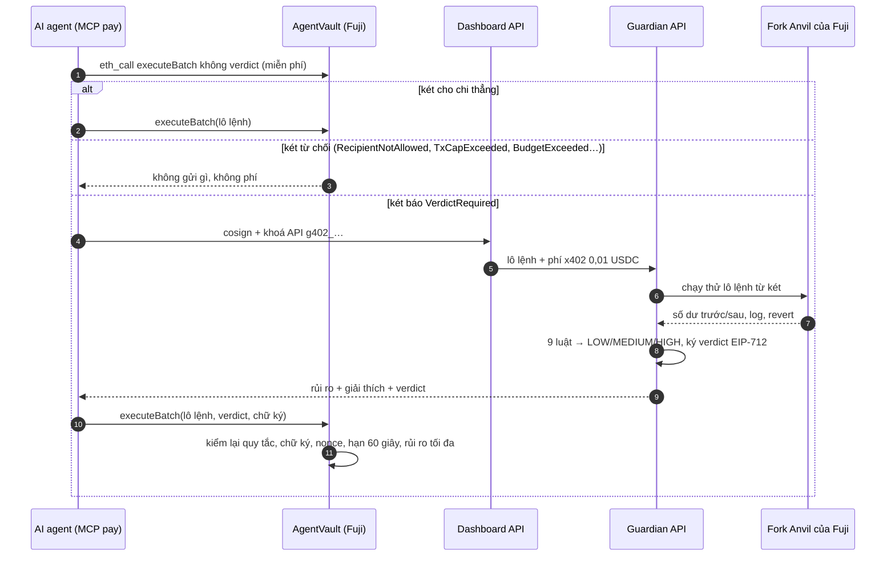

<p align="center">
  
</p>

# Guardian402

**Tường lửa giao dịch và đồng ký (co-signer) cho ví của AI agent trên Avalanche.**

Tiền nằm trong két smart contract (`AgentVault`) của chủ. Agent chỉ chi được trong quy tắc mà két cưỡng chế trên chain. Khoản chi cần phê duyệt thì Guardian chạy thử trên fork của Fuji, chấm rủi ro bằng luật cố định và ký một verdict EIP-712 gắn với đúng lô lệnh đó. Mỗi lần kiểm tra trả phí bằng USDC qua x402.

[Dùng thử](https://miho-hackathon.080895.xyz) · [Bằng chứng trên Fuji](#5-bằng-chứng-trên-fuji) · [Kiến trúc](#4-kiến-trúc) · [API](docs/API.md) · [Đặc tả](docs/SPEC.md) · [Mô hình đe doạ](docs/THREAT_MODEL.md) · [English](README.en.md)

[](https://testnet.snowtrace.io/address/0xAd6BC023d60f871488394dEceE9EC2E85E553549)


[](LICENSE)

Dự thi Team1 Vietnam UniHack 2026, đề gợi ý #12, #14 và #17. Chỉ chạy trên Avalanche Fuji testnet, không có token.
<br>Live demo: https://miho-hackathon.080895.xyz/
---

## 0. Thông tin cho người chấm

Số liệu dưới đây đo tại commit hiện tại; mỗi dòng có giao dịch hoặc lệnh để kiểm lại (mục [5](#5-bằng-chứng-trên-fuji) và [10](#10-chạy-lại)).

```yaml
project: Guardian402
category: AI-agent payments security (transaction firewall + co-signer)
hackathon: Team1 Vietnam UniHack 2026
topics: ["#12 agent treasury with guardrails", "#14 transaction guardian", "#17 x402 on Fuji"]
network: Avalanche Fuji C-Chain, chainId 43113, testnet only
live_demo: https://miho-hackathon.080895.xyz
source: https://github.com/surinatheworld/guardian402
contracts_verified_on_snowtrace:
  VaultFactory: "0xAd6BC023d60f871488394dEceE9EC2E85E553549"
  AgentVault_demo: "0xcf2F9AD1e2665112092696F49C4BBc42b81be05E"
usdc_circle: "0x5425890298aed601595a70AB815c96711a31Bc65"
erc8004:
  identity_registry: "0x8004A818BFB912233c491871b3d84c89A494BD9e"
  reputation_registry: "0x8004B663056A597Dffe9eCcC1965A193B7388713"
  agent_id: 295
enforcement: on-chain; AgentVault.executeBatch reverts on any policy violation
risk_engine: 9 deterministic rules; same input gives the same LOW/MEDIUM/HIGH
llm_role: explanation text only (Vietnamese + English); cannot change risk or sign; off with LLM_PROVIDER=none
custody: non-custodial; the owner withdraws at any time; the Guardian key signs verdicts only
revenue: x402 per request in USDC (check 0.005, wallet check 0.005, cosign 0.01); no token
tests: { forge: 197 passed, typescript: 386 passed, fork_integration: 18 }
contract_coverage: AgentVault.sol and VaultFactory.sol 100% lines, statements, branches, functions
eval: 40 synthetic labelled cases; precision 100%, recall 100%, false positive rate 0%, p50 354 ms
mocked_parts: [MockOracle, MockRouter + mWAVAX, scripted attack feed, 3/3 lookalike threshold] # DEMO MODE, section 8
```

### Tiêu chí chấm và bằng chứng

| Tiêu chí                      | Bằng chứng chính                                                                                                                                                                                                                                                                                  | Kiểm ở đâu                                                                                                                                                                                                                                       |
| :---------------------------- | :------------------------------------------------------------------------------------------------------------------------------------------------------------------------------------------------------------------------------------------------------------------------------------------------ | :----------------------------------------------------------------------------------------------------------------------------------------------------------------------------------------------------------------------------------------------- |
| Technical Implementation (25) | Két cưỡng chế quy tắc trên chain, 197 test Foundry (unit, fuzz, invariant), độ bao phủ `AgentVault` và `VaultFactory` 100% dòng và nhánh. Pipeline chạy thử, luật, giải thích, ký; 386 test TypeScript. Verdict ký bằng TypeScript được contract kiểm chéo. CI chạy build, typecheck, lint, test. | [`AgentVault.sol`](contracts/src/AgentVault.sol), [`contracts/test/`](contracts/test), [`pipeline.ts`](apps/guardian/src/pipeline.ts), [`VerdictCrossCheck.t.sol`](contracts/test/VerdictCrossCheck.t.sol), [`ci.yml`](.github/workflows/ci.yml) |
| Avalanche Integration (25)    | 6 contract đã verify trên Fuji. Phí x402 settle bằng USDC của Circle trên C-Chain (EIP-3009). Danh tính và uy tín trên ERC-8004 chính thức. Chạy thử trên fork Anvil của Fuji. Tra Routescan cho contract lạ. Hỗ trợ ví Core.                                                                     | [Mục 5](#5-bằng-chứng-trên-fuji), [`x402.ts`](apps/guardian/src/x402.ts), [`erc8004.fuji.json`](packages/shared/src/addresses/erc8004.fuji.json), [`explorer.ts`](apps/guardian/src/explorer.ts)                                                 |
| Creativity & Innovation (15)  | Hai lớp độc lập: quy tắc trên chain vẫn chặn khi agent bỏ qua Guardian; verdict gắn hash lô lệnh, nonce và hạn 60 giây. Phí theo rủi ro: két tự kiểm miễn phí trước, chỉ trả Guardian khi két đòi phê duyệt. LLM không quyết định tiền đi đâu.                                                    | [Mục 3](#3-giải-pháp-hai-lớp-bảo-vệ), [`agent-tools.ts`](apps/guardian-mcp/src/agent-tools.ts#L213)                                                                                                                                              |
| Impact & Use Case (15)        | Người vận hành AI agent giao tiền cho agent mà không giao toàn quyền. Công cụ MCP `pay` dùng được với mọi agent hỗ trợ MCP. Trang Kiểm tra ví dùng cho bất kỳ ví nào trước khi ký.                                                                                                                | [Mục 6](#6-dùng-thử), [`packages/mcp-agent/`](packages/mcp-agent), [`/kiem-tra-vi`](https://miho-hackathon.080895.xyz/kiem-tra-vi)                                                                                                               |
| UI/UX & Demo (10)             | Dashboard tiếng Việt: tạo két bằng một giao dịch, chạy thử kịch bản, xem từng giao dịch bị chặn hay đã chi kèm lời giải thích, khoá khẩn cấp.                                                                                                                                                     | [Bản công khai](https://miho-hackathon.080895.xyz), ảnh chụp ở [mục 6](#6-dùng-thử)                                                                                                                                                              |

### Đề gợi ý và phần đáp ứng

| Đề                               | Yêu cầu chính                             | Guardian402 đáp ứng bằng                                                                                                                                                     |
| :------------------------------- | :---------------------------------------- | :--------------------------------------------------------------------------------------------------------------------------------------------------------------------------- |
| #12 Agent treasury có guardrails | Agent quản lý tiền trong giới hạn của chủ | `AgentVault`: danh sách người nhận và ứng dụng, hạn mức ngày, mỗi giao dịch và tổng ngân sách, khoá khẩn cấp, mức rủi ro tối đa. `VaultFactory` tạo két trong một giao dịch. |
| #14 Transaction Guardian         | Kiểm tra giao dịch trước khi ký           | `POST /v1/wallet/check` và trang `/kiem-tra-vi`: chạy thử từ địa chỉ của bất kỳ ví nào, 7 luật, lời giải thích tiếng Việt và tiếng Anh.                                      |
| #17 x402 trên Fuji               | Dịch vụ thu phí theo lần gọi qua x402     | `check`, `cosign`, `wallet/check` thu USDC trên Fuji qua x402 2.28.0; facilitator tự host được; Guardian dạng MCP server có trả phí.                                         |

## 1. Vấn đề

Đưa khoá ví cho AI agent là giao toàn quyền tiêu tiền. Agent có thể:

- hiểu sai lệnh, hoặc bị prompt injection rồi gửi giao dịch độc hại;
- chuyển tiền tới địa chỉ lừa đảo hay địa chỉ nhái gần giống địa chỉ thật;
- cấp quyền `approve` không giới hạn, gọi router chưa kiểm chứng;
- tiêu vượt mức chủ muốn.

Quy tắc nằm trong phần mềm của agent hay trên một máy chủ thì ai cầm khoá agent cũng bỏ qua được. Quy tắc chỉ có hiệu lực khi agent không vượt qua được, nên Guardian402 đặt quy tắc trong smart contract giữ tiền.

Guardian402 không phải một AI agent. Đây là hạ tầng nằm giữa quyết định của agent và quyền dùng tiền.

## 2. Ba câu hỏi bắt buộc của đề

| Câu hỏi                 | Trả lời                                                                                                                                                                                                                                                                                                                                                                                                                                                                                         |
| :---------------------- | :---------------------------------------------------------------------------------------------------------------------------------------------------------------------------------------------------------------------------------------------------------------------------------------------------------------------------------------------------------------------------------------------------------------------------------------------------------------------------------------------- |
| Vì sao cần on-chain?    | Két là nơi duy nhất agent không vượt qua được: mọi lệnh phải qua `executeBatch`, sai quy tắc là revert và tiền ở lại két. Két tự kiểm chữ ký verdict lúc thực thi, nên không phải tin máy chủ nào. Chủ két giữ quyền rút tiền và khoá két.                                                                                                                                                                                                                                                      |
| Vì sao Avalanche?       | USDC của Circle trên C-Chain hỗ trợ EIP-3009, đúng thứ scheme `exact` của x402 cần: agent chỉ ký, facilitator gửi giao dịch. Phí và thời gian vào block của C-Chain đủ thấp để thu vài phần nghìn USDC mỗi lần và để giao dịch vào block trong hạn 60 giây của verdict. Fork C-Chain bằng Anvil cho phép chạy thử trên trạng thái gần nhất của Fuji. ERC-8004 chính thức đã có trên Fuji.                                                                                                       |
| Tiền từ đâu?            | Phí theo lần gọi, trả bằng USDC qua x402: 0,005 USDC cho `check` và `wallet/check`, 0,01 USDC cho `cosign`. Chỉ thu khi Guardian trả lời thành công. Khoản két tự chặn hoặc khoản nhỏ dưới ngưỡng phê duyệt thì không gọi Guardian, không tốn phí. Không có token, không bán token, không có lợi suất.                                                                                                                                                                                          |
| Giới hạn pháp lý tại VN | Tài sản mã hoá không phải phương tiện thanh toán hợp pháp tại Việt Nam, nên sản phẩm chỉ chạy trên Fuji với token thử nghiệm. Không giữ tiền người dùng, không huy động vốn, không tư vấn đầu tư. Trên chain chỉ có hash, thanh toán và trạng thái; tài khoản dashboard (email, mật khẩu đã băm) chỉ nằm trong cơ sở dữ liệu của máy chủ dashboard. Lên mainnet cho người dùng Việt Nam cần rà lại Luật Công nghiệp công nghệ số (2025) và chương trình thí điểm theo Nghị quyết 05/2025/NQ-CP. |

## 3. Giải pháp: hai lớp bảo vệ

| Lớp                        | Chạy ở đâu                         | Làm gì                                                                                                  | Khi agent bị chiếm quyền và bỏ qua Guardian     |
| :------------------------- | :--------------------------------- | :------------------------------------------------------------------------------------------------------ | :---------------------------------------------- |
| 1. Quy tắc trên chain      | `AgentVault` trên Fuji             | Kiểm mọi lệnh của agent: người nhận, ứng dụng, hạn mức, verdict, khoá khẩn cấp. Sai một điều là revert. | Vẫn chặn                                        |
| 2. Chạy thử và chấm rủi ro | Guardian API + fork Anvil của Fuji | Chạy thử lô lệnh, chấm bằng 9 luật, giải thích, ký verdict EIP-712 cho đúng lô lệnh đó.                 | Két đòi verdict, nên lệnh cần duyệt vẫn bị chặn |

### Lớp 1: `AgentVault`

Mọi lệnh của agent phải qua [`executeBatch`](contracts/src/AgentVault.sol#L248), tối đa 8 lệnh một lô. Thứ tự kiểm tra:

1. Két không bị khoá; người gọi đúng là agent do chủ chỉ định.
2. Từng lệnh qua [`_checkCall`](contracts/src/AgentVault.sol#L566): với token chỉ được `transfer` hoặc `approve` đúng định dạng; người nhận phải trong danh sách; contract và hàm được gọi phải được duyệt; `approve` không quá mức tối đa (`ApprovalTooLarge`).
3. Nếu có verdict: đúng hash lô lệnh, đúng `verdictNonce`, chưa quá hạn, đúng chữ ký Guardian, rủi ro không vượt `maxAgentRisk` ([`_verifyVerdict`](contracts/src/AgentVault.sol#L610)). Nonce tăng trước mọi lời gọi ra ngoài.
4. Chạy lô lệnh, rồi thu hồi phần `approve` không dùng hết ([`_revokeApprovals`](contracts/src/AgentVault.sol#L651)).
5. Tính số dư thực giảm của từng token và AVAX; kiểm hạn mức ngày (theo ngày UTC), mỗi giao dịch (`maxPerTx`) và tổng ngân sách (`budget`) ([`_recordOutflow`](contracts/src/AgentVault.sol#L680)).
6. Đòi verdict (`VerdictRequired`) khi khoản chi vượt `verdictThreshold`, khi có `approve`, hoặc khi lô lệnh gọi contract và làm giảm số dư.

Quyền của chủ két: rút tiền bất cứ lúc nào kể cả khi két đang khoá, đổi agent, đổi Guardian, sửa quy tắc, làm mới ngân sách, và `ownerExecute` để tự chạy lệnh. `renounceOwnership` bị tắt. [`VaultFactory`](contracts/src/VaultFactory.sol#L21) tạo két trong một giao dịch và không giữ quyền gì trên két.

### Lớp 2: Guardian API

[`Pipeline.run`](apps/guardian/src/pipeline.ts#L113): kiểm đầu vào → đọc quy tắc của két → chạy thử trên fork → chạy luật → giải thích → ký verdict (chỉ `cosign`) → lưu → trả lời.

| Luật                        | Phát hiện                                                                                                | Mức                                                             |
| :-------------------------- | :------------------------------------------------------------------------------------------------------- | :-------------------------------------------------------------- |
| `SIMULATION_FAILED`         | Lô lệnh revert khi chạy thử                                                                              | HIGH                                                            |
| `POLICY_PRECHECK`           | Két sẽ từ chối: sai người nhận, vượt hạn mức hay ngân sách, két đang khoá                                | HIGH                                                            |
| `UNLIMITED_APPROVAL`        | `approve` không giới hạn, vượt mức tối đa hoặc cho địa chỉ ngoài danh sách; `setApprovalForAll`          | HIGH                                                            |
| `UNKNOWN_CONTRACT`          | Contract ngoài danh sách đã biết                                                                         | MEDIUM; HIGH khi kèm tiền, chưa verify hoặc mới tạo dưới 7 ngày |
| `ADDRESS_POISONING`         | Địa chỉ nhái: trùng 4 ký tự đầu và 4 ký tự cuối với một địa chỉ tin cậy, hoặc chỉ khác nó tối đa 4 ký tự | HIGH                                                            |
| `DRAIN_PATTERN`             | Một lô lệnh rút từ 50% số dư trở lên, trừ khi toàn bộ đi tới người nhận đã duyệt                         | HIGH                                                            |
| `ABNORMAL_SLIPPAGE`         | Swap nhận ít hơn giá tham chiếu                                                                          | MEDIUM từ 2%, HIGH từ 10%                                       |
| `RECIPIENT_NOT_ALLOWLISTED` | Tiền hoặc đầu ra của swap tới địa chỉ ngoài danh sách                                                    | HIGH                                                            |
| `UNPROTECTED_SWAP`          | `minOut` thấp hơn kết quả chạy thử quá 3%                                                                | MEDIUM                                                          |

Ngưỡng nằm trong [`config/rules.json`](apps/guardian/config/rules.json). Kiểm tra ví bất kỳ dùng 7 luật, bỏ hai luật đọc quy tắc của két (`POLICY_PRECHECK`, `RECIPIENT_NOT_ALLOWLISTED`). Tra Routescan cho contract lạ bật bằng `EXPLORER_LOOKUP=true`.

**Vai trò của LLM.** Mặc định Guardian dùng mẫu câu có sẵn. Khi bật (Anthropic, Gemini hoặc API kiểu OpenAI), LLM chỉ viết lời giải thích từ kết quả chạy thử. Lời giải thích mâu thuẫn với mức rủi ro, sai định dạng hoặc quá 1,5 giây thì bị thay bằng mẫu câu ([`llm.ts`](apps/guardian/src/explain/llm.ts#L49)). Module giải thích không import trình ký hay ví nào.

## 4. Kiến trúc

Luồng của công cụ MCP `pay` ([`agent-tools.ts`](apps/guardian-mcp/src/agent-tools.ts#L213)); nút "Thử ngay trên web" của dashboard chạy cùng luồng.



| Thành phần   | Đường dẫn                                   | Vai trò                                                                                                      |
| :----------- | :------------------------------------------ | :----------------------------------------------------------------------------------------------------------- |
| Contract     | [`contracts/`](contracts)                   | `AgentVault`, `VaultFactory`, mock DEMO; Solidity 0.8.28, OpenZeppelin 5.7.0, EVM `cancun`                   |
| Dùng chung   | [`packages/shared/`](packages/shared)       | ABI, địa chỉ, kiểu EIP-712, schema zod, RPC có dự phòng                                                      |
| Guardian API | [`apps/guardian/`](apps/guardian)           | Paywall x402, chạy thử, luật, giải thích, ký verdict, lưu SQLite                                             |
| MCP server   | [`apps/guardian-mcp/`](apps/guardian-mcp)   | MCP phía agent (`get_rules`, `check_payment`, `pay`, `get_transaction`); Guardian dạng MCP server có trả phí |
| Gói npm MCP  | [`packages/mcp-agent/`](packages/mcp-agent) | Bản đóng gói `guardian402-mcp` của MCP phía agent                                                            |
| Dashboard    | [`apps/dashboard/`](apps/dashboard)         | Next.js 16, tiếng Việt: tài khoản (email hoặc SIWE), tạo két, quy tắc, hoạt động, agent, API cho agent       |
| Agent demo   | [`apps/agent/`](apps/agent)                 | Kịch bản S0–S6, API điều khiển cục bộ                                                                        |
| Eval         | [`eval/`](eval)                             | 40 ca có nhãn, bộ chạy, báo cáo                                                                              |
| Script       | [`scripts/`](scripts)                       | Fork, deploy, seed, ERC-8004, chạy cả hệ thống                                                               |

## 5. Bằng chứng trên Fuji

Mọi giao dịch dưới đây chạy trên Avalanche Fuji thật và kiểm được trên Snowtrace.

### 5.1 Contract đã verify

| Contract                                | Địa chỉ                                                                                                                         |
| :-------------------------------------- | :------------------------------------------------------------------------------------------------------------------------------ |
| VaultFactory                            | [`0xAd6BC023d60f871488394dEceE9EC2E85E553549`](https://testnet.snowtrace.io/address/0xAd6BC023d60f871488394dEceE9EC2E85E553549) |
| AgentVault (két demo, S0–S6)            | [`0xcf2F9AD1e2665112092696F49C4BBc42b81be05E`](https://testnet.snowtrace.io/address/0xcf2F9AD1e2665112092696F49C4BBc42b81be05E) |
| MockRouter (DEMO)                       | [`0xe20967C615e442991D468ed7f797edcAeA1771d9`](https://testnet.snowtrace.io/address/0xe20967C615e442991D468ed7f797edcAeA1771d9) |
| MockOracle (DEMO)                       | [`0xeebAac693aA19308bA859b3D668e3794310e66AE`](https://testnet.snowtrace.io/address/0xeebAac693aA19308bA859b3D668e3794310e66AE) |
| mWAVAX (DEMO)                           | [`0xC2439b70B85CF5fBD5A7dA935567e476bFc97ba5`](https://testnet.snowtrace.io/address/0xC2439b70B85CF5fBD5A7dA935567e476bFc97ba5) |
| CancunSmoke (kiểm EVM của Fuji)         | [`0x0D363882aA2DdA271323F91a1a268Cd707D3C426`](https://testnet.snowtrace.io/address/0x0D363882aA2DdA271323F91a1a268Cd707D3C426) |
| USDC (của Circle, không do nhóm deploy) | [`0x5425890298aed601595a70AB815c96711a31Bc65`](https://testnet.snowtrace.io/address/0x5425890298aed601595a70AB815c96711a31Bc65) |

Guardian có danh tính ERC-8004 là agent **#295** trên IdentityRegistry chính thức [`0x8004A818…4BD9e`](https://testnet.snowtrace.io/address/0x8004A818BFB912233c491871b3d84c89A494BD9e) ([giao dịch đăng ký](https://testnet.snowtrace.io/tx/0x6d22083e006da209338f289b5389f1486902233f859bcfe00b179512b8658001)). Chủ két xem lại một lần kiểm tra rồi ghi "đúng" hoặc "báo động nhầm" lên ReputationRegistry chính thức; trang Về Guardian chỉ tính phản hồi từ ví đang sở hữu két tạo qua `VaultFactory`, và khoá của Guardian không tự chấm được cho mình. Két demo trước (code cũ, giữ nguyên): [`0x6A8C…Cf3c`](https://testnet.snowtrace.io/address/0x6A8CCC880238DF1f4309d1B04EDFBD6017A4Cf3c).

### 5.2 Luồng chính với ví MetaMask (13/11/2026)

Két [`0xff0d…9C2d`](https://testnet.snowtrace.io/address/0xff0db552A0Ffe0464273DAe402dd19efB7Bc9C2d) tạo qua trang Bắt đầu: chỉ trả cho Treasury, tối đa 2 USDC mỗi giao dịch, tổng 5 USDC. Agent gọi `pay` của MCP server.

| Bước                               | Ai làm            | Kết quả                                                                                                                                                                                                                    |
| :--------------------------------- | :---------------- | :------------------------------------------------------------------------------------------------------------------------------------------------------------------------------------------------------------------------- |
| Nạp 10 USDC vào két                | Chủ két, MetaMask | [tx](https://testnet.snowtrace.io/tx/0xe14a3197b03ce8dcc7855bf37aa24feb2163389c6108f2751e8d7a89dd187bf3)                                                                                                                   |
| Trả 1 USDC cho Treasury            | Agent             | rủi ro thấp, [đã chi](https://testnet.snowtrace.io/tx/0xa7db521a54613d8a92fccbb7b331ec28bf48e2d7c0aac1bfcb2fa84920e8ed97)                                                                                                  |
| Trả 2,5 USDC                       | Agent             | bị chặn: vượt hạn mức mỗi giao dịch, không gửi gì                                                                                                                                                                          |
| Trả 2 USDC, rồi 2 USDC             | Agent             | [đã chi](https://testnet.snowtrace.io/tx/0x42170a0049edecfd3c7228b25aaae7e835b6627b7587d367f502904dff8c9607), [đã chi](https://testnet.snowtrace.io/tx/0xf7103a3222f7e599ece9413f50de34cce170c1a979d5d95d3debd1d857e91edd) |
| Trả 0,5 USDC khi đã tiêu đủ 5 USDC | Agent             | bị chặn: hết tổng ngân sách                                                                                                                                                                                                |
| Làm mới ngân sách                  | Chủ két, MetaMask | ngân sách về lại 5 USDC                                                                                                                                                                                                    |
| Trả 1 USDC sau khi làm mới         | Agent             | [đã chi](https://testnet.snowtrace.io/tx/0xd5e2f1963f288ac01983708ff5d181ee9aaa57cf2db1b57f3cb5b58638b166d6)                                                                                                               |
| Rút 2 USDC về ví                   | Chủ két, MetaMask | thành công                                                                                                                                                                                                                 |

### 5.3 Phí theo rủi ro (15/11/2026)

`pnpm happy-path:fuji` với `HAPPY_PATH_UNIT=0.2`. Két [`0x0BBc…A1bE`](https://testnet.snowtrace.io/address/0x0BBcE9a627A205C7C620a556261Fe23d7290A1bE) tạo qua VaultFactory ([tx](https://testnet.snowtrace.io/tx/0x70d022f02d593f860c0c3408f4effb2ed7d1cf47134bc93b5612cb2fce059924), [nạp 1,2 USDC](https://testnet.snowtrace.io/tx/0x37289c1d379b54b2c6c801a8b7cad38e74261e0ce61dc0fb267d85e180fc299f)): chỉ trả cho Treasury, tối đa 0,4 USDC mỗi giao dịch, tổng 0,7 USDC, khoản tới 0,1 USDC không cần Guardian.

| Khoản    | Két tự kiểm (miễn phí) | Guardian                                                                                                                 | Kết quả                                                                                                      |
| :------- | :--------------------- | :----------------------------------------------------------------------------------------------------------------------- | :----------------------------------------------------------------------------------------------------------- |
| 0,1 USDC | cho chi thẳng          | không gọi, không phí                                                                                                     | [đã chi](https://testnet.snowtrace.io/tx/0x7b4488a4cd85b770e5f849795b504b8ba36783cefa67a1bd0fb09eb04839b5f8) |
| 0,2 USDC | cần phê duyệt          | LOW, [phí 0,01 USDC](https://testnet.snowtrace.io/tx/0xe5b22ee55c47646680c00b093a68a9091da6b1dbf2e9f66b471bc46e614548d1) | [đã chi](https://testnet.snowtrace.io/tx/0x6690c25d240b54e10936a06af331c40e04de58c54f20b77132dfd3a9be9d3915) |
| 0,5 USDC | `TxCapExceeded`        | không gọi, không phí                                                                                                     | không gửi gì                                                                                                 |
| 0,4 USDC | cần phê duyệt          | LOW, [phí 0,01 USDC](https://testnet.snowtrace.io/tx/0x628715afc7c31c8eda72ae2eb72111351e918b235bac418475c6243250412ff4) | [đã chi](https://testnet.snowtrace.io/tx/0x23701067d01e4cfcfea76a0ab7d41a9ed0b0e39a6b41d769d9986de467c5924f) |
| 0,1 USDC | `BudgetExceeded`       | không gọi, không phí                                                                                                     | không gửi gì                                                                                                 |

### 5.4 Kịch bản tấn công S0–S6

| Mã  | Kịch bản                                                | Guardian | Két                                                                                                                                                                                                                                            |
| :-- | :------------------------------------------------------ | :------- | :--------------------------------------------------------------------------------------------------------------------------------------------------------------------------------------------------------------------------------------------- |
| S0  | Chuyển 1,5 USDC cho Treasury                            | LOW      | [thực hiện](https://testnet.snowtrace.io/tx/0x02b10072b18e80301ccd5fdfa8e0193d74fac595c83a1dbdeec677dea0444eb1)                                                                                                                                |
| S1  | Swap 2 USDC sang mWAVAX, có `minOut`                    | LOW      | [thực hiện](https://testnet.snowtrace.io/tx/0x643d89ad6e6e526bdc2bc5f2d9a0084263c68564235104d4a0c418b94a090e00)                                                                                                                                |
| S2  | Agent bị chèn lệnh, rút sạch két về ví kẻ tấn công      | HIGH 100 | [`RecipientNotAllowed`](https://testnet.snowtrace.io/tx/0x18f9908fedaf48e0e7ca4eea3e1b5020470d333869412ac90ff0cf6a25e132ae)                                                                                                                    |
| S3  | Cấp quyền không giới hạn cho địa chỉ nhái sàn swap      | HIGH 100 | [`RecipientNotAllowed`](https://testnet.snowtrace.io/tx/0xb0a0846cf4297693f3e6508d50b631e7fff1e51542c620435a9c640c8ac00fce)                                                                                                                    |
| S4  | Swap qua pool lệch giá 30%, `minOut = 0`                | HIGH 85  | [`RiskTooHigh`](https://testnet.snowtrace.io/tx/0x1220fd094ecbbc621c6640f15c9570092f34cfd330b329271432473d8f3869f5)                                                                                                                            |
| S5  | Dùng lại phê duyệt cũ cho lệnh khác, rồi khi đã hết hạn | LOW      | [`InvalidVerdict`](https://testnet.snowtrace.io/tx/0x9924ab795e1974f6232321d1fee49c6046213d494790f72da4f86d74eb5ab056), [`VerdictExpired`](https://testnet.snowtrace.io/tx/0x885d3cb381d11d9d55b98c7bd96b7f174abddc9d406c283c582c7496d620a51f) |
| S6  | Agent chi khi chủ két đã khoá khẩn cấp                  | HIGH 60  | [`Paused`](https://testnet.snowtrace.io/tx/0xe61ec50818bdbe9d5844e2546a7d2ff3902ef71ff09d083e8100482b19b61161)                                                                                                                                 |

- S2, S3: agent bị chiếm quyền gửi thẳng vào két, không qua Guardian; lớp 1 vẫn từ chối.
- S4: qua mọi quy tắc tĩnh của két; chỉ kết quả chạy thử của lớp 2 cho thấy pool lệch giá.
- Mỗi lần gọi Guardian có một giao dịch trả phí x402 thật, ví dụ [phí của S0](https://testnet.snowtrace.io/tx/0xadf11f6a7b76b4a10b830d8cd978b0fe50bc0e6734ce72aee852204e8b2e4741).

### 5.5 Kiểm thử tự động

| Bộ                                              | Kết quả                                                                                | Lệnh                                                                    |
| :---------------------------------------------- | :------------------------------------------------------------------------------------- | :---------------------------------------------------------------------- |
| Contract: unit, fuzz, invariant                 | 197/197                                                                                | `cd contracts && forge test`                                            |
| Độ bao phủ `AgentVault.sol`, `VaultFactory.sol` | 100% dòng, câu lệnh, nhánh, hàm                                                        | `forge coverage --report summary --no-match-coverage "(test\|script)/"` |
| TypeScript, 7 package                           | 386/386                                                                                | `pnpm test`                                                             |
| Guardian trên fork Fuji                         | 18 test                                                                                | `pnpm --filter @guardian402/guardian test:fork`                         |
| Verdict ký bằng TypeScript, kiểm bằng Solidity  | pass                                                                                   | `pnpm test:crosscheck`                                                  |
| Eval, 40 ca có nhãn do nhóm viết                | precision 100%, recall 100%, dương tính giả 0%, p50 354 ms ([báo cáo](eval/report.md)) | `pnpm eval`                                                             |

Eval đo trên dữ liệu tổng hợp do nhóm tự viết, không phải giao dịch thật của người dùng; kết quả không có nghĩa Guardian bắt được mọi tấn công.

## 6. Dùng thử

**Không cần ví.** Mở [miho-hackathon.080895.xyz](https://miho-hackathon.080895.xyz), bấm **Xem két demo** ở trang đăng nhập, rồi mở **Chạy thử** để Guardian chấm một kịch bản. Chạy thử miễn phí và không gửi gì lên chain.

**Không có két.** Trang [**Kiểm tra ví**](https://miho-hackathon.080895.xyz/kiem-tra-vi) kiểm một giao dịch của bất kỳ ví nào trước khi ký: cấp quyền, chuyển tiền, hoặc dữ liệu thô mà trang web gửi cho ví. Ví và ứng dụng tích hợp gọi `POST /v1/wallet/check` (0,005 USDC qua x402).

**Chủ két, thiết lập một lần:**

1. Đăng nhập bằng ví (Sign-In with Ethereum: ký một thông điệp, miễn phí) hoặc email. Hỗ trợ [Core](https://core.app) và MetaMask trên mạng Avalanche Fuji.
2. Tạo két ở trang **Bắt đầu**: chọn ví agent, người nhận và hạn mức, rồi ký một giao dịch `VaultFactory.createVault`. Một nút nữa nạp USDC vào két.
3. Kết nối agent: nhận khoá API (`g402_…`) và cấu hình MCP. Nút **Thử ngay trên web** cho xem một khoản hợp lệ và một khoản bị chặn.
4. Theo dõi ở **Tổng quan** và **Hoạt động**. Làm mới ngân sách, sửa quy tắc, rút tiền hay khoá khẩn cấp đều là giao dịch chủ két tự ký.

**Agent** cần địa chỉ API (`https://<dashboard>/api/agent/v1`), khoá API và khoá riêng của ví agent. Khoá riêng chỉ nằm trên máy chạy agent. Khoá API không rút được tiền và không đổi được quy tắc.

| Công cụ MCP       | Làm gì                                                                                                  | Phí                                                    |
| :---------------- | :------------------------------------------------------------------------------------------------------ | :----------------------------------------------------- |
| `get_rules`       | Đọc quy tắc và hạn mức còn lại của két, trả về thành câu hướng dẫn cho agent                            | miễn phí                                               |
| `check_payment`   | Kiểm tra trước một khoản chi, không gửi                                                                 | 0,005 USDC                                             |
| `pay`             | Két tự kiểm trước; khoản két cho chi thẳng thì gửi luôn, khoản cần duyệt thì Guardian duyệt rồi két chi | 0,01 USDC khi cần duyệt; 0 khi két chặn hoặc khoản nhỏ |
| `get_transaction` | Xem kết quả một giao dịch                                                                               | miễn phí                                               |

Cấu hình MCP, Agent REST API và Guardian API: [docs/API.md](docs/API.md).

|                   Hoạt động: Guardian chấm gì, két quyết định ra sao                   | Quy tắc chi tiêu: hạn mức, người nhận, mức rủi ro |
| :------------------------------------------------------------------------------------: | :-----------------------------------------------: |
|  |   |

## 7. Phạm vi: hỗ trợ và chưa hỗ trợ

| Hỗ trợ                                                                 | Chưa hỗ trợ, lý do                                                                                                                     |
| :--------------------------------------------------------------------- | :------------------------------------------------------------------------------------------------------------------------------------- |
| Chuyển ERC-20 và AVAX tới người nhận đã duyệt                          | Phân tích calldata của contract tuỳ ý: V1 chỉ hiểu chuyển token và swap qua router đã biết                                             |
| Swap qua router đã duyệt, kiểm trượt giá bằng oracle tham chiếu        | Tham số bên trong lệnh gọi contract đã duyệt (ví dụ người nhận của swap): két không đọc; phần này dựa vào luật của Guardian và hạn mức |
| Hạn mức ngày theo ngày UTC, mỗi giao dịch, tổng ngân sách              | Cửa sổ 24 giờ trượt: quanh 00:00 UTC có thể chi tới hai lần hạn mức ngày; hạn mức mỗi giao dịch và tổng ngân sách vẫn giữ              |
| Kiểm tra giao dịch của bất kỳ ví nào trước khi ký (tư vấn, không chặn) | Chặn bắt buộc bên trong ví của người dùng: cần tích hợp với nhà làm ví                                                                 |
| Khoản nhỏ dưới ngưỡng phê duyệt chạy không cần Guardian, trong hạn mức | Lộ khoá agent: kẻ tấn công vẫn chi được các khoản nhỏ tới người nhận đã duyệt, trong hạn mức                                           |
| Chủ két giữ toàn quyền                                                 | Lộ khoá chủ két: ai có khoá đó đổi được quy tắc và dùng `ownerExecute`, đúng thiết kế                                                  |
| Chạy thử ngay trước khi ký verdict                                     | Trạng thái chain đổi giữa lúc chạy thử và lúc vào block: cần đặt `minOut` trên chain                                                   |
| Chặn swap lệch giá quá ngưỡng                                          | Lỗ do thị trường: swap hợp lệ, trượt giá trong ngưỡng vẫn có thể lỗ                                                                    |
| Chặn giao dịch độc hại sau khi agent bị chèn lệnh                      | Chống prompt injection ở tầng prompt                                                                                                   |
| Tài sản nằm trong két                                                  | Tài sản ngoài `AgentVault`                                                                                                             |

Ghi chú vận hành: bản sao Fuji của Guardian được làm mới vài phút một lần, nên khoản chi ngay sau khi nạp tiền có thể chậm thêm vài giây. Bản công khai chấm kịch bản S0–S6 nhưng không gửi chúng lên chain; chạy thật cần chạy dự án trên máy ([mục 9](#9-chạy-trên-máy)). Mô hình đe doạ đầy đủ: [docs/THREAT_MODEL.md](docs/THREAT_MODEL.md).

## 8. Phần giả lập (DEMO MODE)

Mỗi phần dưới đây nằm sau một cờ cấu hình, hiện dải `DEMO MODE` trên dashboard và được công bố khi thuyết trình.

| Phần                     | Thay cho                                                          | Cờ hoặc vị trí                                                                |
| :----------------------- | :---------------------------------------------------------------- | :---------------------------------------------------------------------------- |
| MockOracle               | Oracle giá thật; giá cố định 25 USDC/mWAVAX                       | [`contracts/src/mocks/`](contracts/src/mocks)                                 |
| MockRouter và mWAVAX     | DEX thật; hai pool, pool 1 lệch giá 30%                           | [`contracts/src/mocks/`](contracts/src/mocks)                                 |
| Lệnh "prompt injection"  | Agent LLM thật; đọc từ fixture cố định để demo lặp lại được       | [`apps/agent/fixtures/feed.json`](apps/agent/fixtures/feed.json), `DEMO_MODE` |
| Ngưỡng địa chỉ nhái 3/3  | Ngưỡng thật 4/4                                                   | `DEMO_MODE`, [`rules.json`](apps/guardian/config/rules.json)                  |
| x402 facilitator tự host | Facilitator công cộng, khi bị giới hạn tần suất hoặc demo offline | `FACILITATOR_URL`, `pnpm facilitator`                                         |

## 9. Chạy trên máy

**Yêu cầu:** Node.js ≥ 22.13, pnpm 10 (`corepack enable pnpm`), Foundry 1.8.5, Git. Nếu Windows chặn `anvil.exe`, cần Docker Desktop (fork chạy bằng image `ghcr.io/foundry-rs/foundry:v1.8.5`). Trên Windows, chạy lệnh từ Git Bash và clone vào đường dẫn ngắn (ví dụ `C:\code`) hoặc bật `git config --global core.longpaths true`.

```bash
git clone --recurse-submodules https://github.com/surinatheworld/guardian402
cd guardian402
pnpm install
```

```bash
./run-local.sh
```

Chạy toàn bộ trên một fork của Fuji, không cần token thử nghiệm: lần đầu tạo `.env.local` với khoá testnet mới và nạp dữ liệu mẫu. Mở fork (8545), facilitator x402 (4022), Guardian API (4402), agent API (4403) và dashboard (http://localhost:3000); log ở `.run-local/logs/`. Dừng bằng `Ctrl+C` hoặc `./run-local.sh stop`.

```bash
./run-local.sh fuji
```

Chạy trên Fuji thật: két, phí x402 và giao dịch đều trên Fuji; fork chỉ để Guardian chạy thử. Cần khoá testnet có AVAX và USDC thử nghiệm ([faucet.circle.com](https://faucet.circle.com), [Core faucet](https://core.app/tools/testnet-faucet)).

```bash
./run-local.sh scenario all
```

Chạy bảy kịch bản S0–S6 (một kịch bản: `scenario S2`). Danh sách lệnh đầy đủ: [CLAUDE.md](CLAUDE.md#commands).

## 10. Chạy lại

| Muốn kiểm                     | Lệnh                                                               | Kết quả mong đợi                                      |
| :---------------------------- | :----------------------------------------------------------------- | :---------------------------------------------------- |
| Contract                      | `cd contracts && forge test`                                       | `197 tests passed, 0 failed`                          |
| TypeScript                    | `pnpm test && pnpm typecheck && pnpm lint`                         | 386 test pass, không lỗi kiểu, không lỗi lint         |
| Verdict TypeScript ↔ Solidity | `pnpm test:crosscheck`                                             | `VerdictCrossCheck` pass                              |
| Eval                          | `pnpm fork`, rồi `pnpm eval`                                       | dấu vân tay `75b364aac5a8179c` trong `eval/report.md` |
| Kịch bản S0–S6                | `./run-local.sh`, rồi `./run-local.sh scenario all`                | mỗi kịch bản khớp bảng ở mục 5.4, thoát mã 0          |
| Luồng chính trên Fuji         | Guardian (`NETWORK=fuji`) và dashboard, rồi `pnpm happy-path:fuji` | 5 khoản như mục 5.3, thoát mã 0                       |

## 11. Tài liệu

| Tài liệu                                     | Nội dung                                                     |
| :------------------------------------------- | :----------------------------------------------------------- |
| [docs/SPEC.md](docs/SPEC.md)                 | Đặc tả kỹ thuật và nhật ký thay đổi                          |
| [docs/API.md](docs/API.md)                   | Endpoint công khai, Guardian API, Agent REST API, MCP server |
| [docs/THREAT_MODEL.md](docs/THREAT_MODEL.md) | Mô hình đe doạ và các lần rà soát bảo mật                    |
| [docs/DEMO_RUNBOOK.md](docs/DEMO_RUNBOOK.md) | Kịch bản thuyết trình                                        |
| [docs/PROGRESS.md](docs/PROGRESS.md)         | Nhật ký từng giai đoạn và kết quả kiểm thử                   |
| [eval/report.md](eval/report.md)             | Báo cáo eval                                                 |

Giấy phép: [MIT](LICENSE).
