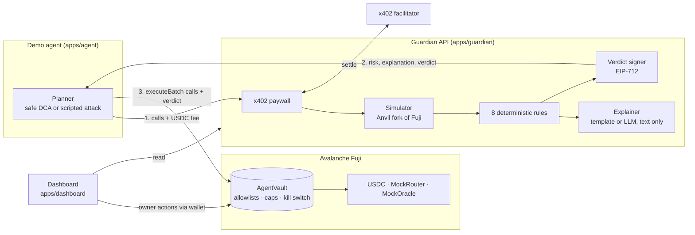

# Guardian402

A transaction firewall and co-signer for AI-agent wallets on Avalanche Fuji. Team1 Vietnam UniHack 2026.
Testnet only: no token, no real money, no custody.

An AI agent's funds sit in **AgentVault**, a contract the owner controls. Before the agent's transaction runs, the
**Guardian API** simulates it on a fork of Fuji, scores it with eight deterministic rules, explains the result in
Vietnamese and English, and signs an EIP-712 verdict bound to those exact calls. The vault runs the batch only if it
passes the on-chain policy (allowlists, daily caps, kill switch) and, when required, carries a valid low-risk
verdict. Each check is paid per request in USDC over **x402**. The LLM only writes the explanation; it never decides
the risk.

> **Tóm tắt.** Guardian402 là "tường lửa" cho ví của AI agent trên Avalanche Fuji. Tiền của agent nằm trong
> AgentVault do chủ ví kiểm soát. Trước khi agent gửi giao dịch, Guardian mô phỏng giao dịch trên bản fork của Fuji,
> chấm điểm bằng 8 luật cố định, giải thích bằng tiếng Việt và ký một verdict gắn với đúng giao dịch đó. Vault chỉ
> chạy khi giao dịch qua được luật on-chain và, khi cần, có verdict rủi ro thấp. Mỗi lần kiểm tra trả phí bằng USDC
> qua x402.

Docs: [SPEC](docs/SPEC.md) · [Threat model](docs/THREAT_MODEL.md) · [Demo runbook](docs/DEMO_RUNBOOK.md) ·
[Eval report](eval/report.md) · full command list in [CLAUDE.md](CLAUDE.md)

## Architecture



## Requirements

Node ≥ 22.13, pnpm 10 (`corepack enable pnpm`), Foundry 1.8.5 (`foundryup`), Git. On Windows, see
[Windows](#windows).

## Quickstart

### A. Tests and eval, no keys needed (about 10 minutes)

```bash
git clone --recurse-submodules https://github.com/surinatheworld/guardian402
cd guardian402
pnpm install
cd contracts && forge build && forge test && cd ..
pnpm test
```

Start a fork of Fuji in a second terminal, then run the eval (40 labelled cases, writes `eval/report.md`):

```bash
pnpm fork
```

```bash
pnpm eval
```

### B. Full demo on the local fork (about 15 minutes)

1. Make five throwaway keys with `cast wallet new` (testnet only, never reuse them).
2. `cp .env.example .env.local`, fill in `DEPLOYER_PK`, `OWNER_PK`, `AGENT_PK`, `GUARDIAN_SIGNER_PK`,
   `FACILITATOR_PK`, set `PAY_TO` to the deployer's address and keep `NETWORK=local`.
3. Run each long-running command in its own terminal:

```bash
pnpm fork
```

```bash
pnpm deploy:local && pnpm seed:local && pnpm known-contracts && pnpm mine-lookalike local
```

```bash
FACILITATOR_RPC_URL=http://127.0.0.1:8545 pnpm facilitator
```

```bash
FACILITATOR_URL=http://127.0.0.1:4022 DEMO_MODE=true pnpm dev:guardian
```

```bash
DEMO_MODE=true pnpm agent scenario all
```

The deploy and seed scripts fund the keys with test AVAX and test USDC on the fork; nothing touches Fuji.

Dashboard: put `NEXT_PUBLIC_NETWORK=local` in `apps/dashboard/.env.local`, run `DEMO_MODE=true pnpm dev:agent` and
`pnpm dev:dashboard`, then open http://localhost:3000.

### C. On Fuji

Use the team's deployment below, or fund your deployer from the faucet and run `pnpm deploy:fuji`, `pnpm seed:fuji`
and `pnpm verify:fuji`. The 3-minute demo is in [docs/DEMO_RUNBOOK.md](docs/DEMO_RUNBOOK.md).

## Environment

Every variable is listed with comments in [.env.example](.env.example) and in each app's `.env.example`. Secrets go
only in `.env.local` files, which git ignores. The dashboard holds no key: the owner signs with a browser wallet.

## Commands

| Command                                                    | What it does                                             |
| ---------------------------------------------------------- | -------------------------------------------------------- |
| `pnpm test` · `pnpm typecheck` · `pnpm lint`               | TypeScript tests, types and lint in every package        |
| `cd contracts && forge test`                               | contract unit, fuzz and invariant tests                  |
| `pnpm fork`                                                | Anvil fork of Fuji on :8545 (Docker fallback on Windows) |
| `pnpm deploy:local` · `pnpm seed:local`                    | deploy and seed on the fork                              |
| `pnpm deploy:fuji` · `pnpm seed:fuji` · `pnpm verify:fuji` | the same on Fuji, then verify on Snowtrace               |
| `pnpm dev:guardian`                                        | Guardian API on :4402                                    |
| `pnpm facilitator`                                         | self-hosted x402 facilitator on :4022                    |
| `pnpm agent scenario <S1..S6\|all>`                        | run the demo scenarios                                   |
| `pnpm dev:agent`                                           | agent control API on :4403 (DEMO only)                   |
| `pnpm dev:dashboard`                                       | dashboard on :3000                                       |
| `pnpm eval`                                                | 40-case eval, writes `eval/report.md`                    |
| `pnpm erc8004:fuji`                                        | register the Guardian on ERC-8004 (bonus B1)             |
| `pnpm mcp` · `pnpm mcp:example`                            | paid MCP server (bonus B2) and an agent that pays it     |
| `pnpm bench:guardian`                                      | latency of the Guardian pipeline (free DEMO endpoint)    |

## Fuji deployment

Avalanche Fuji C-Chain (chain id 43113), verified on [testnet.snowtrace.io](https://testnet.snowtrace.io).

| Contract          | Address                                                                                                                         |
| ----------------- | ------------------------------------------------------------------------------------------------------------------------------- |
| AgentVault        | [`0x3f6a5852788ff6a46d924C407976bB89487f7651`](https://testnet.snowtrace.io/address/0x3f6a5852788ff6a46d924C407976bB89487f7651) |
| MockRouter (DEMO) | [`0xe20967C615e442991D468ed7f797edcAeA1771d9`](https://testnet.snowtrace.io/address/0xe20967C615e442991D468ed7f797edcAeA1771d9) |
| MockOracle (DEMO) | [`0xeebAac693aA19308bA859b3D668e3794310e66AE`](https://testnet.snowtrace.io/address/0xeebAac693aA19308bA859b3D668e3794310e66AE) |
| mWAVAX (DEMO)     | [`0xC2439b70B85CF5fBD5A7dA935567e476bFc97ba5`](https://testnet.snowtrace.io/address/0xC2439b70B85CF5fBD5A7dA935567e476bFc97ba5) |
| USDC (Circle)     | [`0x5425890298aed601595a70AB815c96711a31Bc65`](https://testnet.snowtrace.io/address/0x5425890298aed601595a70AB815c96711a31Bc65) |

**ERC-8004 (bonus B1).** The Guardian is agent **#295** on the official IdentityRegistry
[`0x8004A818BFB912233c491871b3d84c89A494BD9e`](https://testnet.snowtrace.io/address/0x8004A818BFB912233c491871b3d84c89A494BD9e).
Read its registration file:

```bash
cast call 0x8004A818BFB912233c491871b3d84c89A494BD9e "tokenURI(uint256)(string)" 295 --rpc-url https://api.avax-test.network/ext/bc/C/rpc
```

## MCP server (bonus B2)

`pnpm mcp` serves the Guardian's checks as MCP tools paid over x402: `check_transaction` (0.005 USDC) and
`cosign_transaction` (0.01 USDC, with the signed verdict). To try it with the example agent, start a second fork and
run:

```bash
FORK_PORT=8546 pnpm fork
```

```bash
NETWORK=fuji MCP_FORK_RPC_URL=http://127.0.0.1:8546 FACILITATOR_URL=http://127.0.0.1:4022 DEMO_MODE=true pnpm mcp:example
```

## What is mocked (DEMO MODE)

Declared at the start of the pitch and shown as a DEMO MODE banner in the dashboard:

- **MockOracle** (fixed price, 25 USDC per mWAVAX), **MockRouter** with two fake pools (pool 1 is deliberately 30%
  off) and **mWAVAX**, a mock token.
- **Scripted attacks**: the "prompt-injected" planner turns lines of `apps/agent/fixtures/feed.json` into calls; no
  LLM is involved, so the demo is repeatable.
- **Lookalike address** mined to match 3+3 hex characters of the router; the poisoning rule runs at 3/3 in DEMO mode
  (4/4 otherwise).
- **Self-hosted x402 facilitator**, used when the public one is unavailable.
- **`/v1/demo/check`**, a free check endpoint for the dashboard, only with `DEMO_MODE=true`.
- **Eval cases** are synthetic and written by the team.

## Windows

- **Recommended: WSL2.** Clone inside the WSL filesystem (for example `~/code/guardian402`) and install Node, pnpm
  and Foundry there.
- **Fallback: Docker.** If Smart App Control blocks `anvil.exe`, start Docker Desktop: `pnpm fork` then runs Anvil
  from `ghcr.io/foundry-rs/foundry:v1.8.5` (`ANVIL_RUNNER=docker` forces it).
- If `corepack enable pnpm` fails with `EPERM`:
  `corepack enable pnpm --install-directory "%LOCALAPPDATA%\corepack-bin"` and add that folder to `PATH`.
- Git Bash runs the `bash` scripts (`pnpm mine-lookalike`).

## License

[MIT](LICENSE)
