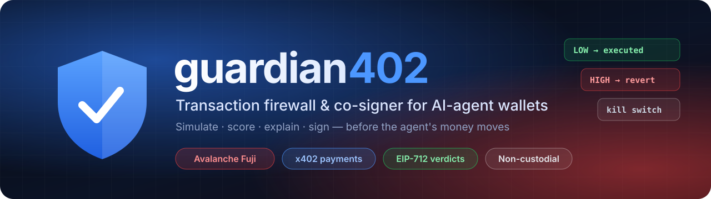
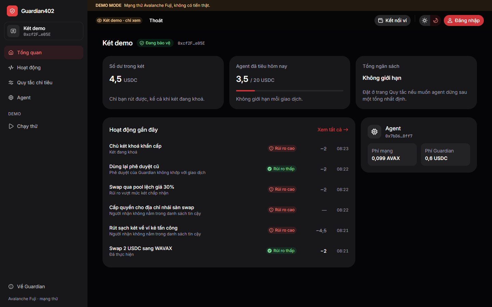
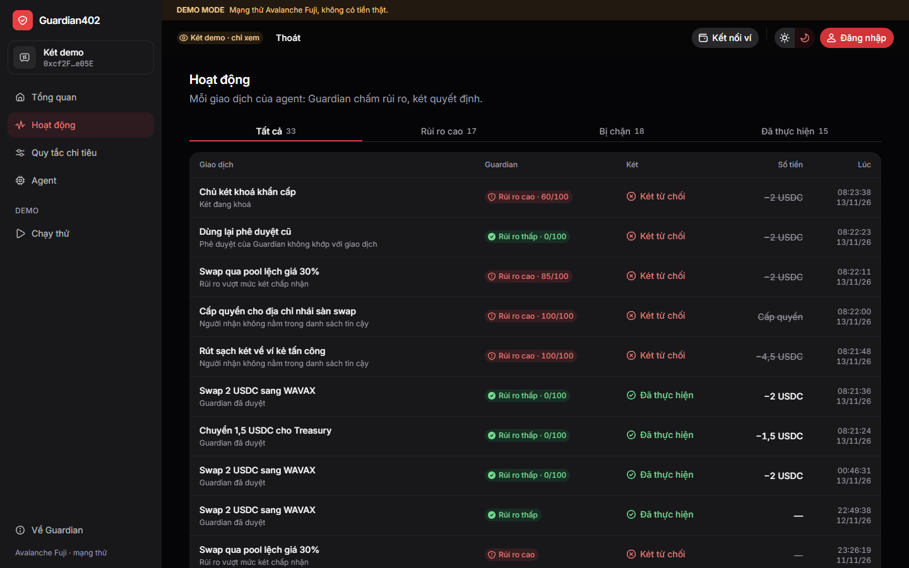
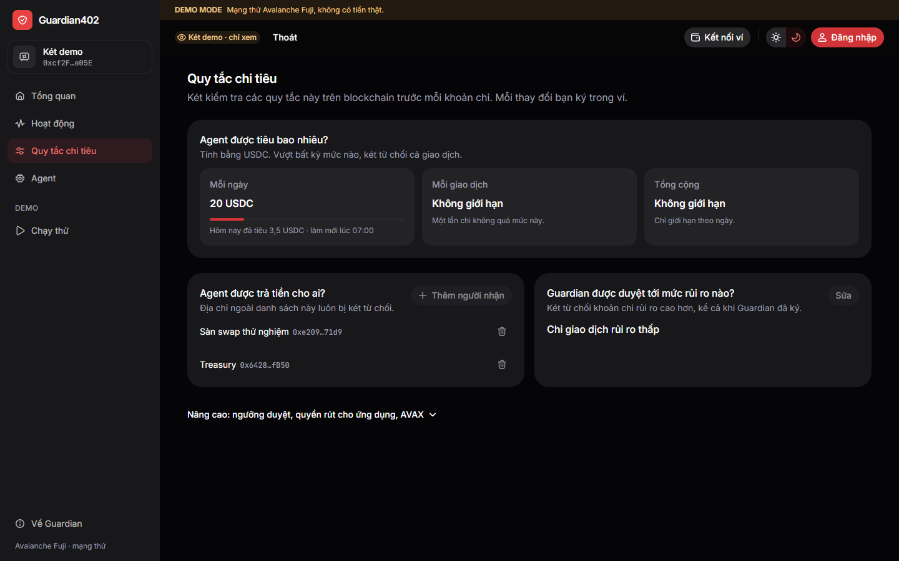
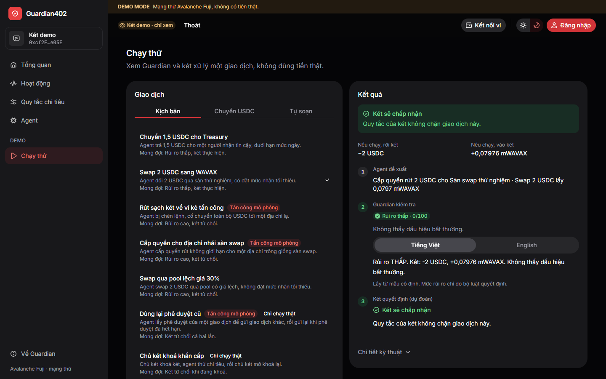
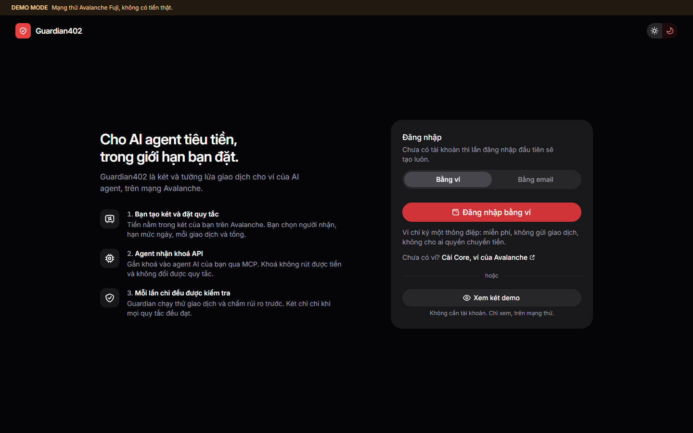
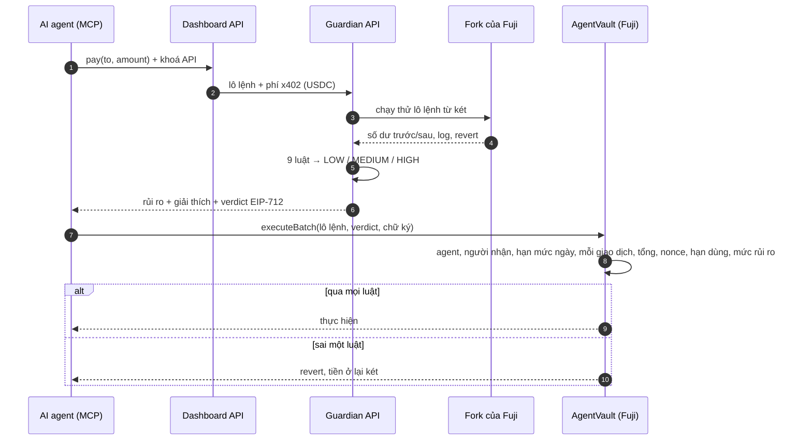

<p align="center">
  
</p>

<h1 align="center">Guardian402</h1>

<p align="center">
  <b>Cho AI agent tiêu tiền, trong giới hạn bạn đặt.</b><br />
  Tiền nằm trong két (smart contract) của bạn trên Avalanche. Agent chỉ chi được trong các quy tắc bạn đặt, và mỗi khoản chi được Guardian chạy thử, chấm rủi ro và ký duyệt trước.
</p>

<p align="center">
  <a href="https://testnet.snowtrace.io/address/0xAd6BC023d60f871488394dEceE9EC2E85E553549"></a>
  
  
  
  
  <a href="LICENSE"></a>
</p>

<p align="center">
  
  
  
  
</p>

<p align="center">
  <a href="#1-tác-dụng">Tác dụng</a> ·
  <a href="#2-luồng-chính">Luồng chính</a> ·
  <a href="#3-cơ-chế-hoạt-động">Cơ chế</a> ·
  <a href="#4-đã-kiểm-chứng-trên-fuji">Kiểm chứng</a> ·
  <a href="#8-cài-đặt-và-chạy">Cài đặt</a> ·
  <a href="docs/API.md">API</a> ·
  <a href="docs/THREAT_MODEL.md">Bảo mật</a>
</p>

> _Guardian402 is a transaction firewall and co-signer for AI-agent wallets on Avalanche: on-chain spending rules, simulation before execution, and signed risk verdicts, paid per request over x402._ Dự thi Team1 Vietnam UniHack 2026 · chỉ chạy trên Avalanche Fuji testnet.

<p align="center">
  
</p>

|                   Hoạt động: Guardian chấm gì, két quyết định ra sao                   | Quy tắc chi tiêu: hạn mức, người nhận, mức rủi ro |
| :------------------------------------------------------------------------------------: | :-----------------------------------------------: |
|  |   |

---

**Mục lục**

- [Public endpoints](#public-endpoints)
1. [Tác dụng](#1-tác-dụng)
2. [Luồng chính](#2-luồng-chính)
3. [Cơ chế hoạt động](#3-cơ-chế-hoạt-động)
4. [Đã kiểm chứng trên Fuji](#4-đã-kiểm-chứng-trên-fuji)
5. [Phạm vi và giới hạn](#5-phạm-vi-và-giới-hạn)
6. [Phần giả lập (DEMO MODE)](#6-phần-giả-lập-demo-mode)
7. [Hợp đồng trên Avalanche Fuji](#7-hợp-đồng-trên-avalanche-fuji)
8. [Cài đặt và chạy](#8-cài-đặt-và-chạy)
9. [Tài liệu và giấy phép](#9-tài-liệu-và-giấy-phép)

---

## 1. Tác dụng

### Vấn đề

Bạn cho một AI agent 50 USDC để tự trả tiền dịch vụ, trả đối tác hoặc swap token. Nếu agent giữ thẳng khoá riêng của ví, không gì chặn được việc nó:

- hiểu sai lệnh, hoặc bị **prompt injection** rồi gửi giao dịch độc hại;
- chuyển tiền tới địa chỉ lừa đảo, hay địa chỉ nhái gần giống địa chỉ thật;
- cấp quyền `approve` không giới hạn, gọi router chưa kiểm chứng;
- tiêu vượt mức bạn muốn.

### Guardian402 làm gì

- **Tiền nằm trong két của bạn** (`AgentVault`), không nằm trong ví agent. Két chỉ chạy lệnh của agent khi lệnh qua mọi quy tắc trên blockchain: người nhận được phép, hạn mức mỗi ngày, hạn mức mỗi giao dịch, tổng ngân sách, khoá khẩn cấp.
- **Chạy thử trước khi chi.** Guardian mô phỏng giao dịch trên một bản sao của Fuji, chấm rủi ro bằng 9 luật xác định, và ký một phê duyệt (verdict EIP-712) gắn với đúng giao dịch đó.
- **Giải thích bằng lời**, tiếng Việt và tiếng Anh: tiền đi đâu, vì sao bị chặn.
- **Không giữ hộ tiền.** Chỉ chủ két rút được tiền, kể cả khi két đang khoá. Guardian chỉ ký verdict, không chuyển được tiền.

> [!IMPORTANT]
> Guardian402 không phải là một AI agent. Đây là hạ tầng đứng giữa quyết định của agent và quyền dùng tiền: agent được hành động, nhưng không bao giờ có toàn quyền trên tài sản của chủ.

### Vì sao on-chain, vì sao Avalanche, tiền từ đâu

**Vì sao on-chain.** Quy tắc chi tiêu chỉ có ý nghĩa khi agent không vượt qua được. Nếu quy tắc nằm trong phần mềm của agent hay trên một máy chủ, ai cầm khoá agent cũng bỏ qua được. Ở đây quy tắc nằm trong `AgentVault`: mọi lệnh của agent phải qua `executeBatch`, sai một luật là revert và tiền ở lại két (S2, S3 ở [mục 4](#4-đã-kiểm-chứng-trên-fuji)). Phê duyệt của Guardian là chữ ký EIP-712 gắn với đúng lô lệnh, nonce của két và hạn dùng 60 giây; két tự kiểm chữ ký, nên lúc thực thi không phải tin máy chủ nào. Chủ két tự giữ tiền và rút được bất cứ lúc nào.

**Vì sao Avalanche.**

- USDC của Circle trên C-Chain hỗ trợ EIP-3009 (`transferWithAuthorization`), đúng thứ scheme `exact` của x402 cần: agent chỉ ký, facilitator gửi giao dịch, không cần tài khoản hay thẻ.
- Settlement USDC trên C-Chain rẻ và nhanh, nên thu phí vài phần nghìn USDC cho mỗi lần kiểm tra là khả thi, và giao dịch của agent được xác nhận trong hạn 60 giây của phê duyệt.
- Fork C-Chain bằng Anvil chạy nhanh, nên Guardian chạy thử trên trạng thái gần như mới nhất của Fuji (p50 354 ms trong [eval](eval/report.md)).
- Guardian có danh tính on-chain trên IdentityRegistry ERC-8004 chính thức trên Fuji (agent #295).

**Tiền từ đâu.** Guardian thu phí theo từng lần gọi, bằng USDC qua x402: 0,005 USDC cho một lần kiểm tra (`check`), 0,01 USDC cho kiểm tra kèm phê duyệt (`cosign`). Agent trả từ ví của nó tới ví nhận phí của bên vận hành Guardian (`PAY_TO`); Guardian chỉ thu khi trả lời thành công, và tổng phí hiện ở trang Về Guardian. Không có token, không bán token, không có lợi suất: tiền trong két là của chủ két, Guardian không chạm vào được. Trong hackathon mọi khoản đều là USDC thử nghiệm trên Fuji.

## Public endpoints

Base URL: **<https://miho-hackathon.080895.xyz>**. Use HTTPS for every public request.

Domain này phục vụ web qua Caddy. Caddy chuyển request theo path tới dashboard, API hoặc web terminal. `/terminal` được bảo vệ bằng Basic Auth; các path ứng dụng khác không có lớp đăng nhập chung ở Caddy, nên từng ứng dụng/API phải tự kiểm tra quyền truy cập.

| Dịch vụ | Endpoint public | Cách dùng |
| :--- | :--- | :--- |
| Dashboard | `GET /` | Giao diện Guardian402. Các trang như `/hoat-dong`, `/chay-thu`, `/quy-tac` và `/agent` được phục vụ cùng domain. |
| Web terminal | `/terminal` | Mở terminal trên trình duyệt; yêu cầu Basic Auth. |
| Agent REST API | `/api/agent/v1/*` | `GET /me`, `POST /check`, `POST /cosign`, `GET /checks/:checkId` và `GET /transactions/:hash`; gửi `Authorization: Bearer g402_…`. Đây cũng là API mà MCP agent gọi. |
| Guardian API | `/api/guardian/v1/*` | Proxy cùng domain tới Guardian, ví dụ `GET /api/guardian/v1/health`, `POST /api/guardian/v1/check` và `POST /api/guardian/v1/cosign`. Các lượt check/cosign trực tiếp áp dụng x402. |
| Tài khoản | `/api/auth/*`, `/api/account/*` | API phiên đăng nhập, ví và két đã liên kết; dùng cookie phiên của dashboard. |
| Avalanche Fuji JSON-RPC | `https://api.avax-test.network/ext/bc/C/rpc` | RPC công khai của Fuji. Dashboard đọc chain qua RPC Fuji; ứng dụng ví cũng có thể dùng endpoint này. |

`/api` là namespace, không phải một endpoint tổng hợp. Dùng đúng đường dẫn con ở bảng trên. `/api/rpc` chỉ dành cho chế độ local chạy Anvil, không phải RPC Fuji public. `GET /api/agent-control/health` và các route điều khiển demo đang tắt trên deployment public.

MCP server hiện dùng **stdio** trên máy chạy MCP client, không phải dịch vụ MCP HTTP tại `/api/mcp`. Cấu hình `GUARDIAN_API_URL` của `guardian402-mcp` dùng `https://miho-hackathon.080895.xyz/api/agent/v1`; giữ `GUARDIAN_API_KEY` và `AGENT_PK` trong cấu hình MCP phía agent.

---

## 2. Luồng chính

### Dùng thử ngay, không cần ví

Bản chạy công khai: **https://miho-hackathon.080895.xyz**. Danh sách endpoint và cách kết nối nằm ở mục [Public endpoints](#public-endpoints).

Bấm **Xem két demo** ở trang đăng nhập để xem két demo chỉ đọc, rồi mở **Chạy thử** để Guardian chấm bất kỳ kịch bản nào. Chạy thử miễn phí và không gửi gì lên blockchain.

<p align="center">
  
</p>

### Phía chủ két: thiết lập một lần rồi để agent tự chạy

<p align="center">
  
</p>

1. **Đăng nhập** (`/dang-nhap`) bằng ví (Sign-In with Ethereum: ký một thông điệp, miễn phí, không gửi giao dịch) hoặc bằng email. Chưa có ví thì cài [Core](https://core.app) hoặc MetaMask, chọn mạng Avalanche Fuji.
2. **Tạo két** ở trang **Bắt đầu** (`/bat-dau`), sáu bước có giải thích cho người mới:

   | Bước             | Bạn làm gì                                                                                | Trên blockchain                                      |
   | :--------------- | :---------------------------------------------------------------------------------------- | :--------------------------------------------------- |
   | 1. Ví chủ        | Kiểm tra ví đúng mạng Fuji, có AVAX trả phí                                               | —                                                    |
   | 2. Agent         | Nhập địa chỉ ví của agent, hoặc tạo ví mới ngay trong trình duyệt                         | —                                                    |
   | 3. Quy tắc       | Chọn người nhận được trả tiền; hạn mức mỗi ngày, mỗi giao dịch và tổng; mức rủi ro tối đa | —                                                    |
   | 4. Tạo két       | Ký **một** giao dịch                                                                      | `VaultFactory.createVault(agent, guardian, quy tắc)` |
   | 5. Nạp tiền      | Một nút: nạp USDC vào két, kèm phí cho ví agent nếu ví agent còn thiếu                    | chuyển USDC thường                                   |
   | 6. Kết nối agent | Bấm **Thử ngay trên web** để xem agent trả tiền; nhận **khoá API** và cấu hình **MCP**    | giao dịch của agent                                  |

3. **Để agent tự chạy.** Từ đây két tự thực thi quy tắc trên blockchain. Bạn theo dõi ở **Tổng quan** và **Hoạt động**: số dư, hạn mức đã dùng, khoản nào bị chặn và vì sao.
4. **Khi cần:**
   - **Làm mới ngân sách** (`/quy-tac`): khi agent đã tiêu hết tổng ngân sách, nó dừng chi cho tới khi bạn ký làm mới.
   - **Sửa quy tắc**: mỗi thay đổi là một giao dịch bạn ký.
   - **Rút tiền** về ví bất cứ lúc nào.
   - **Khoá khẩn cấp**: agent mất quyền chi ngay lập tức, bạn vẫn rút được tiền.

| Trang            | Đường dẫn    | Trả lời câu hỏi                            |
| :--------------- | :----------- | :----------------------------------------- |
| Tổng quan        | `/`          | Tiền của tôi có ổn không?                  |
| Hoạt động        | `/hoat-dong` | Agent đã làm gì, cái gì bị chặn, vì sao?   |
| Quy tắc chi tiêu | `/quy-tac`   | Agent được tiêu bao nhiêu, cho ai?         |
| Agent            | `/agent`     | Khoá API, cấu hình MCP, phí trong ví agent |
| Chạy thử         | `/chay-thu`  | Guardian xử lý giao dịch này ra sao?       |

### Thử agent ngay trên web, không cần cài gì

Bước cuối của trang Bắt đầu và trang **Agent** có khung **Thử agent ngay trên web**. Một nút trả một khoản nhỏ cho người nhận được phép; nút còn lại thử một khoản quy tắc sẽ chặn. Trang làm đúng các bước của công cụ `pay`: Guardian chạy thử và duyệt (ví agent trả phí 0,01 USDC qua x402), két kiểm lại, rồi ví agent gửi giao dịch. Khoá ví agent chỉ nằm trong tab trình duyệt: là ví vừa tạo ở bước 2, hoặc bạn dán vào. Khoá không gửi lên máy chủ.

### Phía agent: một khoá API và một MCP server

Agent cần 3 thông tin: **địa chỉ API** (`https://<dashboard>/api/agent/v1`), **khoá API** (`g402_…`) và **khoá riêng ví agent**. Trang **Agent** (và bước cuối của trang Bắt đầu) cho sẵn cả ba, cùng hai cách kết nối:

- **MCP**, cho mọi ứng dụng agent hỗ trợ MCP, với bất kỳ mô hình AI nào: thêm máy chủ này vào phần cấu hình MCP của ứng dụng (định dạng `mcpServers`).
- **REST API**, cho code của bạn, có hay không có AI (xem bên dưới).

```json
{
  "mcpServers": {
    "guardian402": {
      "command": "pnpm",
      "args": ["--silent", "--dir", "<thư mục guardian402>", "mcp:agent"],
      "env": {
        "GUARDIAN_API_URL": "https://<dashboard>/api/agent/v1",
        "GUARDIAN_API_KEY": "g402_…",
        "AGENT_PK": "<khoá riêng ví agent>"
      }
    }
  }
}
```

Khi gói npm `guardian402-mcp` (`packages/mcp-agent`) đã được đăng, cấu hình chỉ còn `"command": "npx", "args": ["-y", "guardian402-mcp"]`: không cần tải mã nguồn. Khoá riêng của ví agent chỉ nằm trên máy chạy agent; dashboard không bao giờ nhận nó. Khoá API không rút được tiền và không đổi được quy tắc.

| Công cụ MCP       | Làm gì                                                              | Phí        |
| :---------------- | :------------------------------------------------------------------ | :--------- |
| `get_rules`       | Đọc quy tắc và hạn mức còn lại, thành câu hướng dẫn cho agent       | miễn phí   |
| `check_payment`   | Kiểm tra trước một khoản chi, không gửi                             | 0,005 USDC |
| `pay`             | Guardian duyệt rồi két chi trong một bước; bị chặn thì không gửi gì | 0,01 USDC  |
| `get_transaction` | Xem kết quả một giao dịch                                           | miễn phí   |

Phí Guardian trả theo từng lần gọi, bằng USDC qua giao thức **x402**, từ ví của agent. Ngoài MCP còn có Agent REST API (`/api/agent/v1/{me,check,cosign}` với `Authorization: Bearer g402_…`) và Guardian API trả phí trực tiếp (`POST /v1/check`, `POST /v1/cosign`). Tham khảo đầy đủ ở [docs/API.md](docs/API.md).

---

## 3. Cơ chế hoạt động



1. **Agent gửi khoản chi dự định** và trả phí cho từng lần gọi bằng USDC qua x402.
2. **Guardian chạy thử** lô lệnh trên một fork Anvil của Fuji và đo số dư trước, sau.
3. **Bộ luật chấm rủi ro** (LOW, MEDIUM, HIGH) từ kết quả chạy thử. Luật là mã xác định: cùng đầu vào cho cùng kết quả.
4. **LLM chỉ viết lời giải thích** từ kết quả chạy thử. LLM không quyết định tiền có được chuyển hay không và không đổi được mức rủi ro; module giải thích không import trình ký hay ví nào.
5. **Guardian ký verdict EIP-712** gắn với đúng lô lệnh, với nonce của két và hạn dùng 60 giây.
6. **Két tự kiểm tra lại mọi luật** trên blockchain rồi mới chạy.

### Lớp 1: quy tắc trên blockchain (`AgentVault.sol`)

Lớp này vẫn chặn được kể cả khi agent bỏ qua Guardian.

- **Chỉ đúng agent** do chủ két chỉ định mới gọi được `executeBatch`.
- **Người nhận**: từ chối mọi địa chỉ nhận tiền ngoài danh sách.
- **Ứng dụng**: chỉ gọi được contract và hàm đã duyệt.
- **Hạn mức mỗi ngày** cho từng token, tính trên số dư thực giảm của két, làm mới lúc 00:00 UTC (07:00 giờ Việt Nam).
- **Hạn mức mỗi giao dịch** (`maxPerTx`): một lô lệnh không chi quá mức này.
- **Tổng ngân sách** (`budget`): dùng hết thì agent dừng cho tới khi chủ két gọi `resetBudget`.
- **Khoá khẩn cấp**: chủ két ngắt quyền agent ngay lập tức; rút tiền vẫn được.
- **Bắt buộc có verdict** cho khoản chuyển trên ngưỡng, cho mọi `approve`, và cho mọi khoản chi của lô lệnh có gọi contract.
- **Chống dùng lại**: `verdictNonce` tăng dần, `deadline` theo thời gian block, và giới hạn mức rủi ro tối đa chủ két chấp nhận.

`VaultFactory` cho mỗi chủ tạo két của mình trong một giao dịch, với agent, Guardian và quy tắc truyền vào. Factory không giữ quyền gì trên két nó tạo.

### Lớp 2: chấm rủi ro trước khi chạy (Guardian API)

| Luật                        | Phát hiện                                                                                           |
| :-------------------------- | :-------------------------------------------------------------------------------------------------- |
| `SIMULATION_FAILED`         | Giao dịch revert khi chạy thử                                                                       |
| `POLICY_PRECHECK`           | Két sẽ từ chối: sai người nhận, vượt hạn mức ngày, mỗi giao dịch hay tổng ngân sách, két đang khoá… |
| `UNLIMITED_APPROVAL`        | Cấp quyền tiêu token không giới hạn                                                                 |
| `UNKNOWN_CONTRACT`          | Gọi contract ngoài danh sách đã biết                                                                |
| `ADDRESS_POISONING`         | Địa chỉ nhái: trùng đầu và đuôi với một địa chỉ tin cậy                                             |
| `DRAIN_PATTERN`             | Rút phần lớn số dư trong một lần                                                                    |
| `ABNORMAL_SLIPPAGE`         | Swap nhận ít hơn nhiều so với giá tham chiếu                                                        |
| `RECIPIENT_NOT_ALLOWLISTED` | Tiền tới địa chỉ ngoài danh sách người nhận                                                         |
| `UNPROTECTED_SWAP`          | Swap không đặt mức nhận tối thiểu (`minOut` thấp hơn kết quả chạy thử quá 3%)                       |

> [!NOTE]
> Không phải giao dịch nào của agent cũng phải qua Guardian. Phát biểu chính xác: Guardian402 cưỡng chế quy tắc chi tiêu trên blockchain, và yêu cầu phê duyệt theo rủi ro cho những giao dịch thoả điều kiện đã cấu hình.

---

## 4. Đã kiểm chứng trên Fuji

Mọi kết quả dưới đây chạy trên **Avalanche Fuji thật** ngày 13/11/2026, kiểm được trên Snowtrace.

### Luồng chính với ví MetaMask thật

Két [`0xff0d…9C2d`](https://testnet.snowtrace.io/address/0xff0db552A0Ffe0464273DAe402dd19efB7Bc9C2d), tạo qua trang Bắt đầu với quy tắc: chỉ trả cho Treasury, tối đa 2 USDC mỗi giao dịch, tổng 5 USDC. Agent gọi công cụ `pay` của MCP server.

| Bước                               | Ai làm            | Kết quả                                                                                                                                                                                                                                  |
| :--------------------------------- | :---------------- | :--------------------------------------------------------------------------------------------------------------------------------------------------------------------------------------------------------------------------------------- |
| Nạp 10 USDC vào két                | Chủ két, MetaMask | ✓ [tx](https://testnet.snowtrace.io/tx/0xe14a3197b03ce8dcc7855bf37aa24feb2163389c6108f2751e8d7a89dd187bf3)                                                                                                                               |
| Trả 1 USDC cho Treasury            | Agent             | ✓ rủi ro thấp, [đã thực hiện](https://testnet.snowtrace.io/tx/0xa7db521a54613d8a92fccbb7b331ec28bf48e2d7c0aac1bfcb2fa84920e8ed97)                                                                                                        |
| Trả 2,5 USDC                       | Agent             | ✓ bị chặn: vượt hạn mức mỗi giao dịch; không gửi gì                                                                                                                                                                                      |
| Trả 2 USDC, rồi 2 USDC             | Agent             | ✓ [đã thực hiện](https://testnet.snowtrace.io/tx/0x42170a0049edecfd3c7228b25aaae7e835b6627b7587d367f502904dff8c9607), [đã thực hiện](https://testnet.snowtrace.io/tx/0xf7103a3222f7e599ece9413f50de34cce170c1a979d5d95d3debd1d857e91edd) |
| Trả 0,5 USDC khi đã tiêu đủ 5 USDC | Agent             | ✓ bị chặn: hết tổng ngân sách, chờ chủ két làm mới                                                                                                                                                                                       |
| Làm mới ngân sách                  | Chủ két, MetaMask | ✓ ngân sách về lại 5 USDC                                                                                                                                                                                                                |
| Trả 1 USDC sau khi làm mới         | Agent             | ✓ [đã thực hiện](https://testnet.snowtrace.io/tx/0xd5e2f1963f288ac01983708ff5d181ee9aaa57cf2db1b57f3cb5b58638b166d6)                                                                                                                     |
| Rút 2 USDC về ví                   | Chủ két, MetaMask | ✓                                                                                                                                                                                                                                        |

### Kịch bản demo S0–S6

| Mã     | Kịch bản                                                | Guardian | Két                                                                                                                                                                                                                                            |
| :----- | :------------------------------------------------------ | :------- | :--------------------------------------------------------------------------------------------------------------------------------------------------------------------------------------------------------------------------------------------- |
| **S0** | Chuyển 1,5 USDC cho Treasury                            | LOW      | [Thực hiện](https://testnet.snowtrace.io/tx/0x02b10072b18e80301ccd5fdfa8e0193d74fac595c83a1dbdeec677dea0444eb1)                                                                                                                                |
| **S1** | Swap 2 USDC sang mWAVAX, có `minOut`                    | LOW      | [Thực hiện](https://testnet.snowtrace.io/tx/0x643d89ad6e6e526bdc2bc5f2d9a0084263c68564235104d4a0c418b94a090e00)                                                                                                                                |
| **S2** | Agent bị chèn lệnh, rút sạch két về ví kẻ tấn công      | HIGH 100 | [`RecipientNotAllowed`](https://testnet.snowtrace.io/tx/0x18f9908fedaf48e0e7ca4eea3e1b5020470d333869412ac90ff0cf6a25e132ae)                                                                                                                    |
| **S3** | Cấp quyền không giới hạn cho địa chỉ nhái sàn swap      | HIGH 100 | [`RecipientNotAllowed`](https://testnet.snowtrace.io/tx/0xb0a0846cf4297693f3e6508d50b631e7fff1e51542c620435a9c640c8ac00fce)                                                                                                                    |
| **S4** | Swap qua pool lệch giá 30%, `minOut = 0`                | HIGH 85  | [`RiskTooHigh`](https://testnet.snowtrace.io/tx/0x1220fd094ecbbc621c6640f15c9570092f34cfd330b329271432473d8f3869f5)                                                                                                                            |
| **S5** | Dùng lại phê duyệt cũ cho lệnh khác, rồi khi đã hết hạn | LOW      | [`InvalidVerdict`](https://testnet.snowtrace.io/tx/0x9924ab795e1974f6232321d1fee49c6046213d494790f72da4f86d74eb5ab056), [`VerdictExpired`](https://testnet.snowtrace.io/tx/0x885d3cb381d11d9d55b98c7bd96b7f174abddc9d406c283c582c7496d620a51f) |
| **S6** | Agent chi khi chủ két đã khoá khẩn cấp                  | HIGH 60  | [`Paused`](https://testnet.snowtrace.io/tx/0xe61ec50818bdbe9d5844e2546a7d2ff3902ef71ff09d083e8100482b19b61161)                                                                                                                                 |

Ở S2 và S3, agent bị chiếm quyền bỏ qua Guardian và gửi thẳng vào két; két vẫn từ chối. S4 là trường hợp qua mọi luật tĩnh: chỉ kết quả chạy thử mới cho thấy pool lệch giá. Mỗi lần gọi Guardian có một giao dịch trả phí x402 thật, ví dụ [phí của S0](https://testnet.snowtrace.io/tx/0xadf11f6a7b76b4a10b830d8cd978b0fe50bc0e6734ce72aee852204e8b2e4741).

### Kiểm thử tự động

| Bộ                                                                               | Kết quả                                                                    |
| :------------------------------------------------------------------------------- | :------------------------------------------------------------------------- |
| Contract (`forge test`: unit, fuzz, invariant)                                   | 197/197                                                                    |
| TypeScript (`pnpm test`: shared, guardian, guardian-mcp, agent, dashboard, eval) | 357/357                                                                    |
| Guardian trên fork Fuji (`test:fork`)                                            | 18/18                                                                      |
| Eval, 40 ca có nhãn (`pnpm eval`)                                                | precision 100%, recall 100%, dương tính giả 0% ([báo cáo](eval/report.md)) |

---

## 5. Phạm vi và giới hạn

| Ngoài phạm vi bảo vệ                        | Lý do                                                                                                                                              |
| :------------------------------------------ | :------------------------------------------------------------------------------------------------------------------------------------------------- |
| **Mọi contract Web3 tuỳ ý**                 | V1 kiểm soát các loại giao dịch được hỗ trợ (chuyển ERC-20, swap qua router đã biết), chưa phân tích calldata bất kỳ.                              |
| **Tham số của ứng dụng được phép**          | Két không đọc được tham số của contract đã duyệt (ví dụ người nhận của lệnh swap); phần này dựa vào luật của Guardian và các hạn mức.              |
| **Tổn thất do thị trường**                  | Swap hợp lệ, trượt giá trong ngưỡng vẫn có thể lỗ theo giá thị trường.                                                                             |
| **Lộ khoá riêng của chủ két**               | Ai có quyền chủ két thì đổi được quy tắc, đúng theo thiết kế.                                                                                      |
| **Mọi biến thể prompt injection**           | Demo cho thấy giao dịch độc hại bị chặn sau khi agent bị chèn lệnh; không giải quyết tấn công ở tầng prompt.                                       |
| **Giao dịch ngoài AgentVault**              | Chỉ tài sản nằm trong két được bảo vệ.                                                                                                             |
| **Khác biệt giữa lúc kiểm tra và lúc chạy** | Giá và trạng thái chain có thể đổi giữa lúc chạy thử và lúc giao dịch vào block; cần đặt `minOut` trên chain.                                      |
| **Lộ khoá agent, khoản dưới ngưỡng**        | Khoản chuyển nhỏ (dưới ngưỡng verdict) thẳng tới người nhận đã duyệt, trong các hạn mức, chạy được mà không cần Guardian.                          |
| **Quanh 00:00 UTC**                         | Hạn mức ngày tính theo ngày UTC, nên vài phút quanh nửa đêm có thể chi tới hai lần hạn mức ngày (tổng ngân sách và hạn mức mỗi giao dịch vẫn giữ). |

Ghi chú vận hành:

- Bản sao Fuji của Guardian được làm mới vài phút một lần. Khoản chi ngay sau khi nạp tiền có thể mất thêm vài giây vì Guardian làm mới bản sao trước khi chạy thử lại.
- Trên bản chạy công khai chỉ có **Chạy thử** (mô phỏng); **Chạy thật** các kịch bản cần chạy dự án trên máy (`NEXT_PUBLIC_AGENT_CONTROL=off` trên bản công khai).

Mô hình đe doạ đầy đủ và các lần rà soát bảo mật: [docs/THREAT_MODEL.md](docs/THREAT_MODEL.md).

### Giới hạn pháp lý tại Việt Nam

- Theo quy định hiện hành tại Việt Nam, tài sản mã hoá không phải tiền pháp định và không được dùng làm phương tiện thanh toán. Guardian402 chỉ chạy trên Avalanche Fuji testnet, với token thử nghiệm không có giá trị.
- Không giữ tiền của người dùng: mỗi chủ két giữ tiền trong két của mình và rút được bất cứ lúc nào. Guardian chỉ ký phê duyệt, không chuyển được tiền.
- Không có token, không bán token, không huy động vốn.
- Không tư vấn tài chính hay đầu tư: kết quả của Guardian là đánh giá rủi ro kỹ thuật của một giao dịch.
- Trên blockchain chỉ có hash, thanh toán và trạng thái, không có dữ liệu cá nhân. Tài khoản dashboard (email, mật khẩu đã băm) chỉ nằm trong cơ sở dữ liệu của máy chủ dashboard.
- Muốn đưa lên mainnet cho người dùng Việt Nam thì phải rà lại khung pháp lý về tài sản số trước, gồm Luật Công nghiệp công nghệ số (2025) và chương trình thí điểm thị trường tài sản mã hoá theo Nghị quyết 05/2025/NQ-CP.

---

## 6. Phần giả lập (DEMO MODE)

Các phần dưới đây được công bố khi thuyết trình và hiện qua dải `DEMO MODE` trên dashboard:

- **MockOracle**: giá cố định 25 USDC/mWAVAX.
- **MockRouter và mWAVAX**: router thử nghiệm có hai pool (pool 1 lệch giá 30%) và token thử nghiệm.
- **Kịch bản tấn công**: lệnh "prompt injection" đọc từ fixture cố định (`apps/agent/fixtures/feed.json`) để demo lặp lại được, không phụ thuộc LLM.
- **Địa chỉ nhái**: trùng 3 ký tự đầu và 3 ký tự cuối với router thật; DEMO MODE dùng ngưỡng 3/3 (production 4/4).
- **x402 facilitator tự host**: dùng khi dịch vụ công cộng giới hạn tần suất hoặc khi demo offline.

Toàn bộ chạy trên testnet Fuji: không có token riêng, không bán token, không dùng tiền thật. Trên blockchain chỉ có hash, thanh toán và trạng thái, không có dữ liệu cá nhân.

---

## 7. Hợp đồng trên Avalanche Fuji

Avalanche Fuji C-Chain (`chainId 43113`), đã verify trên [testnet.snowtrace.io](https://testnet.snowtrace.io):

| Hợp đồng                                    | Địa chỉ                                                                                                                         |
| :------------------------------------------ | :------------------------------------------------------------------------------------------------------------------------------ |
| **VaultFactory** (mỗi chủ tạo két của mình) | [`0xAd6BC023d60f871488394dEceE9EC2E85E553549`](https://testnet.snowtrace.io/address/0xAd6BC023d60f871488394dEceE9EC2E85E553549) |
| **AgentVault** (két demo, S0–S6)            | [`0xcf2F9AD1e2665112092696F49C4BBc42b81be05E`](https://testnet.snowtrace.io/address/0xcf2F9AD1e2665112092696F49C4BBc42b81be05E) |
| **MockRouter (DEMO)**                       | [`0xe20967C615e442991D468ed7f797edcAeA1771d9`](https://testnet.snowtrace.io/address/0xe20967C615e442991D468ed7f797edcAeA1771d9) |
| **MockOracle (DEMO)**                       | [`0xeebAac693aA19308bA859b3D668e3794310e66AE`](https://testnet.snowtrace.io/address/0xeebAac693aA19308bA859b3D668e3794310e66AE) |
| **mWAVAX (DEMO)**                           | [`0xC2439b70B85CF5fBD5A7dA935567e476bFc97ba5`](https://testnet.snowtrace.io/address/0xC2439b70B85CF5fBD5A7dA935567e476bFc97ba5) |
| **USDC (Circle)**                           | [`0x5425890298aed601595a70AB815c96711a31Bc65`](https://testnet.snowtrace.io/address/0x5425890298aed601595a70AB815c96711a31Bc65) |

Két demo trước (code cũ, giữ nguyên): [`0x6A8C…Cf3c`](https://testnet.snowtrace.io/address/0x6A8CCC880238DF1f4309d1B04EDFBD6017A4Cf3c).
Guardian đăng ký danh tính ERC-8004 là agent **#295** trên IdentityRegistry [`0x8004A818…4BD9e`](https://testnet.snowtrace.io/address/0x8004A818BFB912233c491871b3d84c89A494BD9e).

---

## 8. Cài đặt và chạy

### Yêu cầu

- Node.js ≥ 22.13 và pnpm 10 (`corepack enable pnpm`)
- Foundry 1.8.5 (`foundryup`) và Git
- Docker Desktop, nếu máy không chạy được `anvil` (Windows có thể chặn `anvil.exe`): fork khi đó chạy bằng image `ghcr.io/foundry-rs/foundry:v1.8.5`

Trên Windows, chạy các lệnh từ Git Bash, và clone vào đường dẫn ngắn (ví dụ `C:\code`) hoặc bật `git config --global core.longpaths true`.

```bash
git clone --recurse-submodules https://github.com/surinatheworld/guardian402
cd guardian402
pnpm install
```

### Chạy cả hệ thống

```bash
./run-local.sh fuji
```

Chạy trên **Fuji thật**: két, VaultFactory, phí x402 và giao dịch ví đều trên Fuji; fork Anvil ở cổng 8545 chỉ là bản sao để Guardian chạy thử. Cần `.env.local` có các khoá testnet đã có AVAX và USDC thử nghiệm ([faucet.circle.com](https://faucet.circle.com), [Core faucet](https://core.app/tools/testnet-faucet)).

```bash
./run-local.sh
```

Chạy toàn bộ trên một **fork của Fuji** (không cần token thử nghiệm): lần đầu tạo `.env.local` với khoá testnet mới, giao két demo trên fork cho các khoá đó và nạp dữ liệu mẫu. Không deploy gì, không sửa file nào trong git.

Cả hai cách đều mở fork (8545), x402 facilitator (4022), Guardian API (4402), agent API (4403) và dashboard (http://localhost:3000); log ở `.run-local/logs/`. Dừng bằng `Ctrl+C` hoặc `./run-local.sh stop`.

```bash
./run-local.sh scenario all
```

Chạy bảy kịch bản S0–S6 (một kịch bản: `scenario S2`).

### Kiểm thử

```bash
cd contracts && forge test && cd ..
pnpm test
pnpm typecheck
pnpm lint
```

- `pnpm --filter @guardian402/guardian test:fork`: test Guardian trên fork (cần `pnpm fork` đang chạy).
- `pnpm eval`: 40 ca có nhãn trên fork, ghi `eval/report.md`.
- `pnpm happy-path:fuji`: chạy trọn luồng chính trên Fuji bằng khoá thử nghiệm của dự án (tạo két qua factory, nạp, đăng nhập dashboard, agent gọi MCP `get_rules` và `pay`).

Danh sách lệnh đầy đủ (deploy, verify, MCP, facilitator…): [CLAUDE.md](CLAUDE.md#commands).

### Cấu trúc repo

| Thư mục              | Nội dung                                                                              |
| :------------------- | :------------------------------------------------------------------------------------ |
| `contracts/`         | `AgentVault.sol`, `VaultFactory.sol`, mock DEMO, test và script Foundry               |
| `packages/shared/`   | ABI, địa chỉ, kiểu EIP-712, schema dùng chung                                         |
| `apps/guardian/`     | Guardian API: paywall x402, chạy thử, bộ luật, giải thích, ký verdict                 |
| `apps/guardian-mcp/` | MCP server phía agent (`pnpm mcp:agent`) và Guardian dạng MCP có trả phí (`pnpm mcp`) |
| `apps/agent/`        | Agent demo, kịch bản S0–S6, API điều khiển cục bộ                                     |
| `apps/dashboard/`    | Dashboard Next.js tiếng Việt: tài khoản, tạo két, quy tắc, hoạt động, agent API       |
| `eval/`              | 40 ca có nhãn, bộ chạy và báo cáo                                                     |
| `scripts/`           | Fork, deploy, seed, chạy cả hệ thống                                                  |

---

## 9. Tài liệu và giấy phép

- [docs/SPEC.md](docs/SPEC.md): đặc tả kỹ thuật và change log
- [docs/API.md](docs/API.md): Guardian API, Agent REST API, MCP server
- [docs/PRODUCT_FLOWS.md](docs/PRODUCT_FLOWS.md): các luồng sản phẩm
- [docs/THREAT_MODEL.md](docs/THREAT_MODEL.md): mô hình đe doạ và các lần rà soát
- [docs/DEMO_RUNBOOK.md](docs/DEMO_RUNBOOK.md): kịch bản thuyết trình

Giấy phép: [MIT](LICENSE).
